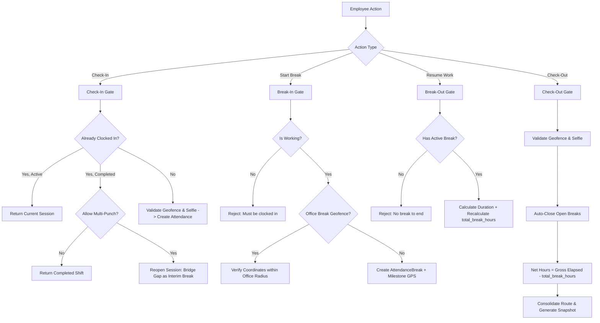

# HRMS Attendance & Telemetry Module — Architectural & Operational Guide

## 1. Overview & Directory Architecture

This document serves as the single source of truth for the **HRMS Attendance & Live Telemetry Module** in the WM-Product-SaaS enterprise platform. When modifications or enhancements are requested, refer to this flow guide to preserve existing behavior and maintain architectural integrity.

### File Sitemap
```
app/Domains/HRMS/
├── Models/
│   ├── Attendance.php                  # Primary shift attendance session model
│   ├── AttendanceRule.php              # Multi-tier organizational rules engine
│   ├── AttendanceBreak.php              # Shift break sessions (lunch, split shifts, tea)
│   ├── AttendanceLocationLog.php       # High-frequency breadcrumbs during active work
│   ├── AttendanceCorrection.php        # Regularization workflow requests
│   └── BiometricPunchLog.php           # Raw device & web punch audit records
├── Repositories/
│   ├── AttendanceRepositoryInterface.php
│   └── AttendanceRepository.php        # Core validation, checkIn, checkOut, breakIn, breakOut
├── Services/
│   └── AttendanceRouteService.php      # Telemetry consolidation, gap audit, OSM snapshot generator
└── Controllers/
    ├── AttendanceController.php        # My Attendance logs & admin management views
    ├── HrmsDashboardController.php     # Web punch station orchestration
    └── Api/AttendanceApiController.php # Mobile and REST API endpoints

resources/views/modules/hrms/
├── penalization-policy/
│   └── index.blade.php                # HR Admin rule configuration UI (Attendance Rules tab)
├── dashboard/widgets/web-punch.blade.php  # Web punch station with camera & live telemetry
└── attendance/
    ├── myAttendance.blade.php             # Employee attendance history & Leaflet detail drawer
    └── index.blade.php                    # Admin daily logs & regularization review
```

### UI Navigation & Location Map

| Interface Area | Exact URL / Route | Blade View | Primary Purpose |
| :--- | :--- | :--- | :--- |
| **Admin Configuration** | `/hrms/penalization-policy?policy_type=attendance_rules` | [`penalization-policy/index.blade.php`](file:///d:/wm-product-saas/resources/views/modules/hrms/penalization-policy/index.blade.php#L701) | HR/Admins toggle geofence, web punch, tracking intervals, break geofence, and multi-punch by Company/BU/Branch scope. |
| **Punch Station** | Dashboard widget & `/dashboard` | [`widgets/web-punch.blade.php`](file:///d:/wm-product-saas/resources/views/modules/hrms/dashboard/widgets/web-punch.blade.php) | Enforces rules on employee: Camera selfie capture, GPS coordinates check, telemetry error warnings, and multi-punch buttons. |
| **Audit & Log Drawer** | `/hrms/attendance/my-attendance` | [`attendance/myAttendance.blade.php`](file:///d:/wm-product-saas/resources/views/modules/hrms/attendance/myAttendance.blade.php) | Visualizes rule compliance: Telemetry card with approved breaks vs unapproved GPS gaps, and interactive Leaflet map. |


---

## 2. Attendance Rules Engine (`attendance_rules`)

Rules follow strict organizational hierarchy. The system executes [`AttendanceRule::forEmployee($employee)`](file:///d:/wm-product-saas/app/Domains/HRMS/Models/AttendanceRule.php#L12-L47), resolving in the following order:
1. `branch_id` (Most specific)
2. `business_unit_id`
3. `company_id`
4. `tenant_id` (Organization-wide fallback)

### Configuration Schema Reference

| Setting Key | Type | Description |
| :--- | :---: | :--- |
| `office_biometric` | boolean | Biometric machine punch required for office employees |
| `office_web` | boolean | Web/browser punch permitted for office employees |
| `office_geofence` | boolean | Enforces office coordinate radius checks on check-in & check-out |
| `office_latitude`, `office_longitude` | float | Coordinates of company office |
| `office_radius` | integer | Allowed geofence boundary in meters (e.g. 100m) |
| `office_tracking` | boolean | Periodic location breadcrumbs enabled for office staff |
| `office_tracking_minutes` | integer | GPS sampling interval in minutes (default: 15) |
| `office_break_geofence` | boolean | *(Enhancement)* Requires employee to be within office radius to start/end breaks |
| `wfh_location` | boolean | GPS coordinates required for work-from-home |
| `wfh_selfie` | boolean | Live camera snapshot required on clock-in / clock-out |
| `wfh_geofence` | boolean | Checks against employee profile `wfh_latitude` / `wfh_longitude` |
| `wfh_tracking_meters` | integer | Allowed home perimeter radius in meters (e.g. 50m) |
| `site_location`, `site_selfie` | boolean | Requirements for field/on-site employees |
| `pause_tracking_on_break` | boolean | *(Enhancement)* Suspends GPS tracking during approved breaks for employee privacy |
| `allow_multiple_punches` | boolean | *(Enhancement)* Supports split shifts & multiple punch sessions on same date |

---

## 3. Core Workflows & Execution Lifecycle



---

## 4. Workflows in Detail

### A. Check-In (`AttendanceRepository::checkIn`)
1. **Existing Session Check:**
   * Scans for open shifts within the last 18 hours (`shiftCutoff`) or matching calendar date `$today`.
   * If an active shift exists (`check_out == null`), returns it.
   * If already clocked out today:
     * If `allow_multiple_punches == false`: Returns the existing completed record.
     * If `allow_multiple_punches == true`: Re-opens the shift by recording an interim `AttendanceBreak` spanning `check_out` to `now()`, clears `check_out`, and adds a resumption milestone coordinate.
2. **Work Mode & Geofence:**
   * Resolves mode: `wfh` (if approved `WfhRequest` exists), `onsite`, or `office`.
   * If `office_web == false`, rejects browser punch.
   * Checks coordinates with the Haversine formula against rule radii.
3. **Selfie Capture:**
   * If `wfh_selfie` or `site_selfie` is required, validates base64 image payload.
4. **Shift & Grace Period:**
   * Compares punch timestamp to `shifts.start_time`.
   * If later than shift start + grace period, sets `status = 'late'` and applies penalty.

### B. Breaks (`breakIn` & `breakOut`)
1. **Break-In (`break_out` in form):**
   * Pre-condition: Employee must have active `check_in` and `check_out == null`.
   * If `office_break_geofence` is active, enforces geofence proximity.
   * Logs a milestone coordinate in `attendance_location_logs`.
   * Creates an `AttendanceBreak` record.
2. **Break-Out (`break_in` in form):**
   * Finalizes active break: `duration_minutes = break_in->diffInMinutes(now)`.
   * Sums all breaks for today: `total_break_hours = sum(duration_minutes) / 60`.
   * Updates parent `attendances.total_break_hours` immediately.

### C. Check-Out (`AttendanceRepository::checkOut`)
1. Re-validates departure geofence coordinates and selfie photo.
2. Auto-finalizes any active breaks running at the time of checkout.
3. Computes net working hours:
   $$\text{Total Work Hours} = \max\left(0, \frac{\text{CheckOut} - \text{CheckIn}}{3600} - \text{Total Break Hours}\right)$$
4. Evaluates minimum shift hours; applies penalties for early departure or under-hours.
5. Invokes [`AttendanceRouteService::consolidateShiftRoute()`](file:///d:/wm-product-saas/app/Domains/HRMS/Services/AttendanceRouteService.php#L21-L196).

---

## 5. Live Telemetry & The 4 Pillars

### Pillar 1: Telemetry Gap on Map & Snapshot
* Continuous segments are rendered in **solid indigo/blue** (`#6366f1` / `#3b82f6`).
* GPS gaps (points separated by $> 1.5\times \text{interval}$ or $> 20$ mins) are rendered as **red dashed lines** (`color: '#ef4444', dashArray: '8, 8'`).
* **Approved Break Windows** (Enhancement 1) are rendered as **amber dashed lines** (`color: '#f59e0b', dashArray: '6, 6'`) with a `✓ Authorized Break` badge.
* Static PNG snapshot stitches OpenStreetMap raster tiles (100% watermark-free, no third-party keys required) with dashed lines drawn using `drawDashedLine()`.

### Pillar 2: Live In-App Warning Banner on Web Punch
* Located in `web-punch.blade.php` (`#web_punch_gps_warning`).
* If GPS is turned off or blocked mid-shift, an alert banner surfaces automatically with exact reason (`PERMISSION_DENIED`, `POSITION_UNAVAILABLE`, `TIMEOUT`) and a "RETRY GPS" button.
* If `pause_tracking_on_break` is active, breadcrumb collection pauses cleanly while on break.

### Pillar 3: HR Compliance Gap Audit
* Gaps are stored in `attendances.route_summary`:
  ```json
  {
    "has_tracking_gaps": true,
    "total_untracked_minutes": 42,
    "tracking_gaps": [
      {
        "from_time": "10:15 AM",
        "to_time": "10:57 AM",
        "duration_min": 42,
        "is_approved_break": false,
        "from_index": 2,
        "to_index": 3
      }
    ]
  }
  ```
* Displayed inside the **Telemetry Compliance Card** in [`myAttendance.blade.php`](file:///d:/wm-product-saas/resources/views/modules/hrms/attendance/myAttendance.blade.php#L415-L430). Approved breaks display in green/amber, while unauthorized offline periods display in red.

### Pillar 4: Hard Punch Validation Gate
* Hard validation gates in `checkIn()`, `checkOut()`, and geofenced break methods reject null or invalid coordinates whenever rules mandate location.

---

## 6. Edge Case Handling Matrix

| Scenario | Handling Mechanism |
| :--- | :--- |
| **Overnight Shift (10 PM – 6 AM)** | Uses an 18-hour sliding window (`subHours(18)`). Next morning checkout attaches to previous night's check-in. |
| **Forgotten Clock-Out** | Record remains open. Employee files an Attendance Regularization request (`AttendanceCorrection`). HR approves/edits check-out time. |
| **Employee on Lunch Break** | Telemetry pauses if `pause_tracking_on_break == true`. Gap consolidation matches break timestamps and suppresses unapproved gap penalties. |
| **Split Shifts / Second Shift** | With `allow_multiple_punches == true`, re-clocking in bridges the interim period as a break and reactivates the shift. |
| **GPS Spoofing / Mock GPS** | Rejection of non-finite coordinates, requirement for `enableHighAccuracy: true`, and mandatory real-time mirrored selfie capture. |

---

## 7. Development Guidelines for Future Updates

1. **Preserve Method Signatures:** Always keep parameters like `$latitude = null` and `$longitude = null` optional with default values in [`AttendanceRepositoryInterface.php`](file:///d:/wm-product-saas/app/Domains/HRMS/Repositories/AttendanceRepositoryInterface.php).
2. **Defensive Schema Checks:** When querying new `attendance_rules` columns, always use null coalescing operators (e.g. `$rule->allow_multiple_punches ?? false`) to ensure older tenant records without new migrations never throw errors.
3. **Tile Watermarks:** Never re-introduce unauthenticated Carto raster voyager URLs (`basemaps.cartocdn.com`) without verified keys, as Carto returns image-watermarked tiles. Always prioritize official OpenStreetMap (`tile.openstreetmap.org`).
