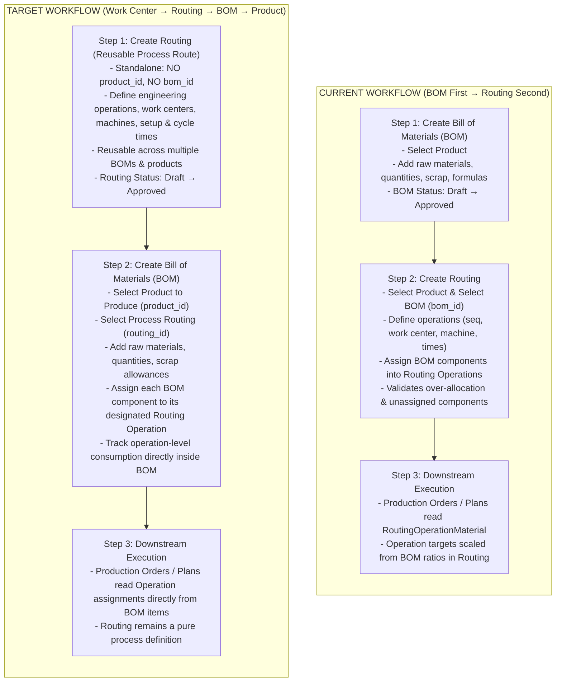
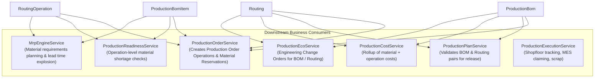

# BOM & Routing Architecture Map & Technical Reference

> **Document Purpose:** Comprehensive architectural map of the Bill of Materials (BOM) and Routing domains within the Production module (`app/Domains/Production`).  
> **Target Audience:** Engineering, Product, and Agent pair-programming discussions for the **Routing-First / BOM-Second Structural Inversion** and the **Work Center → Routing Linking** initiative.  
> **Last Updated:** October 2026 (re-verified post-implementation; all changed files re-read)  

---

## Table of Contents
1. [Executive Summary: Current Flow vs. Target Flow](#1-executive-summary-current-flow-vs-target-flow)
2. [Database Schema & Data Relationships](#2-database-schema--data-relationships)
3. [Models & Eloquent Relationships](#3-models--eloquent-relationships)
4. [Lifecycle, Validation & Business Rules Matrix](#4-lifecycle-validation--business-rules-matrix)
5. [Service Layer & Business Logic Deep-Dive](#5-service-layer--business-logic-deep-dive)
6. [Controllers, HTTP Requests & DTO Mappings](#6-controllers-http-requests--dto-mappings)
7. [UI Views, Forms & Frontend State (Alpine.js / Select2)](#7-ui-views-forms--frontend-state-alpinejs--select2)
8. [Downstream Consumers & System Dependencies](#8-downstream-consumers--system-dependencies)
9. [Detailed Structural Inversion Impact Checklist](#9-detailed-structural-inversion-impact-checklist)

---

## 1. Executive Summary: Current Flow vs. Target Flow



### Key Differences At A Glance

| Dimension | Current Architecture | Target Inverted Architecture |
| :--- | :--- | :--- |
| **First Entity Created** | **BOM** (`ProductionBom`) | **Routing** (`Routing`) |
| **Tracking Link** | Routing tracks BOM via `routings.bom_id` | BOM tracks Routing via `production_boms.routing_id` |
| **Product Dependency** | Routing required `product_id` (1:1 with Product) | **Routing has NO `product_id`** (reusable process route; Product is defined on BOM) |
| **Relationship Cardinality** | 1 Routing $\leftrightarrow$ 1 BOM (circular product link) | **1 Routing $\rightarrow$ Many BOMs** (BOM links Product to Routing) |
| **Component-Operation Assignment** | Operations in Routing hold materials (`production_routing_operation_materials`) | BOM Items hold operation references (`production_bom_items.routing_operation_id`) |
| **Pre-requisite for Creation** | BOM has no pre-requisite. Routing requires an active/draft BOM. | Routing has no pre-requisite. BOM requires an active/draft Routing. |
| **Allocation & Over-Allocation Logic** | Enforced in `StoreRoutingRequest` / `UpdateRoutingRequest` | Enforced in `StoreProductionBomRequest` / `UpdateProductionBomRequest` |
| **Lifecycle Cascades** | Approving/cancelling BOM cascades to linked Routings | Approving/cancelling Routing cascades to linked BOMs |
| **Downstream Sourcing** | `ProductionOrderService` queries `RoutingOperationMaterial` | `ProductionOrderService` queries `ProductionBomItem` linked operations |

---

## 2. Database Schema & Data Relationships

### 2.1 Current BOM Tables
* **`production_boms`**:
  * `id` (`bigint unsigned`, PK)
  * `tenant_id` (`bigint unsigned`, FK `tenants.id`)
  * `bom_number` (`varchar(100)`) — e.g. `BOM-2026-000001`
  * `bom_name` (`varchar(255)`, nullable)
  * `bom_type` (`varchar(50)`) — default `manufacturing` (also `engineering`, `sales`, `phantom`, `subcontracting`)
  * `usage_context` (`varchar(50)`) — default `manufacturing`
  * `product_id` (`bigint unsigned`, FK `products.id`)
  * **`routing_id`** (`bigint unsigned`, FK `routings.id` restrictOnDelete) — **✅ Added** (migration `2026_10_31_120000`). BOM now tracks its parent Routing directly. **Mandatory** on all new BOMs.
  * `base_quantity` (`decimal(12,4)`) — default `1.0000`
  * `base_uom_id` (`bigint unsigned`, FK `uoms.id`)
  * `version` (`varchar(20)`) — default `1.0.0`
  * `revision` (`integer`) — default `0`
  * `revision_reason` (`text`, nullable)
  * `effective_date` (`date`)
  * `expiry_date` (`date`, nullable)
  * `status` (`varchar(50)`) — `draft`, `pending_approval`, `approved`, `scheduled`, `inactive`, `cancelled`, `under_revision`
  * `notes` (`text`, nullable)
  * `has_warning` (`tinyint(1)`) — default `0`
  * `warning_reason` (`text`, nullable)
  * `created_by` / `approved_by` (`bigint unsigned`, FK `users.id`)
  * `approved_at` (`datetime`, nullable)
  * `created_at` / `updated_at` / `deleted_at` (`timestamps`, `softDeletes`)
  * ~~`routing_id` dropped in migration `2026_10_15_130000`~~ — **Correction:** `routing_id` was dropped in an earlier architecture and **re-introduced** in `2026_10_31_120000_invert_bom_and_routing_relationships.php` as a mandatory FK under the new Routing-First architecture.

* **`production_bom_items`**:
  * `id` (`bigint unsigned`, PK)
  * `tenant_id` (`bigint unsigned`, FK `tenants.id`)
  * `bom_id` (`bigint unsigned`, FK `production_boms.id` cascade)
  * `material_id` (`bigint unsigned`, FK `products.id` cascade)
  * `child_bom_id` (`bigint unsigned`, nullable, FK `production_boms.id`)
  * `replaces_item_id` (`bigint unsigned`, nullable, FK `production_bom_items.id`)
  * `quantity` (`decimal(12,4)`)
  * `quantity_type` (`varchar(50)`) — `fixed` or `formula`
  * `formula` (`varchar(500)`, nullable)
  * `uom_id` (`bigint unsigned`, FK `uoms.id` cascade)
  * `material_scrap_percentage` (`decimal(5,2)`) — default `0.00`
  * `is_alternative` (`tinyint(1)`) — default `0`
  * `priority` (`integer`) — default `1`
  * `sequence` (`integer`) — default `1`
  * `notes` (`text`, nullable)
  * **`routing_operation_id`** (`bigint unsigned`, nullable, FK `production_routing_operations.id` nullOnDelete) — **✅ Added** (migration `2026_10_31_120000`). Each component row designates which routing operation consumes it.

* **`production_bom_approvals`**:
  * `id`, `tenant_id`, `bom_id`, `user_id`, `action` (`Created`, `Submitted`, `Approved`, `Rejected`, `Revision Created`, `Cancelled`), `comments`, `created_at`.

---

### 2.2 Current Routing Tables
* **`routings`**:
  * `id` (`bigint unsigned`, PK)
  * `tenant_id` (`bigint unsigned`, FK `tenants.id`)
  * `routing_number` (`varchar(255)`, nullable) — e.g. `RTG-2026-000001`
  * `name` (`varchar(255)`)
  * ~~`product_id`~~ — **To be dropped** in upcoming migration (Routing is an independent, reusable process template; product identity is established strictly on the BOM)
  * ~~`bom_id`~~ — **Dropped** in migration `2026_10_31_120000_invert_bom_and_routing_relationships.php` (`[INVERSION-DECOUPLE-TRACK-03]`)
  * ~~`material_quantity_mode`~~ — **Dropped** in same migration (`[INVERSION-DECOUPLE-TRACK-03]`)
  * `version` (`varchar(50)`) — default `1.0.0`
  * `revision` (`integer`) — default `0`
  * `is_default` (`tinyint(1)`) — default `1`
  * `effective_from` (`date`, nullable)
  * `effective_to` (`date`, nullable)
  * `status` (`varchar(50)`) — `draft`, `pending_approval`, `active`, `scheduled`, `historical`, `cancelled`
  * `description` (`text`, nullable)
  * `created_by` / `approved_by` (`bigint unsigned`, FK `users.id`)
  * `approved_at` (`datetime`, nullable)
  * `created_at` / `updated_at` / `deleted_at` (`timestamps`, `softDeletes`)

* **`production_routing_operations`**:
  * `id` (`bigint unsigned`, PK)
  * `tenant_id` (`bigint unsigned`, FK `tenants.id`)
  * `routing_id` (`bigint unsigned`, FK `routings.id` cascade)
  * `sequence` (`integer`) — e.g. `10`, `20`, `30`
  * `operation_number` (`varchar(50)`) — e.g. `OP-010`
  * `previous_operation_id` (`bigint unsigned`, nullable, self-referencing FK)
  * `name` (`varchar(255)`)
  * `description` (`text`, nullable)
  * `operation_type` (`varchar(50)`) — `manufacturing`, `inspection`, `outsourcing`, `transport`, `maintenance`
  * `work_center_id` (`bigint unsigned`, nullable, FK `production_work_centers.id`)
  * `section_id` (`bigint unsigned`, nullable, FK `production_work_center_sections.id`) — *Planned in WC-TRACK-01 (Primary Section)*
  * `machine_id` (`bigint unsigned`, nullable, FK `production_machines.id`) — *Primary Machine (Multi-machine supported via `production_routing_operation_machines` pivot)*
  * `section_manual_production_id` (`bigint unsigned`, nullable, FK `production_section_manual_productions.id`) — *Planned in WC-TRACK-02 (Primary Manual Batch; multi-batch via `production_routing_operation_manual_batches` pivot)*
  * `setup_time_minutes` (`decimal(10,2)`) — default `0.00`
  * `processing_time_minutes` (`decimal(10,2)`) — default `0.00`
  * `wait_time_minutes` (`decimal(10,2)`) — default `0.00`
  * `expected_yield_percentage` (`decimal(5,2)`) — default `100.00`
  * `labor_cost_rate` (`decimal(12,4)`) — default `0.0000`
  * `machine_cost_rate` (`decimal(12,4)`) — default `0.0000`
  * `instructions` (`text`, nullable)
  * `quality_required` (`tinyint(1)`) — default `0`
  * `is_external` (`tinyint(1)`) — default `0` (subcontracting)
  * Subcontract fields: `vendor_id`, `subcontract_lead_time_days`, `subcontract_cost_per_unit`, `subcontract_service_product_id`, `material_supply_type`, `subcontract_input_type`, `dispatch_buffer_days`, `return_buffer_days`
  * Parallel & overlapping fields: `is_parallel`, `parallel_group`, `parallel_type`, `queue_threshold_enabled`, `overlap_enabled`, `transfer_batch_quantity`, `transfer_lag_minutes`
  * `created_at` / `updated_at` / `deleted_at` (`timestamps`, `softDeletes`)

* **`production_routing_operation_materials`**:
  * `id` (`bigint unsigned`, PK)
  * `tenant_id` (`bigint unsigned`, FK `tenants.id`)
  * `routing_operation_id` (`bigint unsigned`, FK `production_routing_operations.id` cascade)
  * **`bom_id`** (`bigint unsigned`, nullable, FK `production_boms.id` cascadeOnDelete) — **✅ Added** (migration `2026_10_31_120000`). Links each material consumption record to the specific BOM version that generated it.
  * `material_id` (`bigint unsigned`, FK `products.id` cascade)
  * `quantity` (`decimal(12,4)`)
  * `uom_id` (`bigint unsigned`, FK `uoms.id` cascade)
  * `consumption_type` (`varchar(255)`, nullable) — e.g. `backflush`, `manual`
  * `sequence` (`integer`) — default `0`
  * `created_at` / `updated_at`

---

## 3. Models & Eloquent Relationships

### 3.1 `ProductionBom` (`app/Domains/Production/Models/ProductionBom.php`)
```php
// ✅ IMPLEMENTED — Current actual relationships
public function product(): BelongsTo           // Finished good (product_id)
public function baseUom(): BelongsTo           // Recipe output UOM (base_uom_id)
public function routing(): BelongsTo           // ✅ BelongsTo(Routing::class, 'routing_id') — NEW Inverted FK
public function getActiveRoutingAttribute()    // ✅ Accessor: returns $this->routing (replaces old HasOne via bom_id)
public function items(): HasMany               // ProductionBomItem
public function approvals(): HasMany           // ProductionBomApproval (ordered desc)
public function creator(): BelongsTo           // User (created_by)
public function approver(): BelongsTo          // User (approved_by)

// [INVERSION-DECOUPLE-TRACK-03] Old relationships commented out:
// public function routings(): HasMany  // OLD: HasMany(Routing::class, 'bom_id')
```
**Key fillable fields:** `routing_id` (integer, nullable cast) is in `$fillable` and `$casts`.  
**Key behaviour:** `approve()` validates `$bom->routing` is `approved`/`active`/`scheduled` before allowing BOM approval.

### 3.2 `ProductionBomItem` (`app/Domains/Production/Models/ProductionBomItem.php`)
```php
// ✅ IMPLEMENTED — Current actual relationships
public function bom(): BelongsTo               // Parent ProductionBom (bom_id)
public function operation(): BelongsTo         // ✅ BelongsTo(RoutingOperation::class, 'routing_operation_id') — NEW
public function childBom(): BelongsTo          // Sub-assembly BOM (child_bom_id)
public function primaryItem(): BelongsTo       // If alternative, points to primary item (replaces_item_id)
public function alternatives(): HasMany        // Alternative items replacing this (replaces_item_id)
public function material(): BelongsTo          // Product/raw material (material_id)
public function product(): BelongsTo           // Alias for material() — same FK
public function uom(): BelongsTo               // Uom (uom_id)
```
**Key fillable field:** `routing_operation_id` is in `$fillable` and `$casts` (cast to `integer`).

### 3.3 `Routing` (`app/Domains/Production/Models/Routing.php`)
```php
// ✅ IMPLEMENTED — Current actual relationships (as confirmed by TRACK-03 decoupling)
public function product(): BelongsTo           // Finished good
public function boms(): HasMany                // ✅ HasMany(ProductionBom::class, 'routing_id') — NEW Inverted direction
public function operations(): HasMany          // RoutingOperation ordered by sequence
public function approvals(): HasMany           // RoutingApproval
public function creator(): BelongsTo           // User
public function approver(): BelongsTo          // User

// [INVERSION-DECOUPLE-TRACK-03] bom_id and material_quantity_mode dropped from DB schema.
// RoutingDTO.toArray() explicitly excludes bom_id and material_quantity_mode from serialization.
```

### 3.4 `RoutingOperation` (`app/Domains/Production/Models/RoutingOperation.php`)
```php
// ✅ IMPLEMENTED — Current actual relationships
public function routing(): BelongsTo           // Routing
public function previousOperation(): BelongsTo // Predecessor operation (self-referencing)
public function workCenter(): BelongsTo        // WorkCenter (work_center_id)
public function machine(): BelongsTo           // Machine (machine_id)
public function vendor(): BelongsTo            // Subcontractor Vendor
public function subcontractServiceProduct(): BelongsTo  // Service Product for subcontracting
public function materials(): HasMany           // RoutingOperationMaterial (ordered by sequence)
public function bomItems(): HasMany            // ✅ HasMany(ProductionBomItem::class, 'routing_operation_id') — NEW
public function alternateMachines(): HasMany   // RoutingOperationAlternateMachine (ordered by priority)
```
**Note:** `section_id` is **NOT yet present** on this model or table — it is proposed in WC-TRACK-01.  
**Known Bug:** `estimatedCostPerUnit()` at line 203 still reads `$this->workCenter->cost_per_hour` which no longer exists. This method is a legacy stub; fix is pending WC-TRACK-03.

### 3.5 `RoutingOperationMaterial` (`app/Domains/Production/Models/RoutingOperationMaterial.php`)
```php
// ✅ IMPLEMENTED — Current actual relationships
public function bom(): BelongsTo               // ✅ BelongsTo(ProductionBom::class, 'bom_id') — NEW
public function routingOperation(): BelongsTo  // RoutingOperation (routing_operation_id)
public function material(): BelongsTo          // Product (material_id)
public function uom(): BelongsTo               // Uom (uom_id)
```
**`bom_id` added** to `$fillable` and `$casts`. This field tracks which BOM version sourced a given operation-material row, enabling multi-version BOM coexistence and `bom_id`-scoped deletion on BOM update.

---

## 4. Lifecycle, Validation & Business Rules Matrix

### 4.1 Current Flow Rules (Where They Live)

| Rule Name | Current Enforcement Location | Current Behavior | Target Inversion Behavior |
| :--- | :--- | :--- | :--- |
| **Rule 1: Pre-requisite Check** | `RoutingService::submitApproval()`<br>`RoutingService::approve()` | Routing **requires** an active or draft BOM to submit or approve. Throws exception if missing. | **Remove from Routing**. Routing is independent.<br>Add to `ProductionBomService`: BOM requires active/draft Routing. |
| **Rule 2: Complete Allocation (Rule A)** | `StoreRoutingRequest::withValidator()`<br>`UpdateRoutingRequest::withValidator()` | Every component in the linked BOM **must** be assigned to at least one routing operation. Missing components block save. | **Move to BOM Form Request**: Every BOM item must designate a Routing Operation (or allow unassigned if permitted). |
| **Rule 3: Foreign Material Restriction** | `StoreRoutingRequest::withValidator()` | Operation cannot assign materials not present in the linked BOM. | **Obsolete in Routing**: Routing operations do not pick materials. In BOM, components are naturally part of the BOM. |
| **Rule 4: Over-Allocation Guard (Rule C)** | `StoreRoutingRequest::withValidator()` | Sum of quantities assigned across all operations cannot exceed BOM item quantity (`per_unit` or normalized `per_bom_base_quantity`). | If 1 BOM item = 1 Operation: Guaranteed no over-allocation.<br>If 1 component can be split across operations: Validated in BOM. |
| **Rule 5: Partial Allocation Warning (Rule B)** | `StoreRoutingRequest::withValidator()` | If allocated quantity is less than BOM required, flashes a warning session message. | If split allocations supported, BOM alerts user on leftover unallocated quantity. |
| **Rule 6: Draft Routing Synchronization** | `RoutingLifecycleService::syncDraftRoutingsToApprovedBom()` | When a BOM is approved, all draft routings for that product are automatically updated to point to the new BOM. | **Invert**: When a Routing is approved, draft BOMs can synchronize to the newly approved Routing. |
| **Rule 7: BOM Rejection Cascade** | `ProductionBomService::reject()` | If a draft BOM is rejected, any linked pending routings are automatically rejected back to draft. | **Invert**: If a Routing is rejected, linked pending BOMs are affected. |
| **Rule 8: BOM Cancellation Cascade** | `ProductionBomService::cancel()`<br>`RoutingLifecycleService::handleRoutingsOnBomCancellation()` | When BOM is cancelled, connected scheduled routings are cancelled, and active routings become historical. | **Invert**: When a Routing is cancelled, connected BOMs must be handled (scheduled cancelled, active obsoleted). |
| **Rule 9: Active Version Retirement** | `BomLifecycleService::transitionOnApproval()`<br>`RoutingLifecycleService::transitionOnApproval()` | Approving a new version sets `expiry_date` / `effective_to` of previous active version without gap. | **BOM:** Retains automatic version supersession per product.<br>**Routing:** Decoupled — **NO automatic supersession**. Uniqueness enforced via `[tenant_id, name, version]`. Approving a routing does not retire other routings; older routings are manually inactivated or marked historical by the user, allowing multiple active routings to coexist in parallel. |

---

## 5. Service Layer & Business Logic Deep-Dive

### 5.1 `ProductionBomService` (`app/Domains/Production/Services/ProductionBomService.php`)
* **`create(ProductionBomDTO $dto, ?int $creatorUserId)`** ✅ **IMPLEMENTED**:
  * Validates BOM number uniqueness, product-version conflicts, effective date rules.
  * Persists BOM header in `draft` with `routing_id` from DTO.
  * Calls `persistBomItems()` (two-pass: create all items → resolve `replaces_item_id` for alternatives).
  * Calls `syncRoutingOperationMaterials()` ✅ to populate `production_routing_operation_materials`.
  * Logs `ProductionBomApproval` with action `'Created'`; fires `BomCreated` event.
* **`update(int $id, ProductionBomDTO $dto)`**:
  * Verifies `draft` or `under_revision`. Deletes & recreates items via `persistBomItems()`.
  * Calls `$bom->refreshWarningStatus()`.
* **`approve(int $id, int $approverUserId)`** ✅ **[TRACK-06] GATE CHECK**:
  * **Gate:** `$bom->routing` must be `approved`/`active`/`scheduled` — throws if not.
  * Calls `bomLifecycleService->transitionOnApproval()`.
  * `[INVERSION-DECOUPLE-TRACK-03]` Old Routing cascades (archiveRoutings, syncDraftRoutings) are **commented out**.
  * Updates parent BOM component warnings; fires `BomApproved` event.
* **`reject()` / `cancel()`**:
  * `[INVERSION-DECOUPLE-TRACK-03]` Old Routing rejection/cancellation cascades **commented out**.
  * `cancel()` still triggers parent BOM component warning refresh.
* **`duplicateVersion()`** ✅ **[TRACK-10]**:
  * Clones header with `routing_id`. Two-pass clone of items with `routing_operation_id`.
  * Calls `syncRoutingOperationMaterials()` on cloned BOM.
* **`syncRoutingOperationMaterials(ProductionBom $bom)`** ✅ **[TRACK-02] — NEW**:
  * Deletes all `RoutingOperationMaterial` rows scoped to `bom_id`.
  * Re-inserts one `RoutingOperationMaterial` per item that has a non-null `routing_operation_id`.

### 5.2 `RoutingService` (`app/Domains/Production/Services/RoutingService.php`)
* **`create(RoutingDTO $dto, int $tenantId, ?int $creatorUserId)`** ✅ **IMPLEMENTED**:
  * Validates routing number, product-version conflicts, effective dates.
  * Inserts routing record in `draft`. Calls `syncOperations()`. Logs `'Created'`. Fires `RoutingCreated`.
* **`update(int $id, RoutingDTO $dto)`**:
  * Ensures `draft` status. Calls `syncOperations()`.
* **`submitApproval(int $id, int $userId)`** ✅ **[TRACK-03] DECOUPLED**:
  * Validates ≥1 operation.
  * `[INVERSION-DECOUPLE-TRACK-03]` BOM pre-requisite check fully **commented out**. Routing submits independently.
* **`approve(int $id, int $approverUserId)`** ✅ **[TRACK-03] DECOUPLED**:
  * `[INVERSION-DECOUPLE-TRACK-03]` BOM active check fully **commented out**. Routing approves independently.
  * Calls `routingLifecycleService->transitionOnApproval()`.
* **`reject(int $id, int $userId)`** ✅ **[TRACK-06]**:
  * Returns to `draft`. Calls `routingLifecycleService->handleBomsOnRoutingRejection()`.
* **`cancel(int $id, int $userId)`**:
  * Calls `routingLifecycleService->transitionOnCancellation()` (cascades to connected BOMs).
* **`syncOperations()`**:
  * Force-deletes old operations, recreates from DTO.
  * `[INVERSION-DECOUPLE-TRACK-03]` `RoutingOperationMaterial::create()` per-operation **commented out** — materials now flow from BOM.
  * Pass 2: resolves `previous_operation_id`.
* **`validateMachineBelongsToWorkCenter(int $machineId, int $workCenterId)`**:
  * Uses `Machine::with('section')->find()` → `section->work_center_id === $workCenterId`.

### 5.3 `RoutingLifecycleService` (`app/Domains/Production/Services/RoutingLifecycleService.php`)
✅ **[TRACK-06]** New BOM cascade methods fully implemented:
* **`handleBomsOnRoutingRetirement()`**: Active BOMs → `inactive` + audit log. Draft BOMs → warning flag.
* **`handleBomsOnRoutingCancellation()`**: Same pattern as retirement, triggered from `transitionOnCancellation()`.
* **`handleBomsOnRoutingRejection()`**: Pending-approval BOMs → `draft` + warning + audit log `'Rejected'`.
* **`[INVERSION-DECOUPLE-TRACK-03]` Commented-out preserved methods:**
  * `syncDraftRoutingsToApprovedBom()`, `archiveRoutingsForDeactivatedBoms()`, `handleRoutingsOnBomCancellation()`.

### 5.4 `RoutingCostService` (`app/Domains/Production/Services/RoutingCostService.php`)

> [!CAUTION]
> **BUG — Line 73** reads `$operation->workCenter->cost_per_hour` which no longer exists on `production_work_centers`. The null-safe accessor returns `null` silently, making WC-fallback labor rate = `0.0`. Fix is pending **WC-TRACK-03**.

* `calculateOperationCost()`: Level 1 = `$operation->labor_cost_rate`; Level 2 = broken WC fallback.

### 5.5 `ProductionCostService` (`app/Domains/Production/Services/ProductionCostService.php`)

> [!CAUTION]
> **BUG — Lines 51 & 106** read `$operation->workCenter->cost_per_hour` (line 51) and `$operation->workCenter->overhead_rate` (line 106) — both dropped from `production_work_centers`. Both silently return `0.0`. Fix pending **WC-TRACK-03**.

* `calculateMaterialCost()`: Sum of `gross_qty × unit_cost` for primary items only.
* `calculateLaborCost()`: Loads `$bom->routing->operations->workCenter`. Broken WC fallback.
* `calculateMachineCost()`: Uses `machine_cost_rate` (no WC fallback — not broken).
* `calculateOverheadCost()`: Broken `overhead_rate` fallback → always `0.0`.
* `calculateRoutingCost()`: Labor + Machine. `calculateTotalManufacturingCost()`: Material + Routing + Overhead.
* `calculateCost(ProductionBom $bom)`: Returns full cost map `{material_cost, labor_cost, machine_cost, overhead_cost, scrap_adjustment, routing_cost, total_cost}`.
* `calculateSubcontractCost(ProductionOrder $order)`: 3-tier authoritative hierarchy: Actual (Vendor Bill) → Committed (PO) → Estimated (Routing Snapshot).

---

## 6. Controllers, HTTP Requests & DTO Mappings

### 6.1 Routing Flow
* **Controller:** `RoutingController` (`app/Domains/Production/Controllers/RoutingController.php`)
  * `create()`: Loads products, work centers, machines, vendors, and **still loads `$boms`** (deferred cleanup per TRACK-06 sub-rule 7; will be removed in implementation batch).
  * `store(StoreRoutingRequest $request)`: Validates header and operation grid, calls `RoutingService::create()`.
  * `edit()`: Loads routing with operations and `$boms` (same deferred cleanup).
  * `update(UpdateRoutingRequest $request)`: Calls `RoutingService::update()`.
* **Form Requests:**
  * `StoreRoutingRequest` & `UpdateRoutingRequest`:
    * `[INVERSION-DECOUPLE-TRACK-03]` BOM allocation Rule 4 (complete allocation, over-allocation guard, foreign material restriction) is **fully commented out**.
    * Machine validation cross-checks `machine->section->work_center_id == $workCenterId` (hierarchy-aware).
    * `bom_id` and `material_quantity_mode` rules are **commented out**.
* **DTOs:** `RoutingDTO` — `bom_id` and `material_quantity_mode` are still present as nullable fields but **excluded from `toArray()`** output with `[INVERSION-DECOUPLE-TRACK-03]` comments.

### 6.2 BOM Flow
* **Controller:** `ProductionBomController` (`app/Domains/Production/Controllers/ProductionBomController.php`)
  * `create()`: Loads products, materials, UOMs. **NOW ALSO loads `$routings`** (`Routing::with('operations')->whereIn('status', ['approved', 'active', 'draft'])->get()`). ✅
  * `edit()`: Loads products, materials, UOMs. **NOW ALSO loads `$routings`** filtered by `product_id`. ✅
  * `store(StoreProductionBomRequest $request)`: Validates header + items, calls `ProductionBomService::create()`.
  * `show()`: Runs `BomExplosionService`, calculates full cost summaries (`calculateMaterialCost`, `calculateRoutingCost`, `calculateTotalManufacturingCost`), `BomWhereUsedService` for where-used.
* **Form Requests:**
  * `StoreProductionBomRequest`:
    * `'routing_id' => 'required|integer|exists:routings,id'` ✅ **[TRACK-01]**
    * `'items.*.routing_operation_id' => 'required|integer|exists:production_routing_operations,id'` ✅ **[TRACK-05]**
    * Custom validator: checks `routing->product_id == bom->product_id` ✅ **[TRACK-01]**
    * Custom validator: checks each `routing_operation_id` belongs to the selected routing ✅ **[TRACK-05]**
    * Duplicate check: same `material_id` blocked in same operation, allowed across distinct operations ✅ **[TRACK-05]**
* **DTOs:**
  * `ProductionBomDTO`: Has `public readonly ?int $routing_id` ✅. `fromArray()` maps `routing_id`. `toArray()` includes `routing_id`.
  * `ProductionBomItemDTO`: Has `routing_operation_id` (confirmed present from model `$fillable` — DTO must also carry it).

---

## 7. UI Views, Forms & Frontend State (Alpine.js / Select2)

### 7.1 Routing Create & Edit Views (`resources/views/modules/production/routing/`)
* **Header Form (`create.blade.php` / `edit.blade.php`):**
  * Product select dropdown.
  * Work Center dropdown: populates all WCs. Machine dropdown: AJAX `GET /production/machines/by-work-center/{id}`.
  * **`[INVERSION-DECOUPLE-TRACK-03]`** BOM select dropdown, material_quantity_mode radios, and allocation summary card are deferred for removal during implementation batch.
* **Operations Table Headers:** `Seq | Operation Name/Yield | Work Center | Machine | Setup(m) | Run(m) | Wait(m) | Labor($/m) | QC | Actions`
* **No Section Column Yet** — WC-TRACK-02 proposes adding Work Center → Section → Machine cascading selection.

### 7.2 BOM Create & Edit Views (`resources/views/modules/production/bom/`)
* **Header Form (`create.blade.php` / `edit.blade.php`):**
  * Product select dropdown, Base Quantity & UOM, Version, Effective Date, Revision Reason.
  * **Routing selector** is loaded from `$routings` passed by controller ✅ — but actual Blade UI wiring is still ⏸️ **TRACK-04 On Hold**.
* **Components Table:**
  * Rows: Product, Quantity, UOM, Scrap%, Priority, Alternative link.
  * **Operation column in each row** — backend validation requires `routing_operation_id` per item ✅, but Blade UI for per-row operation dropdown is ⏸️ **TRACK-04 On Hold**.

---

## 8. Downstream Consumers & System Dependencies

The relationship between BOM, Routing, and Operations impacts several critical downstream services:



### Detailed Downstream Impacts:
1. **`ProductionOrderService::create()` / `createOrderOperations()`**:
   * Creates `ProductionOrderOperation` snapshots from routing operations.
   * Currently checks `RoutingOperationMaterial::where('routing_operation_id', ...)` to compute stage targets and component scaling.
   * Must be refactored to look at `ProductionBomItem` records assigned to the `routing_operation_id`.
2. **`ProductionReadinessService::checkMaterialReadiness()`**:
   * Currently queries `RoutingOperationMaterial` (lines 307–321) to check if an operation has material allocations.
   * If inverted, checks BOM items matching the operation.
3. **`ProductionPlanService::store()` / `submit()`**:
   * Validates both `bom_id` and `routing_id`.
   * Under the new flow, selecting the BOM automatically gives the default or linked Routing!
4. **`ProductionEcoService`**:
   * Handles BOM revisions and Routing revisions through ECO change management.

---

## 9. Detailed Structural Inversion Impact Checklist

> **Legend:** ✅ Done & verified in code | 🔵 In Progress | ⏸️ Deferred | 🐛 Bug / Needs Fix

| Component / Layer | Status | Current State (Code-Verified) |
| :--- | :--- | :--- |
| **Migrations** | ✅ | `2026_10_31_120000`: `routing_id` added to `production_boms`; `bom_id` + `material_quantity_mode` dropped from `routings`; `routing_operation_id` added to `production_bom_items`; `bom_id` added to `production_routing_operation_materials` |
| **`Routing` Model** | ✅ | `boms()` HasMany(`ProductionBom`, `routing_id`) added. `bom_id` and `material_quantity_mode` removed from schema. |
| **`ProductionBom` Model** | ✅ | `routing()` BelongsTo(`Routing`, `routing_id`) added. `getActiveRoutingAttribute()` returns `$this->routing`. Old `routings()` HasMany commented out `[INVERSION-DECOUPLE-TRACK-03]`. |
| **`ProductionBomItem` Model** | ✅ | `routing_operation_id` in `$fillable` and `$casts`. `operation()` BelongsTo(`RoutingOperation`) added. |
| **`RoutingOperation` Model** | ✅ | `bomItems()` HasMany(`ProductionBomItem`) added. `materials()` HasMany still present (for RoutingOperationMaterial). **`section_id` NOT yet added** (WC-TRACK-01). |
| **`RoutingOperationMaterial` Model** | ✅ | `bom_id` in `$fillable` and `$casts`. `bom()` BelongsTo added. |
| **`StoreRoutingRequest`** | ✅ | BOM allocation Rule 4 fully commented out. Machine validation uses `machine->section->work_center_id`. |
| **`StoreProductionBomRequest`** | ✅ | `routing_id: required` + product-routing match. `items.*.routing_operation_id: required` + ownership check. Duplicate check: same material × same operation blocked. |
| **`RoutingService`** | ✅ | BOM pre-requisite on submit/approve commented out. `syncOperations()` no longer creates `RoutingOperationMaterial`. `reject()` calls `handleBomsOnRoutingRejection()`. |
| **`ProductionBomService`** | ✅ | `approve()` gates on linked routing status. Old routing cascades commented out. `syncRoutingOperationMaterials()` new method. `duplicateVersion()` clones `routing_id` and `routing_operation_id`. |
| **`RoutingLifecycleService`** | ✅ | `handleBomsOnRoutingRetirement()`, `handleBomsOnRoutingCancellation()`, `handleBomsOnRoutingRejection()` all implemented. Old BOM-→-Routing cascade methods commented out. |
| **`ProductionBomDTO`** | ✅ | `routing_id` property added, `fromArray()` maps it, `toArray()` outputs it. |
| **`RoutingDTO`** | ✅ | `bom_id` and `material_quantity_mode` still declared as nullable properties but commented out of `toArray()` `[INVERSION-DECOUPLE-TRACK-03]`. |
| **`RoutingCostService`** | 🐛 | Line 73 still reads `$operation->workCenter->cost_per_hour` (dropped column). Labor WC fallback = `0.0`. Fix pending **WC-TRACK-03**. |
| **`ProductionCostService`** | 🐛 | Lines 51 & 106 read `cost_per_hour` and `overhead_rate` (both dropped). Overhead always = `0.0`. Fix pending **WC-TRACK-03**. |
| **`RoutingOperation::estimatedCostPerUnit()`** | 🐛 | Line 203 reads `$this->workCenter->cost_per_hour` (dropped). Fix pending **WC-TRACK-03**. |
| **Routing Create/Edit Views** | ⏸️ | `$boms` still loaded in controller; BOM dropdown and allocation card still in Blade (deferred removal per TRACK-06 sub-rule 7). WC→Section→Machine cascade pending **WC-TRACK-02**. |
| **BOM Create/Edit Views** | ⏸️ | Backend accepts `routing_id` and `routing_operation_id`. Blade UI Routing selector and per-row operation dropdown pending **TRACK-04**. |
| **Downstream Services** | ⏸️ | `ProductionOrderService`, `ProductionReadinessService`, `ProductionPlanService` not yet updated. Pending **TRACK-07**. |
| **Feature Tests** | ✅ | `BomRoutingInversionTest.php` created with 7 test methods covering TRACK-01, 02, 03, 05, 06, 10. |
| **Seeders** | ⏸️ | Seeder refactoring deferred to final cleanup (TRACK-08). |

---
*(End of Architecture Map — Keep this file updated as decisions are agreed upon in the Tracker)*

