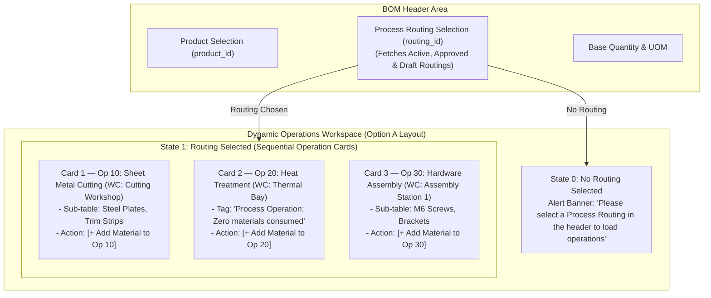
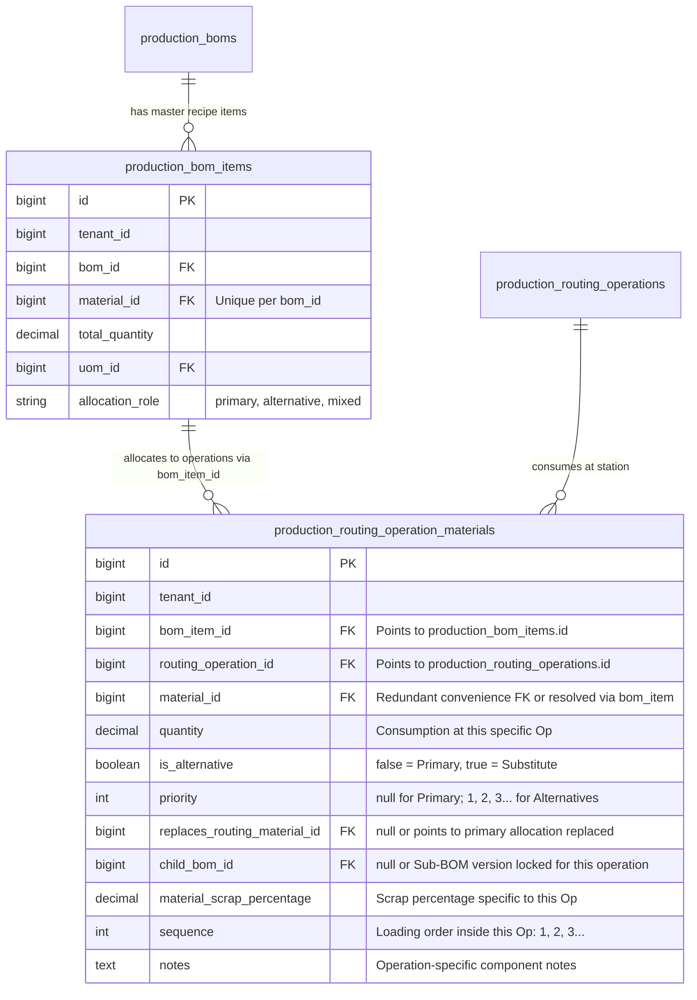

# BOM & Routing Feature Exchange Tracker

This document tracks all requirements, architecture shifts, business rules, design decisions, and implementation plans for **inverting the creation and tracking relationship between Bill of Materials (BOM) and Routing**.

* **Reference Architecture Map:** [`docs/bom_routing_architecture_map.md`](file:///c:/xampp/htdocs/wm-product-saas/docs/bom_routing_architecture_map.md)
* **Work Center Linking Tracker:** [`docs/work_center_routing_linking_tracker.md`](file:///c:/xampp/htdocs/wm-product-saas/docs/work_center_routing_linking_tracker.md)
* **Status Legend:**
  * 🟡 **Discussion / Proposed** — Item under discussion and architectural review.
  * 🟢 **Agreed** — Requirements and technical specification agreed upon; queued for batch implementation.
  * 🔵 **In Progress** — Currently being coded during execution phase.
  * 🛠️ **Applied** — Implemented in code/schema; awaiting user verification & UI implementation.
  * ✅ **Verified** — Verified and signed off by user after full UI and end-to-end testing.
  * ⏸️ **On Hold / Postponed** — Deferred for future iteration.

---

## Summary Register

| ID | Title / Area | Status | Impacted Components |
| :--- | :--- | :--- | :--- |
| **TRACK-01** | Invert Parent Entity Tracking Link (`routing_id` on BOM vs `bom_id` on Routing) | 🛠️ **Applied** | Migrations, `ProductionBom`, `Routing`, DTOs |
| **TRACK-02** | Move Operation-Component Assignment into BOM & Populate `RoutingOperationMaterial` | 🛠️ **Applied** | Migrations, `ProductionBomItem`, `RoutingOperationMaterial`, `ProductionBomService` |
| **TRACK-03** | Decouple Routing Creation & Approval from BOM Pre-requisite | 🛠️ **Applied** | `StoreRoutingRequest`, `RoutingService`, `RoutingRepository`, `RoutingController` |
| **TRACK-04** | BOM Creation & Edit UI Overhaul (Routing Header Selector & Component Operation Dropdowns) | 🛠️ **Applied** | `bom/create.blade.php`, `bom/edit.blade.php`, `routing/create.blade.php`, `routing/edit.blade.php`, `routing/show.blade.php` |
| **TRACK-05** | Material Allocation & Validation Rules (Mandatory Operation, Zero-Material Operations, Multi-Op) | 🛠️ **Applied** | `StoreProductionBomRequest`, `UpdateProductionBomRequest`, `ProductionBomService` |
| **TRACK-06** | Invert Lifecycle & Approval Cascades (Routing State Changes Affecting Connected BOMs) | 🛠️ **Applied** | `RoutingLifecycleService`, `BomLifecycleService`, `ProductionBomService` |
| **TRACK-07** | Refactor Downstream Consumers (`ProductionOrder`, `ProductionPlan`, Readiness & Costing) | ⏸️ **On Hold / Deferred** | `ProductionOrderService`, `ProductionReadinessService`, `ProductionCostService` (After BOM & Routing finalized) |
| **TRACK-08** | Clean Database Migrations & Schema Modernization (Zero Legacy Backfill Needed) | 🛠️ **Applied** | Migrations (`routings`, `boms`, `bom_items`, `routing_operation_materials`), Seeders at end |
| **TRACK-09** | ECO (Engineering Change Order) Compatibility — BOM & Routing Inversion Impact | ⏸️ **On Hold / Deferred** | `ProductionEcoService`, `ProductionEcoImpactAnalysisService`, `ProductionEco` (Deferred - to be finalized later) |
| **TRACK-10** | BOM Duplication & Revision — Clone `routing_operation_id` on Items | 🛠️ **Applied** | `ProductionBomService::duplicateVersion()` |
| **TRACK-11** | Bulk Import Service — Invert `RoutingOperationMaterial` Population Source | 🛠️ **Applied** | `ProductionMasterImportService` (lines 703–793), CSV import schema |
| **TRACK-12** | Feature Test Suite Updates — Align All BOM & Routing Tests with New Architecture | 🛠️ **Applied** | `tests/Feature/Production/BomRoutingInversionTest.php`, `tests/Feature/Production/RoutingTest.php` |
| **TRACK-13** | Parallel Operations Live Grouping & Machine/Batch Collision Safeguards | ⏸️ **On Hold / Deferred** | `create.blade.php`, `edit.blade.php`, `StoreRoutingRequest`, `UpdateRoutingRequest`, `SchedulingService` |
| **TRACK-14** | 2-Tier BOM Storage Architecture & Live Component Rollup Tab | 🛠️ **Applied** (Awaiting Acceptance) | `bom/create.blade.php`, `bom/edit.blade.php`, `database/migrations/2026_11_05_160000_update_bom_items_and_routing_materials_for_2tier_architecture.php`, `ProductionBomItem`, `RoutingOperationMaterial`, `ProductionBomService` |

---

## Detailed Feature Tracking & Technical Proposals

---

### TRACK-01: Invert Parent Entity Tracking Link (`routing_id` on BOM vs `bom_id` on Routing)
* **Date Logged:** 2026-10-30
* **Status:** 🛠️ **Applied**
* **Area:** Database Schema, Models & Core Entity Relationships

#### 1. Description & Context
Currently, a Routing points to a BOM via `routings.bom_id`. This forces users to create the BOM first before creating a Routing.
In the target architecture, a Routing represents the manufacturing process (sequence of machine operations) which can be designed first. The BOM represents the recipe of materials used to execute that manufacturing process and therefore points to the Routing via `production_boms.routing_id`.

#### 2. Agreed Architectural Decisions
1. **Mandatory Routing on BOM:**
   - Selecting a `routing_id` is **mandatory** for BOM creation and editing (`required|exists:routings,id`).
2. **Product Decoupling from Routing (`product_id` Dropped on Routings):**
   - Routing represents a pure, generic manufacturing process route (e.g. "Sheet Metal Stamping Line", "Standard Powder Coating Flow").
   - `production_routings.product_id` is dropped, eliminating circular validation conflicts.
   - Routings are reusable across 1-to-many BOMs.
   - The selectable Routings on the BOM form fetch all available active/draft/approved Routings in the tenant without product-bound constraints.
3. **Lifecycle Status Transitions:**
   - When creating or editing a **Draft BOM**, the user is permitted to link a **Draft, Active, or Approved Routing**.
   - A Draft BOM **can be submitted for approval (`pending_approval`)** while the linked Routing is in Draft or Pending Approval.
   - When **Approving the BOM**, the linked Routing must strictly be in an **Approved / Active** state.
   - If the connected Routing is **rejected**, any linked pending BOM is **automatically rejected / returned to draft**.
   - Routing approval does **NOT** auto-approve the BOM (the BOM requires its own independent approval review).
4. **Schema Cleanup for `routings.bom_id` and `routings.product_id`:**
   - Cleanly **drop foreign key and column `bom_id`** from the `routings` table.
   - Cleanly **drop foreign key and column `product_id`** from the `routings` table.

#### 3. Agreed Technical Specification
* **Database Migrations:**
  * Add `routing_id` to `production_boms` (`foreignId('routing_id')->constrained('routings')->restrictOnDelete()`).
  * Drop foreign key and column `bom_id` from `routings`.
* **Model Relationships:**
  * In `ProductionBom.php`: Define `public function routing(): BelongsTo { return $this->belongsTo(Routing::class, 'routing_id'); }`.
  * In `Routing.php`: Define `public function boms(): HasMany { return $this->hasMany(ProductionBom::class, 'routing_id'); }`. Remove `bom()` belongsTo relationship.
* **DTO & Requests:**
  * Update `ProductionBomDTO`: Add `public readonly int $routing_id`.
  * Update `StoreProductionBomRequest` & `UpdateProductionBomRequest`: Add `'routing_id' => 'required|exists:routings,id'`.
  * Update `RoutingDTO`, `StoreRoutingRequest`, `UpdateRoutingRequest`: Remove all `bom_id` references.

#### 4. Files to Modify (During Implementation Batch)
* `database/migrations/xxxx_xx_xx_add_routing_id_to_boms_and_drop_bom_id_from_routings.php`
* `app/Domains/Production/Models/ProductionBom.php`
* `app/Domains/Production/Models/Routing.php`
* `app/Domains/Production/DTO/ProductionBomDTO.php`
* `app/Domains/Production/DTO/RoutingDTO.php`
* `app/Domains/Production/Requests/StoreProductionBomRequest.php`
* `app/Domains/Production/Requests/UpdateProductionBomRequest.php`
* `app/Domains/Production/Requests/StoreRoutingRequest.php`
* `app/Domains/Production/Requests/UpdateRoutingRequest.php`

---

### TRACK-02: Move Operation-Component Assignment into BOM & Populate `RoutingOperationMaterial`
* **Date Logged:** 2026-10-30
* **Status:** 🛠️ **Applied**
* **Area:** Component Assignment & Tracking Architecture

#### 1. Description & Context
Currently, `production_routing_operation_materials` stores which material is consumed in which routing operation, but it is populated when creating a Routing.
In the target architecture, we **keep the same destination table (`production_routing_operation_materials`)** and change the source:
Instead of data originating from the Routing form, the data originates from the **BOM**. When a BOM is saved, it assigns each component to its designated Routing Operation and populates/syncs `production_routing_operation_materials`.

#### 2. Agreed Architectural Decisions
1. **Reuse Existing Table:**
   - Keep `production_routing_operation_materials` as the execution and stage-material tracking table.
   - Do NOT create a separate or redundant mapping table.
2. **Add `bom_id` to `production_routing_operation_materials`:**
   - Add `foreignId('bom_id')->nullable()->constrained('production_boms')->cascadeOnDelete()` to `production_routing_operation_materials`.
   - This provides explicit BOM version attribution to every operation material record.
3. **Capture Operation in BOM Items:**
   - Each component row in the BOM form allows selecting the `routing_operation_id`.
   - `production_bom_items` records `routing_operation_id` (`foreignId('routing_operation_id')->nullable()->constrained('production_routing_operations')->nullOnDelete()`).
4. **Synchronization Flow:**
   - On BOM `create()` and `update()`, `ProductionBomService` syncs the assigned component materials into `production_routing_operation_materials` for that BOM and its operations.
   - Downstream services (`ProductionOrderService`, `ProductionReadinessService`, etc.) continue reading `RoutingOperationMaterial` seamlessly.

#### 3. Files to Modify (During Implementation Batch)
* `database/migrations/xxxx_xx_xx_add_bom_id_to_routing_operation_materials_and_op_to_bom_items.php`
* `app/Domains/Production/Models/ProductionBomItem.php`
* `app/Domains/Production/Models/RoutingOperationMaterial.php`
* `app/Domains/Production/DTO/ProductionBomItemDTO.php`
* `app/Domains/Production/Services/ProductionBomService.php`

---

### TRACK-03: Decouple Routing Creation & Approval from BOM Pre-requisite
* **Date Logged:** 2026-10-30
* **Status:** 🛠️ **Applied**
* **Area:** Routing Domain & Lifecycle Rules

#### 1. Description & Context
Currently:
* `StoreRoutingRequest` / `UpdateRoutingRequest` enforces Rule 4 (BOM component assignment, complete allocation Rule A, foreign component check, over-allocation Rule C).
* `RoutingService::submitApproval()` and `approve()` throw an exception if the routing does not have an active or draft BOM.
* This blocks creating and approving a Routing first!

#### 2. Agreed Architectural Decisions
1. **Fully Standalone Routing Workflow:**
   - Routing is created, submitted for review, and approved 100% on its own merits (validating work centers, machines, sequences, cycle times, quality gates).
   - No BOM is required at any point in the Routing lifecycle.
2. **Material Quantity Mode Removed from Routing:**
   - The concept of `material_quantity_mode` (`per_unit` vs `per_bom_base_quantity`) is removed from Routing because Routing does not care about material quantities.
   - The engineer authoring the BOM will specify consumption quantities directly.
3. **Comment-Out Policy (Preserve Logic for BOM Re-use):**
   - **Do NOT delete the existing validation and allocation code immediately.**
   - Instead, comment it out cleanly with explicit markers (`// [INVERSION-DECOUPLE-TRACK-03] ...`) so the logic remains visible as reference when adapting it into the BOM in TRACK-05.
   - Document all commented-out locations in this tracker file so that once all tracks are verified and tested, they can be removed in a single clean cleanup pass.

#### 3. Planned Comment-Out Locations (Execution Phase)
1. **`app/Domains/Production/Requests/StoreRoutingRequest.php` & `UpdateRoutingRequest.php`:**
   - Comment out `bom_id` and `material_quantity_mode` from `$rules`.
   - Comment out Rule 4 (BOM component assignment & over-allocation validation block, lines ~184–321).
2. **`app/Domains/Production/Services/RoutingService.php`:**
   - In `submitApproval()`: Comment out lines ~138–159 (requiring active/draft BOM check).
   - In `approve()`: Comment out lines ~190–206 (requiring approved/active BOM check).
   - In `syncOperations()`: Comment out lines ~420–441 (populating `RoutingOperationMaterial` from routing operations).
3. **`resources/views/modules/production/routing/create.blade.php` & `edit.blade.php`:**
   - Comment out "Select BOM" dropdown.
   - Comment out "Material Quantity Mode" radio buttons.
   - Comment out "Live BOM Component Allocation Summary Card".
   - Comment out the operation materials assignment modal/button from the operations table.
4. **`app/Domains/Production/Services/RoutingLifecycleService.php`:**
   - Comment out `syncDraftRoutingsToApprovedBom()` (line 223) entirely — this method auto-updates `routings.bom_id` on draft Routings when BOM is approved. Under inversion, Routing does not track BOM. Mark: `// [INVERSION-DECOUPLE-TRACK-03]`.
   - Comment out `archiveRoutingsForDeactivatedBoms()` (line 241) — called from `ProductionBomService::approve()` to archive linked Routings when old BOM versions are deactivated. Under inversion, BOM approval does NOT cascade to Routings. Mark: `// [INVERSION-DECOUPLE-TRACK-03]`.
   - Comment out `handleRoutingsOnBomCancellation()` (line 287) — called from `ProductionBomService::cancel()`. Under inversion, BOM cancellation does NOT cascade to Routings. Mark: `// [INVERSION-DECOUPLE-TRACK-03]`.
5. **`app/Domains/Production/Services/ProductionBomService.php`:**
   - In `approve()` lines ~199–209: Comment out calls to `archiveRoutingsForDeactivatedBoms()` and `syncDraftRoutingsToApprovedBom()`. Mark: `// [INVERSION-DECOUPLE-TRACK-03]`.
   - In `reject()` lines ~257–279: Comment out the entire `$linkedRoutings` block that auto-rejects connected pending Routings when a BOM is rejected. Mark: `// [INVERSION-DECOUPLE-TRACK-03]`.
   - In `cancel()` lines ~299–305: Comment out call to `routingLifecycleService->handleRoutingsOnBomCancellation()`. Mark: `// [INVERSION-DECOUPLE-TRACK-03]`.
6. **`app/Domains/Production/Models/ProductionBom.php`:**
   - Comment out `routings()` HasMany relationship (line 75) — based on old `bom_id` FK on Routing.
   - Comment out `routing()` HasOne relationship (line 80) — based on old `bom_id` FK on Routing.
   - Comment out `getActiveRoutingAttribute()` accessor (line 86) — resolves routing from `WHERE bom_id = ...`; must be replaced with the new `belongsTo` direct FK accessor.
   - Mark all with `// [INVERSION-DECOUPLE-TRACK-03]`.

#### 4. Files to Modify (During Implementation Batch)
* `app/Domains/Production/Requests/StoreRoutingRequest.php`
* `app/Domains/Production/Requests/UpdateRoutingRequest.php`
* `app/Domains/Production/Services/RoutingService.php`
* `resources/views/modules/production/routing/create.blade.php`
* `resources/views/modules/production/routing/edit.blade.php`

---

### TRACK-04: BOM Creation & Edit UI Overhaul (Operation-Centric Sequential Cards / Accordions)
* **Date Logged:** 2026-10-30 (Updated: November 2026 with Option A Layout Consensus)
* **Status:** 🛠️ **Applied (Awaiting User Acceptance)**
* **Area:** BOM Frontend Views (`bom/create.blade.php`, `bom/edit.blade.php`), Routing Views (`routing/create.blade.php`, `routing/edit.blade.php`, `routing/index.blade.php`, `routing/show.blade.php`), Alpine.js Scripts & Form Validation

#### 1. Description & Context
In the inverted architecture:
* Routing is created first as an independent, reusable manufacturing process route (without `product_id` or `bom_id`).
* When creating a BOM, the user chooses which Finished Product to manufacture (`product_id`) and which Process Routing to use (`routing_id`).
* **UI Evolution (Consensus Reached):**
  * *Initial Implementation:* A flat components table where every row contained an "Operation" dropdown selector.
  * *User Refinement (Agreed Option A):* Instead of repetitive dropdowns in every row, the components workspace presents **sequential Operation Cards/Accordions** corresponding to the operations of the selected Process Routing.
  * Inside each operation card, the user configures the specific raw materials / components consumed at that physical work station.

#### 2. Visual Architecture & Block Diagrams



##### UI Layout Blueprint (Option A: Operation-Centric Cards)

```text
══════════════════════════════════════════════════════════════════════════════════════════════
BOM HEADER
Item to Produce: [ Executive Desk (FG-DESK) ]       Base Quantity: [ 1.00 ] [ PCS (auto) ]
Process Routing: [ RTG-001 - Desk Routing (v1.0.0 · Active) ]   Version: [ 1.0.0 ]
══════════════════════════════════════════════════════════════════════════════════════════════

[ Expand All ]  [ Collapse All ]                                  Total Materials: 4 items

┌────────────────────────────────────────────────────────────────────────────────────────────┐
│ ▼  OP 10: SHEET METAL CUTTING                         [ WC: Cutting Workshop ] 2 Materials │
├────────────────────────────────────────────────────────────────────────────────────────────┤
│  Setup: 15.0m  •  Run: 45.0m/unit  •  Yield: 98%                                           │
│                                                                                            │
│  #   COMPONENT PRODUCT        QTY & TYPE   UOM   SCRAP %   ALTERNATIVE    ACTION           │
│  ────────────────────────────────────────────────────────────────────────────────────────  │
│  1   Steel Plate 2mm (RM-01)  2.00 Fixed   PCS   0.00%     Primary        [✕]              │
│  2   Edge Trim Strip (RM-05)  1.00 Fixed   MTR   2.00%     Primary        [✕]              │
│                                                                                            │
│  + Add Material to Op 10                                                                   │
└────────────────────────────────────────────────────────────────────────────────────────────┘

┌────────────────────────────────────────────────────────────────────────────────────────────┐
│ ▶  OP 20: HEAT TREATMENT & CURING                     [ WC: Thermal Bay ]      0 Materials │
├────────────────────────────────────────────────────────────────────────────────────────────┤
│  (Collapsed / Tag: "Process Operation: No materials consumed at this station")             │
│  [ Click to expand & add material ]                                                        │
└────────────────────────────────────────────────────────────────────────────────────────────┘

┌────────────────────────────────────────────────────────────────────────────────────────────┐
│ ▼  OP 30: HARDWARE ASSEMBLY                           [ WC: Assembly Bay 1 ]   2 Materials │
├────────────────────────────────────────────────────────────────────────────────────────────┤
│  Setup: 10.0m  •  Run: 30.0m/unit  •  Yield: 100%                                          │
│                                                                                            │
│  #   COMPONENT PRODUCT        QTY & TYPE   UOM   SCRAP %   ALTERNATIVE    ACTION           │
│  ────────────────────────────────────────────────────────────────────────────────────────  │
│  1   M6 Hex Screw (RM-SCREW)  16.00 Fixed  PCS   0.00%     Primary        [✕]              │
│  2   Corner Bracket (RM-BRKT) 4.00 Fixed   PCS   0.00%     Primary        [✕]              │
│                                                                                            │
│  + Add Material to Op 30                                                                   │
└────────────────────────────────────────────────────────────────────────────────────────────┘
```

#### 3. Interaction & Frontend Implementation Details

1. **Automatic Operation Locking (`routing_operation_id`)**:
   - When the user clicks `+ Add Material to Op 10`, the new item is pushed with its `routing_operation_id` hardcoded to Op 10 (`op.id`).
   - The user never has to touch an operation dropdown in the table row.
2. **Reclaimed Table Space**:
   - The ~16% width previously eaten up by the per-row Operation dropdown is removed.
   - Component Name, SKU, Notes, Formula, UOM, Scrap %, Priority, and Alternatives have generous horizontal breathing room.
3. **Empty / Process Operations**:
   - Operations that do not consume raw materials (e.g. QC inspection, drying, cooling) display a clean soft alert: *"Process operation: Zero materials consumed at this station"*.
4. **Form Submission Mapping**:
   - In Alpine.js, each item carries its `routing_operation_id: op.id`.
   - On submit, all rows compile into the standard array `items[index][routing_operation_id]`, `items[index][material_id]`, etc.
   - Backend controller, DTO, validation requests, and models remain 100% consistent with no breaking changes.
5. **Alternative Component Scoping**:
   - Primary component replacement targets (`replaces_row_uid`) are scoped to the **same operation** (an alternative component must replace a primary component consumed at that same station).
6. **Operation Card Primary vs. Alternative Indicator**:
   - Each Operation Card header must explicitly identify whether the operation itself is a **Primary Operation** (`is_alternative = false`) or an **Alternative Operation** (`is_alternative = true`).
   - If alternative, display the target operation it substitutes and its priority (e.g. `[🟡 Alternative Operation (Substitutes Op 10 · Priority 1)]`).
7. **Process Routing Switch Safeguard & Material Reset Policy**:
   - When a user changes the selected Process Routing in the BOM header:
     - **If materials are already entered** (`items.some(it => it.material_id)`): Display a confirmation warning modal informing the user that changing the routing will reset and remove all assigned materials because the operation sequence is changing.
       - If **Cancelled**: Revert the dropdown selection to the previous routing with zero data loss.
       - If **Confirmed**: Cleanly wipe all component rows (`items = []`), load the new routing's operations cleanly, and ensure NO stale materials carry over.
     - **If no materials are entered**: Change the routing immediately without showing any warning.

#### 4. Routing Views Cleanups (Already Applied)
1. **Header Cleanup**: Removed `bom_id` dropdown and "Linked BOM" badge from `routing/create.blade.php` and `routing/edit.blade.php`.
2. **Accordion Cleanup**: Removed consumed materials row and live BOM allocation summary card from the Routing builder.
3. **Routing Show View (`routing/show.blade.php`)**:
   - Removed legacy "Consumed Component / Input Item" column from operations sequence table.
   - Replaced old allocation summary with the **Linked Bill of Materials (BOMs)** table displaying `$routing->boms`.

#### 5. Files Impacted for Implementation
* `resources/views/modules/production/bom/create.blade.php` (Option A Sequential Operation Cards, sub-tables, zero-material notices, embedded priority, unified Odoo/Apex UI input controls with `odoo-table-input` and `odoo-table-select`, dynamic Bootstrap-5 Select2 on `bom-alt-select` with operation-specific candidate indexing)
* `resources/views/modules/production/bom/edit.blade.php` (Option A Sequential Operation Cards, sub-tables, zero-material notices, embedded priority, unified Odoo/Apex UI input controls with `odoo-table-input` and `odoo-table-select`, dynamic Bootstrap-5 Select2 on `bom-alt-select` with operation-specific candidate indexing)
* `lang/en/production.php` (Added `select_routing_first`, `select_routing_operation`, `process_operation_zero_materials`, `add_material_to_op`, `expand_all`, `collapse_all`, `no_routing_selected_alert`, `zero_materials_notice`)
* `app/Domains/Production/Controllers/ProductionBomController.php` (Eager loaded `['operations.workCenter', 'operations.section']` on Routings)

#### 6. Identified Frontend Issues & Enhancements from User Testing (2026-11-05)

##### Issue A: Operation Card Header Lacks Primary vs. Alternative Designation (Photo 1)
* **Date Identified:** 2026-11-05
* **Symptom:** In the Operation Card header (`media_1793870056410_784cd0a7.png`), an operation displays its sequence, name, work center, and cycle times, but does not indicate whether the operation itself is part of the standard primary process route or an alternative operation branch.
* **Specification / Fix:**
  - Add a distinct role badge in the Operation Card header:
    - If `op.is_alternative === false`: Display `[🟢 Primary Operation]`.
    - If `op.is_alternative === true`: Display `[🟡 Alternative Operation]` with details of the target primary operation it replaces and its priority (e.g. `Substitutes Op 10 · Priority 1`).

##### Issue B: Changing Process Routing Shifts All Materials to Op 1 Without Warning (Photo 2)
* **Date Identified:** 2026-11-05
* **Symptom:** When a user initially selects Routing 1 and configures components across Op 1, Op 2, and Op 3, and then changes the header dropdown to Routing 3 (`media_1793870288461_3bbc669d.jpg`), all materials from Op 2 and Op 3 of R1 are unintentionally shifted into Op 1 of R3, dumping all components into a single card without warning!
* **Root Cause:**
  - In `create.blade.php` / `edit.blade.php`, `updateAvailableOperations()` runs:
    ```javascript
    this.items.forEach(item => {
        if (!item.routing_operation_id || !validOpIds.includes(String(item.routing_operation_id))) {
            item.routing_operation_id = firstOpId;
        }
    });
    ```
    Since the operations of R1 do not exist in R3, the fallback automatically reassigned all rows to `firstOpId` (Op 1 of R3) instead of warning the user and wiping the obsolete assignments.
* **Agreed Specification & Safeguard:**
  1. **User Confirmation Prompt:**
     - When changing `#routing_id`, intercept the change event:
     - Check if `this.items.some(it => it.material_id)`.
     - **If materials exist:** Display a confirmation dialog (`window.confirmAction`):
       - Title: *"Change Process Routing?"*
       - Message: *"Changing the Process Routing will reset and remove all currently assigned component materials because the operation sequence is changing. Do you want to proceed?"*
       - If **Cancelled**: Revert the dropdown back to the previous routing value; keep all existing materials intact.
       - If **Confirmed**: Clear all component rows (`this.items = []`), load the new routing's operations cleanly, and ensure no orphaned materials carry over.
     - **If no materials exist:** (Empty form), switch the routing immediately with zero warning.

---

### TRACK-05: Material Allocation & Validation Rules (Single vs. Multi-Operation Split & Zero-Material Operations)
* **Date Logged:** 2026-10-30
* **Status:** 🛠️ **Applied**
* **Area:** Business Rules & Validation Engine

#### 1. Description & Context
Previously, Routing validated that every BOM item was allocated to at least one operation.
Now, the validation rules shift to the **BOM**:
The BOM defines the material components, and every component must be assigned to an operation belonging to the BOM's linked Routing.

#### 2. Agreed Architectural Decisions
1. **Zero-Material Operations Allowed:**
   - Routing operations without any components assigned are explicitly allowed (e.g. Quality Inspection, Heat Treatment, Cooling/Drying, CNC Machining). They consume time and labor/machine cost without raw material consumption.
2. **Mandatory Component Assignment:**
   - Every raw material / component row in the BOM **must** be assigned to a valid operation (`routing_operation_id` is required).
   - Packaging materials are also assigned to a designated packaging operation (packaging is modeled as an operation in the routing).
3. **Multi-Operation Consumption Support & Operation-Scoped Duplicate Prevention:**
   - **Historical Rule Context:** Before the inversion, BOM had no routing link and strictly enforced a global duplicate check (`Duplicate material component found in BOM`), while the Routing page had its own separate material allocation checks.
   - **New Inverted Architecture Rule:** In the new architecture where BOM owns the operation assignment (and especially with Option A's Operation Card layout), duplicate component prevention is scoped strictly **per operation**:
     - **Allowed:** Consuming the same component across multiple distinct operations (e.g. M6 Screws consumed in Op 10 Frame Assembly, and M6 Screws consumed again in Op 30 Final Fastening).
     - **Blocked:** Adding the exact same material component twice inside the **same** operation (`$key = "{$materialId}_{$opId}"`).
   - In `StoreProductionBomRequest` and `UpdateProductionBomRequest`, this is already enforced via `$key = "{$materialId}_{$opId}"`.
   - In the frontend Option A UI, inside an operation's card, attempting to add an already selected material triggers an immediate client-side duplicate alert.
4. **Operation Ownership Validation:**
   - Every `items.*.routing_operation_id` must exist and belong to the selected `routing_id` (`production_routing_operations.routing_id == bom.routing_id`).

#### 3. Technical Specification for `StoreProductionBomRequest` / `UpdateProductionBomRequest`
* Add rule: `'items.*.routing_operation_id' => 'required|integer|exists:production_routing_operations,id'`.
* Validate that each `routing_operation_id` belongs to the routing selected in `routing_id`.
* Update duplicate check: allow same `material_id` only if `routing_operation_id` is different.

#### 4. Additional Sub-Rules to Clarify

5. **Alternative Components & `routing_operation_id`:**
   - An alternative component (`is_alternative = true`) that replaces a primary component must also carry a `routing_operation_id`.
   - The alternative's `routing_operation_id` should default to the same operation as the primary component it replaces (since it substitutes the same consumption slot).
   - The system does NOT enforce that an alternative must use the same operation as its primary — the engineer may route it differently. However, the field is still mandatory (not nullable) for alternatives.
   - **Implication for `StoreProductionBomRequest`:** Alternative items are NOT excluded from the `routing_operation_id` required rule.

6. **Unassigned components at submission (`pending_approval`) vs. draft save:**
   - At **draft save** (`create()` / `update()`): `routing_operation_id` is validated as required (per TRACK-05 Rule 2 above).
   - Rationale: Allowing nullable at draft level would cause silent data loss when RoutingOperationMaterial sync runs.

7. **`RoutingOperationMaterial` sync on BOM update:**
   - When a BOM is updated (items re-synced), the existing `RoutingOperationMaterial` rows for that `bom_id` must be DELETED and re-inserted fresh.
   - Deletion scope: `RoutingOperationMaterial::where('bom_id', $bom->id)->delete()` before re-insertion.
   - This ensures stale operation-material links don't accumulate when item counts or assignments change.

#### 4. Files to Modify (During Implementation Batch)
* `app/Domains/Production/Requests/StoreProductionBomRequest.php`
* `app/Domains/Production/Requests/UpdateProductionBomRequest.php`
* `app/Domains/Production/Services/ProductionBomService.php`

#### 5. Identified Issue & Root Cause: Duplicate Material Error Text Disappears on Re-selection (UI Bug)
* **Date Identified:** 2026-11-05 (Reported during user Journey A testing)
* **Status:** 🛠️ **Investigated & Documented (Awaiting User Approval to Apply Fix)**
* **Symptoms (Observed in Browser):**
  1. Under an Operation Card (e.g., Op 10), when a user selects a material that already exists in the same operation, the Select2 input receives a red outline (`.is-invalid`), and the error text appears underneath: `"Duplicate material component found for the same routing operation."` (Verified in user screenshot `media_1793856589859_eb4b470e.png`).
  2. While remaining on that same row, if the user changes the selection to *another* material that is *also* already used in the same operation, the Select2 input retains the red outline (`.is-invalid`), but the error message text below completely disappears (Verified in user screenshot `media_1793856575603_4180a5b3.png`).
* **Root Cause Breakdown:**
  1. In `resources/views/components/ui/odoo-form-ui.blade.php`, global listeners listen for user interaction:
     `$(document).on('input change', '.odoo-form-control, .odoo-table-input, .odoo-table-select, .erp-file-input', ...)`
     and `$(document).on('change.select2', 'select', ...)`.
  2. When the user changes a select value, `clearOdooError(this)` executes to hide previous server-side validation errors:
     ```javascript
     let serverErrorEl = errorContainer.querySelector('.invalid-feedback');
     if (serverErrorEl) {
         serverErrorEl.classList.remove('d-block');
         serverErrorEl.classList.add('d-none');
     }
     ```
  3. **First duplicate selection:**
     - Alpine's `<template x-if="errors['items.' + getItemIndex(item) + '.material_id']">` had not yet rendered its `<div class="invalid-feedback d-block fs-11 mt-1">` element when `clearOdooError()` ran.
     - Following `validateDuplicateMaterials()`, Alpine evaluated `x-if` to true and rendered the `<div class="invalid-feedback d-block ...">` node fresh into the DOM.
     - `$nextTick()` added `.is-invalid` to the Select2 container. Both red outline and error text were visible.
  4. **Second duplicate selection (re-selection):**
     - When the user selects another duplicate material, `clearOdooError(this)` runs first upon the `change` event.
     - It finds the *already-rendered* `.invalid-feedback` element in the table cell `<td>` and applies `classList.add('d-none')` while removing `d-block`.
     - In Alpine, the `errors['items.X.material_id']` key is updated, but because the condition was *already truthy* and the message string was identical, Alpine does not recreate the DOM node nor does it reset classes overridden by jQuery/DOM manipulation.
     - In `validateDuplicateMaterials()`, Step 4 re-applies `.is-invalid` to `$s2Selection`, keeping the red outline visible, but never removes `d-none` or re-adds `d-block` to `.invalid-feedback`.
     - **Result:** The red border stays on the Select2 box, but the text is suppressed by Bootstrap's `d-none`.
* **Proposed Resolution:**
  1. In `resources/views/modules/production/bom/create.blade.php` and `edit.blade.php`:
     Inside `validateDuplicateMaterials()` Step 4 (`$nextTick`), explicitly ensure any row with a material error has its feedback element refreshed:
     ```javascript
     const $feedback = $row.find('.invalid-feedback');
     if (hasErr) {
         $select.addClass('is-invalid');
         $s2Selection.addClass('is-invalid');
         $feedback.removeClass('d-none').addClass('d-block');
     } else {
         $select.removeClass('is-invalid');
         $s2Selection.removeClass('is-invalid');
         $feedback.removeClass('d-block').addClass('d-none');
     }
     ```
  2. In `resources/views/components/ui/odoo-form-ui.blade.php`:
     Update `clearOdooError(input)` so that it does not blindly add `d-none` to feedback elements managed by Alpine (`:not([x-text])`).

---

### TRACK-06: Invert Lifecycle & Approval Cascades (Routing Changes Affecting Connected BOMs)
* **Date Logged:** 2026-10-30
* **Status:** 🛠️ **Applied**
* **Area:** Domain Lifecycle & State Machine

#### 1. Description & Context
Currently, state changes cascade from BOM to Routing. In the target architecture, Routing is the primary manufacturing process definition, and BOM recipes depend on it. This track defines the exact state machine rules when a Routing is approved, superseded, or cancelled.

#### 2. Agreed Architectural Decisions
1. **Decoupled Routing Versioning (No Product-Linked Auto-Supersession):**
   - Because a Routing is a generic, reusable engineering process route with NO `product_id`, the system will **NOT** automatically supersede, expire, or inactivate other routings upon approval.
   - Routings maintain uniqueness per tenant via **`[tenant_id, name, version]`** and `routing_number`.
   - When a new Routing is approved, it simply becomes `Active` without automatically retiring any older routing.
   - **Manual Inactivation / Historical Transition:** If an older routing is being replaced, the planner/engineer must **manually** set the older routing to `historical` or `inactive`. If not manually retired, multiple routings can happily stay active in parallel, serving different BOMs simultaneously.
2. **BOM Connection & Active Lifecycle:**
   - Each BOM explicitly stores its chosen `routing_id`.
   - Different BOMs can use different Routings (e.g. BOM A uses "Metal Fab v1.0", and BOM B uses "Metal Fab v2.0").
   - Approving a new Routing never disrupts existing active BOMs.
3. **Manual Routing Inactivation or Cancellation Impact:**
   - If an engineer manually marks a Routing as `inactive`, `historical`, or `cancelled`, connected Draft BOMs display an advisory alert:
     `"The linked routing has become inactive or historical. Please review the BOM before submission."`
   - Existing executed or in-flight production orders continue unaffected using their recorded snapshots.
4. **Approval Dependency Rule:**
   - A Draft BOM can be created with a Draft Routing.
   - A Draft BOM **can be submitted for approval (`pending_approval`)** while its linked Routing is in Draft or Pending Approval.
   - A BOM **cannot be approved** unless its linked Routing is already in `approved` or `active` status.
   - If the connected Routing is **rejected**, any linked pending BOM is **automatically rejected / returned to draft**.
   - Routing approval does **NOT** auto-approve connected BOMs (BOMs require independent review).

#### 3. Technical Specification
* In `RoutingLifecycleService::transitionOnApproval()`:
  - Transition active BOMs linked to the retiring routing version to `inactive` with warning reason.
  - Set warning on draft BOMs referencing the retiring routing version.
* In `RoutingLifecycleService::transitionOnCancellation()`:
  - Transition active BOMs linked to the cancelled routing to `inactive`.
  - Set warning on draft BOMs referencing the cancelled routing.
* In `ProductionBomService::approve()`:
  - Validate: `$routing = $bom->routing; if (!$routing || !in_array($routing->status, ['approved', 'active', 'scheduled'])) throw new InvalidArgumentException("Cannot approve BOM: Linked Routing must be approved and active first.");`

#### 4. Additional Lifecycle Sub-Rules

5. **Routing Rejection Cascade → BOMs:**
   - **Decided:** When a Routing is rejected (returned to `draft` from `pending_approval`), connected **pending-approval BOMs** are also returned to `draft`.
   - Rationale: A BOM that was submitted expecting this Routing to be approved is now blocked (cannot be approved without an approved Routing). Rather than leave it in a permanently blocked `pending_approval` state, automatically revert it to `draft` with a warning note:
     `"Automatically returned to draft because linked Routing (RTG-XXXX) was rejected."`
   - Draft BOMs (not yet submitted) are unaffected — they simply receive the standard draft-routing warning.
   - **Implementation:** In `RoutingLifecycleService` (new method `handleBomsOnRoutingRejection()`) called from `RoutingService::reject()`.

6. **`ProductionBomApproval` Audit Log on Routing-Triggered Inactivation:**
   - When a Routing state change causes a connected BOM to transition to `inactive` (per Rules 2 & 3), a `ProductionBomApproval` record must be created logging the action:
     `action = 'Inactivated'`, `comments = "Automatically inactivated because linked Routing (RTG-XXXX) became [historical/cancelled]."`.
   - This ensures full audit traceability for passive/automated BOM state changes.
   - **Implementation:** Inside the loop in `RoutingLifecycleService::transitionOnApproval()` and `transitionOnCancellation()`.

7. **`RoutingController::create()` / `edit()` — Remove `$boms` variable:**
   - `RoutingController::create()` currently passes `$boms` to the view for the BOM dropdown.
   - After TRACK-03, this variable must be removed from the controller (no BOM dropdown in Routing form).
   - Add to TRACK-03 comment-out list: `RoutingController.php` create() and edit() methods — `$boms` query and view pass.

8. **`BomLifecycleService` — Remove Routing Cascade Calls:**
   - `BomLifecycleService::transitionOnApproval()` currently returns `$deactivatedBomIds` which `ProductionBomService::approve()` passes to `archiveRoutingsForDeactivatedBoms()`.
   - After TRACK-03 comment-out, this return value is unused. The method signature and internal logic remain (it's about BOM-to-BOM lifecycle), just the caller no longer acts on it for Routing archiving.

#### 4. Files to Modify (During Implementation Batch)
* `app/Domains/Production/Services/RoutingLifecycleService.php`
* `app/Domains/Production/Services/BomLifecycleService.php`
* `app/Domains/Production/Services/ProductionBomService.php`
* `app/Domains/Production/Models/ProductionOrder.php` (Warning helper for draft orders)

---

### TRACK-07: Refactor Downstream Consumers (`ProductionOrder`, `ProductionPlan`, Readiness & Costing)
* **Date Logged:** 2026-10-30
* **Status:** ⏸️ **On Hold / Deferred**
* **Area:** Downstream Integration & MES Execution

> **Deferred Note:** As agreed with user directive on 2026-10-31, downstream execution adaptations will be handled at a later stage, strictly after the core BOM and Routing redesign is finalized and verified.

#### 1. Description & Context
Multiple services in the ERP currently read `production_routing_operation_materials`:
* **`ProductionOrderService`**:
  * Line 172: Queries `RoutingOperationMaterial::where('routing_operation_id', ...)` to compute operation target quantities and material scaling.
* **`ProductionReadinessService`**:
  * Lines 309 & 317: Queries `RoutingOperationMaterial` to verify if operations have specific material shortages.
* **`ProductionCostService`**:
  * Calculates material cost from BOM items and labor/machine cost from Routing operations.
* **`ProductionPlanService`**:
  * Verifies BOM and Routing pairings when creating a production plan.

#### 2. Key Refactoring Objectives (When Resumed)
1. In `ProductionOrderService`:
   - Standardize material consumption scaling ratio to `quantity / bom->base_quantity` (since `material_quantity_mode` on Routing is obsolete).
   - Filter `RoutingOperationMaterial` by the active order's `bom_id`.
2. In `ProductionPlanService`:
   - Selecting a BOM automatically defaults the Routing from `$bom->routing_id`.
3. In `ProductionCostService`:
   - Update `$bom->routing` to use the direct `belongsTo` foreign key.

---

### TRACK-08: Clean Database Migrations & Schema Modernization (Zero Legacy Backfill Needed)
* **Date Logged:** 2026-10-30
* **Status:** 🛠️ **Applied**
* **Area:** Database Migrations & Schema Cleanup

#### 1. Description & Context
All existing database records are demo/development data. Therefore, complex historical data-backfill scripts are unnecessary. We will execute clean migrations that add required columns, drop deprecated columns, and maintain strict schema integrity.

#### 2. Agreed Migration Decisions
1. **No Data Backfill Required:**
   - Existing demo data can simply be truncated or refreshed; no backfill script is needed.
2. **Schema Cleanup (`routings` table):**
   - Cleanly drop foreign key and column `bom_id` from `routings`.
   - Cleanly drop column `material_quantity_mode` from `routings`.
3. **Columns to Add:**
   - `production_boms`: Add `routing_id` (`foreignId('routing_id')->constrained('routings')->restrictOnDelete()`).
   - `production_bom_items`: Add `routing_operation_id` (`foreignId('routing_operation_id')->constrained('production_routing_operations')->cascadeOnDelete()`).
   - `production_routing_operation_materials`: Add `bom_id` (`foreignId('bom_id')->nullable()->constrained('production_boms')->cascadeOnDelete()`).
   - *(Note: `production_routing_operation_materials` only has `routing_operation_id`, not `routing_id`, so no redundant routing column exists there).*
4. **Seeders:**
   - Seeder refactoring will be handled at the very end after the backend and frontend changes are completely verified.
5. **Architecture Map Update:**
   - The historical note on `production_boms` in the architecture map (`routing_id was dropped in migration 2026_10_15_130000_drop_routing_id_from_production_boms_table.php`) must be corrected — we are **re-adding** `routing_id` as a mandatory FK (it was dropped previously when the old architecture removed it, and is now being re-introduced under the new direction).
6. **`RoutingController` — `$boms` variable removal:**
   - `RoutingController::create()` and `edit()` currently query and pass `$boms` to the view. This query should be dropped as part of TRACK-08 schema-wide cleanup (no `bom_id` on Routing → no BOM dropdown needed).

#### 3. Files to Modify (During Implementation Batch)
* `database/migrations/xxxx_xx_xx_invert_bom_and_routing_relationships.php`
* Seeders (at the final stage)

---

### TRACK-09: ECO (Engineering Change Order) — BOM & Routing Inversion Compatibility
* **Date Logged:** 2026-10-31
* **Status:** ⏸️ **On Hold / Deferred**
* **Area:** Engineering Change Order domain — `ProductionEcoService`, `ProductionEcoImpactAnalysisService`

> **Deferred Note:** As instructed on 2026-10-31, ECO is a module/feature that will be finalized later on. Currently, no ECO changes will be linked to BOM and Routing, and it is acceptable if the ECO module is left broken or disconnected for now. This track is postponed until after the core BOM/Routing architecture and downstream execution flows are settled.

#### 1. Description & Context
The ECO system manages formal change proposals for BOM and Routing revisions. The ECO data model stores:
* `current_bom_id`, `proposed_bom_id` — current and target BOM versions for a change.
* `current_routing_id`, `proposed_routing_id` — current and target Routing versions for a change.

`ProductionEcoService::release()` invokes:
1. `BomLifecycleService::transitionOnEcoRelease()` — activates the proposed BOM and retires the current one.
2. `RoutingLifecycleService::transitionOnEcoRelease()` — activates the proposed Routing and retires the current one.

#### 2. Scope Policy During Inversion
- **No linking:** No changes will be introduced in BOM or Routing services to accommodate or link to ECO at this stage.
- **Allowed to break:** Any existing ECO flows depending on old columns or lifecycle methods will not be updated or refactored until ECO is revisited as a dedicated initiative.
- All detailed concerns (BOM re-linking, ECO impact analysis, release ordering) are archived for future review when ECO is resumed.

---

### TRACK-10: BOM Duplication & Revision — Clone `routing_operation_id` on Items
* **Date Logged:** 2026-10-31
* **Status:** 🛠️ **Applied**
* **Area:** BOM version management (`ProductionBomService::duplicateVersion()`)

#### 1. Description & Context
`ProductionBomService::duplicateVersion()` (lines 317–416) is the two-pass clone algorithm used when creating a new BOM version or revision. It clones all BOM header fields and all `ProductionBomItem` rows into new records.

**Gap:** The clone loop at lines 369–388 copies all item fields **except `routing_operation_id`** (because the column does not yet exist). After TRACK-02 adds `routing_operation_id` to `production_bom_items`, the clone must also carry over `routing_operation_id`.

#### 2. Agreed Decisions
1. **Clone `routing_operation_id` directly:** When duplicating a BOM, each cloned item inherits the original item's `routing_operation_id`. The operation IDs reference the same Routing operations — this is correct since the cloned BOM still initially points to the same Routing.
2. **Clone `routing_id` on BOM header:** The cloned BOM header must also carry over the parent BOM's `routing_id`. The duplicate BOM starts pointing to the same Routing as the original.
3. **Routing validity check at clone time:** If the original BOM's Routing is now `historical` or `cancelled`, the clone is still created in `draft` with a warning badge (per TRACK-06), so the engineer can re-assign to an active Routing before submitting.
4. **Alternative components' `routing_operation_id`:** Alternative components can also have a `routing_operation_id`. The existing two-pass logic for resolving `replaces_item_id` handles alternatives correctly; `routing_operation_id` is just an additional field cloned in Pass 1 alongside the rest.

#### 3. Files to Modify (During Implementation Batch)
* `app/Domains/Production/Services/ProductionBomService.php` — `duplicateVersion()` lines 369–388: add `'routing_operation_id' => $item->routing_operation_id` and `'routing_id' => $original->routing_id` in the header create.
* `app/Domains/Production/Services/ProductionBomVersionService.php` — review for any independent revision flow (file was empty of relevant content; confirms `ProductionBomService` is the authoritative clone source).

---

### TRACK-11: Bulk Import Service — Invert `RoutingOperationMaterial` Population Source
* **Date Logged:** 2026-10-31
* **Status:** 🛠️ **Applied**
* **Area:** `ProductionMasterImportService` — CSV-based bulk import of Routings and BOMs

#### 1. Description & Context
`ProductionMasterImportService` (921 lines) handles bulk creation of Work Centers, Machines, BOMs, and Routings from uploaded Excel/CSV files.

**Current Routing import flow (lines 703–793):**
* Parses `routing_number`, `name`, `product_id`, `version`, `operations[]`, and `operations[].materials[]`.
* Creates `RoutingOperation` records, then directly creates `RoutingOperationMaterial` records for each material in that operation.
* This is the same pattern that is being decoupled in TRACK-03.

**Current BOM import flow (lines 640–701):**
* Creates `ProductionBom` header, then creates `ProductionBomItem` rows.
* Does **not** accept or store `routing_id` or `routing_operation_id` on items.

#### 2. Agreed Decisions
1. **Routing import stops populating `RoutingOperationMaterial`:**
   - Comment out lines 736–745 (update path) and lines 780–790 (create path) in `ProductionMasterImportService` with marker `// [INVERSION-DECOUPLE-TRACK-11]`.
   - Routing import from CSV will create only `RoutingOperation` records (no materials attached at import time).
2. **BOM import must accept `routing_id` and `routing_operation_id`:**
   - The BOM CSV format needs two new columns: `routing_number` (looked up to resolve `routing_id`) and per-item `operation_number` (looked up to resolve `routing_operation_id`).
   - On import, `ProductionBomItem` records are created with the resolved `routing_operation_id`.
   - After saving BOM items, the sync logic (TRACK-02) is triggered to populate `RoutingOperationMaterial`.
3. **Import validation:**
   - Validate that `routing_number` in the BOM CSV resolves to a valid Routing for the same `product_id`.
   - Validate that each `operation_number` in a BOM item row resolves to an operation belonging to that Routing.
   - If `routing_number` column is absent in the CSV, the import row is flagged as an error (since `routing_id` is now mandatory on BOMs).

> [!NOTE]
> The exact CSV column schema (header names, format) is a UI/import template concern that will be finalized when TRACK-04 and the import UI are revisited. The backend validation rules above are backend-only decisions.

#### 3. Files to Modify (During Implementation Batch)
* `app/Domains/Production/Services/ProductionMasterImportService.php`:
  * Comment out `RoutingOperationMaterial::create()` calls in routing import section (lines ~736–745 and ~780–790) with `// [INVERSION-DECOUPLE-TRACK-11]`.
  * Add `routing_id` and `routing_operation_id` resolution in BOM import section.
  * Add import validation for Routing match and operation ownership.

---

### TRACK-12: Feature Test Suite — Align All Affected Tests with New Architecture
* **Date Logged:** 2026-10-31
* **Status:** 🛠️ **Applied**
* **Area:** `tests/Feature/Production/` — all test files that depend on the old BOM-first / Routing-holds-materials architecture.

#### 1. Description & Context
The existing test suite has multiple test files that were written against the old flow. They will break when backend changes from TRACK-01 through TRACK-08 are applied.

#### 2. Test Files Requiring Updates

| Test File | Why It Will Break | Required Change |
| :--- | :--- | :--- |
| `RoutingMaterialAllocationTest.php` (867 lines, 10 test methods) | Entire test suite validates the old BOM-in-Routing allocation rules (Rule A, B, C, `per_unit`, `per_bom_base_quantity`, foreign material rejection) | Comment out old tests with `// [INVERSION-DECOUPLE-TRACK-12]`; write new tests asserting Routing creates without BOM and BOM holds operation assignments |
| `BomAndRoutingLifecycleDatesTest.php` (1064 lines) | Tests that BOM approval cascades to Routing; tests `syncDraftRoutingsToApprovedBom`; checks `routings.bom_id` FK | Invert lifecycle tests to assert Routing approval cascades to BOM; remove `bom_id` FK references |
| `RoutingDrivenSubcontractingTest.php` | References `bom_id` on Routing during subcontracting routing creation | Update Routing creation fixtures to not require `bom_id` |
| `RoutingParallelDependencyTest.php` | Routing creation fixtures may include `bom_id` | Update fixtures |
| `ProductionBatchRoutingContinuityTest.php` | Batch routing tests may reference `bom_id` or material allocation via Routing | Update fixtures and assertions |
| `BomAlternativeComponentsTest.php` | After TRACK-02, alternative components must also carry `routing_operation_id` | Update test to include `routing_operation_id` in alternative component fixtures |
| `RoutingTest.php` | General routing CRUD tests likely assert `bom_id` presence or material_quantity_mode | Update |
| `MasterDataImportExportTest.php` | Tests Routing CSV import with materials; tests BOM import without `routing_id` | Update CSV fixtures and assertions per TRACK-11 |
| `ComplexIndustrialManufacturingScenarioTest.php` | End-to-end scenario — likely creates Routing-with-BOM and asserts material allocations | Update to Routing-first scenario |
| `TableManufacturingSeederTest.php` | Tests seeder output which will be rewritten at end (TRACK-08) | Defer update until seeders are done |

#### 3. New Tests to Write

1. **Routing standalone approval test:** Assert Routing goes `draft → pending_approval → approved` with zero BOM dependency.
2. **BOM requires Routing test:** Assert BOM creation/approval fails without a valid `routing_id`.
3. **BOM item operation assignment test:** Assert each BOM item must carry a `routing_operation_id` belonging to the BOM's Routing.
4. **Duplicate material same operation blocked:** Assert same `material_id` + same `routing_operation_id` combination is rejected.
5. **Duplicate material different operation allowed:** Assert same `material_id` across two different operations is accepted.
6. **RoutingOperationMaterial sync test:** Assert that saving a BOM correctly populates `production_routing_operation_materials` with `bom_id` set.
7. **Routing inactivation → BOM warning test:** Assert that when a Routing becomes `historical`, linked Draft BOMs get `has_warning = true`.
8. **Routing cancellation → Active BOM inactivation test:** Assert connected Active BOMs become `inactive`.
9. **BOM approval gate test:** Assert BOM cannot be approved when Routing status is `draft` or `pending_approval`.
10. **BOM duplication carries `routing_operation_id`:** Assert `duplicateVersion()` correctly clones `routing_operation_id` on all items.

#### 4. Files to Modify (During Implementation Batch)
* `tests/Feature/Production/RoutingMaterialAllocationTest.php`
* `tests/Feature/Production/BomAndRoutingLifecycleDatesTest.php`
* `tests/Feature/Production/RoutingDrivenSubcontractingTest.php`
* `tests/Feature/Production/RoutingParallelDependencyTest.php`
* `tests/Feature/Production/ProductionBatchRoutingContinuityTest.php`
* `tests/Feature/Production/BomAlternativeComponentsTest.php`
* `tests/Feature/Production/RoutingTest.php`
* `tests/Feature/Production/MasterDataImportExportTest.php`
* `tests/Feature/Production/ComplexIndustrialManufacturingScenarioTest.php`
* New file: `tests/Feature/Production/BomRoutingInversionTest.php` (new test suite)

---

### TRACK-13: Parallel Operations Live Grouping & Machine/Batch Collision Safeguards
* **Date Logged:** 2026-11-03
* **Status:** ⏸️ **On Hold / Deferred**
* **Area:** Sequence Grid UI/UX, Dynamic Grouping, Physical Collision Validation & Scheduling

#### 1. Description & Context
Currently, `is_parallel` uses an unstyled text input (`Grp: [ A ]`). The freeform input is prone to typos (e.g. `Group-A` vs `group a`), which breaks finite scheduling where exact string matches are required. Additionally, there is no validation preventing parallel operations from booking the same physical machine or manual batch team simultaneously.

#### 2. Key Requirements & Architecture (To be implemented):
1. **Dynamic Group Dropdown & Live Memory Pool:**
   - Replace freeform single-letter input box (`Grp: [ A ]`) with a Select2 / dynamic select dropdown.
   - Maintain an in-memory list of active parallel groups in the current routing session.
   - Include a `+ Add New Group...` option allowing on-the-fly creation of custom groups (e.g. `Sub-Assembly`, `Wiring Branch`), immediately registering in memory across all table rows and saving to `routing_operations.parallel_group`.
2. **Physical Resource Collision Validation (Same Machine / Manual Batch):**
   - Two operations marked `Parallel` in the same `parallel_group` **cannot** be assigned to the same `machine_id` or same `section_manual_production_id` (a single physical resource cannot process two parallel operations at the exact same moment).
   - **UI Warning:** Display inline warning badge on affected rows alerting planner to the bottleneck.
   - **Backend Validation:** Enforce in `StoreRoutingRequest` and `UpdateRoutingRequest`.
3. **Parallel vs. Predecessor Relationship Rules:**
   - Resolve styling conflict where Bootstrap's `.d-flex` overrides Alpine's `x-show` on the Predecessor wrapper.
   - Support branch-level parallelism (an operation can have a predecessor inside its branch, but the branch itself runs parallel to another branch).
   - Guard against paradoxical configurations (e.g. Op 30 depends on Op 20 which depends on Op 10, but Op 10 and Op 30 are marked as simultaneous parallel siblings).
4. **UI/UX Cleanup:**
   - Neatly align `[✓] Parallel` checkbox and the group selector on the same row.
   - Auto-clear group assignment and resource warnings when `Parallel` is unchecked.

---

### TRACK-14: Live Component Allocation Rollup & Drilldown Drawer (BOM Multi-Op Rollup Tab)
* **Date Logged:** 2026-11-05
* **Status:** 🛠️ **Applied** (Awaiting User Acceptance)
* **Area:** BOM Creation & Edit Views (`bom/create.blade.php`, `bom/edit.blade.php`), `<x-ui.horizontal-tabs>`, Alpine.js reactive store, 2-Tier Database Schema & Persistence (`production_bom_items` & `production_routing_operation_materials`)

#### 1. Description & Context
Under Option A's sequential Operation Cards layout, components are distributed across individual operations (Op 10, Op 20, Op 30...). While this reflects shop-floor execution accurately, production engineers and BOM planners require an aggregated, recipe-level overview to verify:
1. Exactly how much of each raw material / component is consumed in total across the entire finished product.
2. Which specific operations consume that material, and in what quantities.
3. Whether a material is used as a primary component, an alternative substitute, or a mix of both.

To support this, a second tab is introduced alongside `[ ≡ Components ]` in the horizontal tab strip: **`[ 📊 Total Material Rollup (Live) ]`**.

#### 2. Agreed Architectural & UI/UX Decisions
1. **Live Aggregation Engine (Alpine.js In-Memory Computed State):**
   - 100% computed on the client via an Alpine.js getter (`get summarizedMaterials()`).
   - Re-evaluates automatically whenever items are added, removed, quantities changed, or alternative flags toggled in any Operation Card.
   - Zero page reload and zero backend roundtrip latency.
2. **Multi-Operation Role Support (Primary vs. Alternative):**
   - **Crucial Rule:** A single raw material component can be configured as a **Primary** component in one operation (e.g. Op 10), while the exact same material is configured as an **Alternative** (substitute) in another operation (e.g. Op 30).
   - In the summary table row, every material is assigned a clear role badge:
     - `🟢 Primary Only`: Material is consumed exclusively as a primary required item across operations.
     - `🟡 Alternative Only`: Material is configured strictly as an optional substitute across operations.
     - `🔀 Mixed Roles`: Material is primary in at least one operation and alternative in another.
   - The **Quantity** column displays a split: e.g., `8.00 Pcs (4.00 Primary + 4.00 Alt)`.
3. **Interactive Inline Drawer / Drilldown Breakdown:**
   - Clicking on a material row expands an inline accordion drawer directly beneath the row.
   - The drawer lists each operation consuming the material with:
     - Operation badge & name (e.g. `Op 10: 5-Axis CNC Perimeter Profiling`).
     - Role specification: `Primary Component` vs `Alternative (Substitutes: [SKU] Name #Seq)`.
     - Quantity and Quantity Type (`Fixed` vs `Variable / Formula`).
     - Material Scrap % and UOM.
4. **Deep-Linking / Quick Navigation to Operation Card:**
   - Each operation entry inside the drawer includes a `[↗ Jump to Op Card]` action.
   - Clicking this action:
     1. Switches the active tab back to **Tab 1: `Components (By Operation)`**.
     2. Ensures the target Operation Card is expanded (`this.expandedOps[opId] = true`).
     3. Smoothly scrolls the viewport to that component's row and applies a temporary highlight border so the user can edit it immediately.

#### 3. Visual Layout Blueprint (Approach A: Live Material Rollup Tab)

```text
┌─────────────────────────────────┬──────────────────────────────────────────┐
│  ≡ Components (By Operation)    │  📊 Total Material Rollup (Live)  [ 3 ]  │
└─────────────────────────────────┴──────────────────────────────────────────┘

TOTAL MATERIAL SUMMARY (Aggregated Across All Operations)
┌────────────────────────────────────────────────────────────────────────────────────────────────────────┐
│  • Total Unique Materials: 3       • Base Primary Demand: 17.00 Units       • Alternative Slots: 4.00  │
└────────────────────────────────────────────────────────────────────────────────────────────────────────┘

┌───┬──────────────────────────────────────────┬───────────────┬─────────────────┬──────────────────────┬───────────┐
│   │ Component Material                       │ Material Type │ Allocation Role │ Total Quantity       │ UOM       │
├───┼──────────────────────────────────────────┼───────────────┼─────────────────┼──────────────────────┼───────────┤
│ ▼ │ Fabricated Steel Table Leg (750mm)       │ Raw Material  │ 🔀 Mixed Roles  │ 8.00 Pcs             │ Pieces    │
│   │ SKU: RM-TBL-LEG-750                      │               │ (1 Prim, 1 Alt) │ (4 Prim + 4 Alt)     │           │
├───┴──────────────────────────────────────────┴───────────────┴─────────────────┴──────────────────────┴───────────┤
│   │  INLINE DRAWER / ALLOCATION BREAKDOWN:                                                                         │
│   │                                                                                                                │
│   │  ├─ Op 10: 5-Axis CNC Perimeter Profiling                                                                      │
│   │  │   Role:  🟢 Primary Component                                                                               │
│   │  │   Qty:   4.00 Pieces (Fixed)  •  Scrap: 0.00%                                                               │
│   │  │   Action: [↗ Jump to Op 10 Card]                                                                            │
│   │  │                                                                                                             │
│   │  └─ Op 30: Final Table Assembly & Welding                                                                      │
│   │      Role:  🟡 Alternative (Substitutes: [RM-04] Wooden Leg #1)  •  Priority: 1                                │
│   │      Qty:   4.00 Pieces (Fixed)  •  Scrap: 2.00%                                                               │
│   │      Action: [↗ Jump to Op 30 Card]                                                                            │
├───┼──────────────────────────────────────────┼───────────────┼─────────────────┼──────────────────────┼───────────┤
│ ▶ │ Engineered Wood Table Top Board          │ Raw Material  │ 🟢 Primary Only │ 1.00 Pcs             │ Pieces    │
│   │ SKU: RM-TBL-TOP-BOARD                    │               │ (1 Operation)   │ (1.00 Primary)       │           │
├───┼──────────────────────────────────────────┼───────────────┼─────────────────┼──────────────────────┼───────────┤
│ ▶ │ Dining Table Fastener & Hardware Set     │ Raw Material  │ 🟢 Primary Only │ 12.00 Pcs            │ Pieces    │
│   │ SKU: RM-TBL-FASTENER                     │               │ (1 Operation)   │ (12.00 Primary)      │           │
└───┴──────────────────────────────────────────┴───────────────┴─────────────────┴──────────────────────┴───────────┘
```

#### 4. Backend 2-Tier Master-Detail Storage Architecture (Schema Specification)

To eliminate data redundancy between `production_bom_items` and `production_routing_operation_materials`, the storage model is partitioned into a clean parent-child relationship:
* **Tab 2 (Rollup / Summary)** maps to **`production_bom_items`** (Master Recipe per BOM).
* **Tab 1 (Operation Cards)** maps to **`production_routing_operation_materials`** (Operation-Level Allocations).



##### Table 1: `production_bom_items` (Master Recipe Summary — Tab 2)
* **Role:** Stores one aggregated line per unique material in the BOM.
* **Fields Retained:**
  - `id` (PK)
  - `tenant_id`
  - `bom_id` (FK to `production_boms`)
  - `material_id` (FK to `products`, strictly unique per `bom_id`)
  - `total_quantity` (Decimal 15,4 — total planned quantity across all operations)
  - `uom_id` (FK to `uoms`)
  - `allocation_role` (`primary`, `alternative`, `mixed`)
* **Fields Omitted / Removed from Table 1:**
  - `sequence`: Omitted (sequence is determined per operation in Table 2).
  - `notes`: Omitted (operational notes are entered per operation in Table 2).
  - `child_bom_id`: Omitted (sub-BOM assignment is selected per operation in Table 2).
  - `routing_operation_id`: Dropped (operations are tracked in child Table 2).
  - `material_scrap_percentage`: Scrap rollup calculation rules for Table 1 will be specified later.

##### Table 2: `production_routing_operation_materials` (Operation Allocations — Tab 1)
* **Role:** Stores the physical workstation consumption rows configured inside each Operation Card.
* **Fields:**
  - `id` (PK)
  - `tenant_id`
  - `bom_item_id` (FK to `production_bom_items.id` — links allocation back to master recipe item)
  - `routing_operation_id` (FK to `production_routing_operations.id`)
  - `material_id` (FK to `products`)
  - `quantity` (Decimal 15,4 — quantity consumed at this specific operation)
  - `is_alternative` (Boolean — `false` for primary, `true` for alternative substitute)
  - `priority` (Integer nullable — **strictly `null` for primary components**; `1, 2, 3...` for alternative substitutes)
  - `replaces_routing_material_id` (FK nullable — points to the primary allocation row in this operation that it substitutes)
  - `child_bom_id` (FK nullable to `production_boms.id` — Sub-BOM version assigned at this operation)
  - `material_scrap_percentage` (Decimal 5,2 — scrap rate specific to this operation)
  - `sequence` (Integer — workstation line/loading sequence inside this operation: 1, 2, 3...)
  - `notes` (Text nullable — operational component notes)

#### 5. Planned Files to Modify (During Implementation Batch)
* **Database Migrations:**
  - Update `production_bom_items`: drop `routing_operation_id`, `child_bom_id`, `sequence`, `notes`; add `allocation_role`, unique index on `[bom_id, material_id]`.
  - Update `production_routing_operation_materials`: add `bom_item_id` (FK to `production_bom_items`), `child_bom_id` (FK to `production_boms`), `material_scrap_percentage`, `replaces_routing_material_id`.
* **Models & Eloquent Relations:**
  - `ProductionBomItem.php`: `hasMany(RoutingOperationMaterial::class, 'bom_item_id')`.
  - `RoutingOperationMaterial.php`: `belongsTo(ProductionBomItem::class, 'bom_item_id')`, `belongsTo(ProductionBom::class, 'child_bom_id')`.
* **Services & DTOs:**
  - `ProductionBomService.php`: Update `persistBomItems()` to create/update `production_bom_items` as master aggregates, then insert child allocations in `production_routing_operation_materials`.
  - `BomWhereUsedService.php`: Update queries to traverse parent BOMs via `production_bom_items` and `child_bom_id`.
* **Frontend Views:**
  - `resources/views/modules/production/bom/create.blade.php`: Add summary tab in `<x-ui.horizontal-tabs>`, summary tab pane with inline drawer, and Alpine getter `summarizedMaterials` + `jumpToOpCard()`.
  - `resources/views/modules/production/bom/edit.blade.php`: Mirror create view changes for edit mode.
  - `lang/en/production.php`: Add localization strings (`material_rollup`, `total_unique_materials`, `primary_demand`, `alternative_slots`, `mixed_roles`, `primary_only`, `alternative_only`, `jump_to_op_card`).

##### 4. Frontend Enhancements (Tab 2 Rollup Drawer & F5 Draft Recovery)
* **Rollup Inline Drawer DOM Structure:**
  - Resolved Alpine.js single root requirement inside `<template x-for>`: Wrapped both the master rollup row (`<tr>`) and the drilldown allocations drawer (`<tr x-show>`) inside a dedicated `<tbody class="border-top-0">` per summarized material component.
  - Clicking the component row toggles the expanded state with reactive proxy reassignment, smoothly opening the breakdown table showing:
    - Target Operation (`Op 10`, `Op 20` badge + operation name, plus `Alternative Op` badge with substituted op and priority when the operation is an alternative in the routing).
    - Allocation Role (displays `Primary Component` badge for primary items, with an info tooltip "Used only if Op X is executed" when consumed inside an alternative operation; displays `Alternative Component` for substituted rows).
    - Planned quantity, quantity type, scrap rate.
    - Rollup Demand Aggregation: Materials consumed inside an Alternative Operation are automatically grouped into `alternative_qty` / `Alternative Only` / `Mixed Roles` demand, as they are conditionally consumed only if that alternative operation is executed on the shop floor.
    - Interactive "Jump to Op Card" button that switches back to Tab 1 and scrolls/highlights the component in its operation card (with transition-aware offset checking, tab switch delay handling, auto-expansion of collapsed operation cards, and fallback smooth scroll to `:data-op-id` operation card).
* **Client-Side Draft Auto-Save & Recovery (F5 Resilience):**
  - **Storage:** Persisted across reloads in `sessionStorage` (with tab isolation) and mirrored to `localStorage`.
  - **Payload:** Captures selected Product (`#product_id`), selected Process Routing (`#routing_id`), base quantities, version, effective date, revision notes, active tab, and all configured operation components (`items`).
  - **Restoration:** On page reload (F5) or re-opening, if no server-side validation error is reflashed, the draft is restored with Select2 synchronization across header and row dropdowns.
  - **Banner:** Displays a top notification: *"Draft Restored: Restored previously selected routing and entered materials..."* with an instant `[Discard Draft & Reset]` button.
  - **Auto-Cleanup:** Cleanly removes the draft on successful form submission.

---

### TRACK-15: BOM Show Page (`show.blade.php`) Components Tab: Synthesis of Rollup Drawer UI/UX with Financial Calculations
* **Date Logged:** 2026-11-05 (Updated 2026-11-06)
* **Status:** 📋 **Under Discussion (Decisions Recorded, Calculations in Detailed Review)**
* **Area:** UI/UX & Master Data View (Read-Only Specification)

#### 1. Description & Context
On the BOM Details / Show view (`resources/views/modules/production/bom/show.blade.php`), the first tab ("Components") currently displays a flat list of component rows with financial cost calculations (`NET QTY`, `SCRAP %`, `GROSS QTY`, `UNIT COST`, `NET COST`, `TOTAL COST`).

With the new 2-tier database architecture:
- `production_bom_items`: Represents the consolidated master recipe items (1 row per unique material per BOM).
- `production_routing_operation_materials`: Represents the physical workstation allocations across operations.

The user wants to apply the **UI and UX of Photo 1** (the Master Component Row + expandable Operation Allocations Breakdown drawer seen in Tab 2 of the BOM builder) into **Photo 2** (`show.blade.php`), while **retaining all existing financial costing and quantity calculations**.

#### 2. Decisions & Architectural Principles Agreed Upon
* **Tab 1 Scope (Option A Confirmed):**
  * Tab 1 ("Components") will **NOT** render recursive multi-level child BOM items. The legacy recursive tree (`renderComponentTreeRows`) in Tab 1 was an incorrect mixing of concerns and will be removed from this tab.
  * Tab 1 is dedicated **strictly to this BOM's direct components (`production_bom_items`) and their financials**, with expandable workstation operation allocation drawers.
  * Full multi-level explosion remains isolated to its dedicated **Tab 2: Multi-Level BOM Explosion** (`tab-explosion`).
* **Dynamic On-The-Fly Calculations (Confirmed):**
  * All cost figures (`Unit Cost`, `Net Cost`, `Gross Cost`, `Scrap Loss`, `Total Mfg Cost`) are computed dynamically on the fly in memory using base rates from `products.unit_cost` and operation parameters.
  * No cost totals are persisted or cached in the database, ensuring real-time responsiveness to inventory pricing updates.
* **Database Cleanup Migration Completed:**
  * Redundant columns (`routing_operation_id`, `child_bom_id`, `replaces_item_id`, `is_alternative`, `priority`, `sequence`, `notes`) have been permanently dropped from `production_bom_items` via migration `2026_11_05_170000`.

#### 3. Current Focus: Detailed Discussion on Calculations
> [!IMPORTANT]
> **Priority Discussion Item — Financial & Quantity Calculations in Detail:**
> 1. **Master Row Rollup Formulas across Multiple Operations:**
>    * Net Qty = $\sum(\text{Operation Net Qty})$.
>    * Gross Qty = $\sum(\text{Operation Gross Qty accounting for workstation scrap})$.
>    * Effective Scrap % = $\frac{\text{Master Gross Qty} - \text{Master Net Qty}}{\text{Master Net Qty}} \times 100$ vs. using `production_bom_items.material_scrap_percentage`.
>    * Net Cost = $\text{Master Net Qty} \times \text{Unit Cost}$.
>    * Total / Gross Cost = $\text{Master Gross Qty} \times \text{Unit Cost}$.
> 2. **Alternative Components Financial Costing:**
>    * Should alternative materials be excluded from the master table footer grand total so standard product manufacturing cost is not double-counted?
>    * How should alternative rows be visually badged on the master row and inside the drawer (e.g. `(Excluded from base cost)`)?
> 3. **Drawer Row Financials:**
>    * Each operation allocation row in the drawer displaying its individual Net Qty, Scrap %, Gross Qty, and Operation Cost Share.

---

*(End of Feature Tracker — Items will be updated and refined during discussion)*

