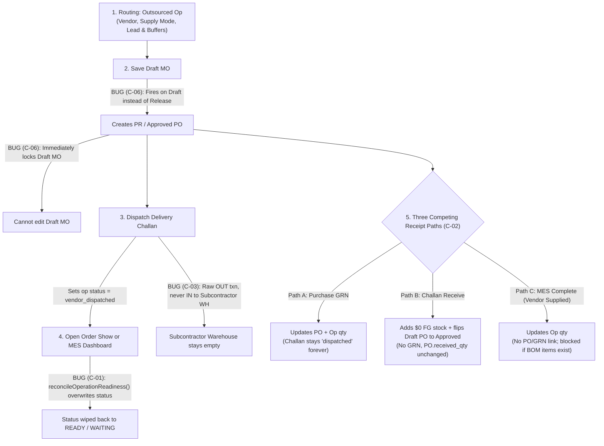
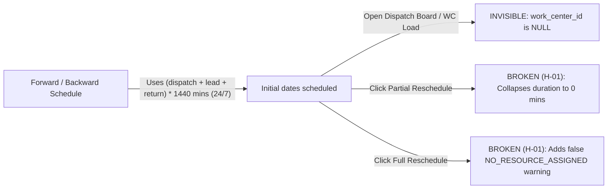
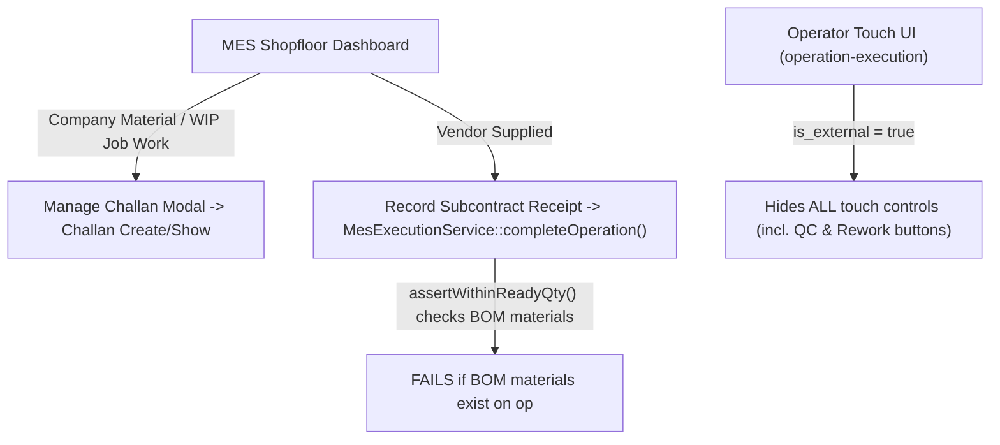
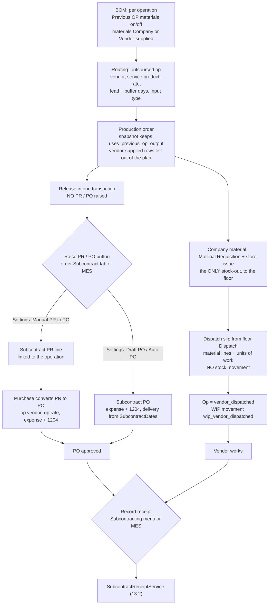
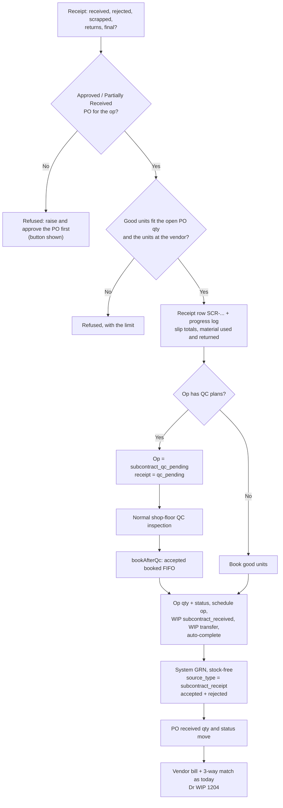
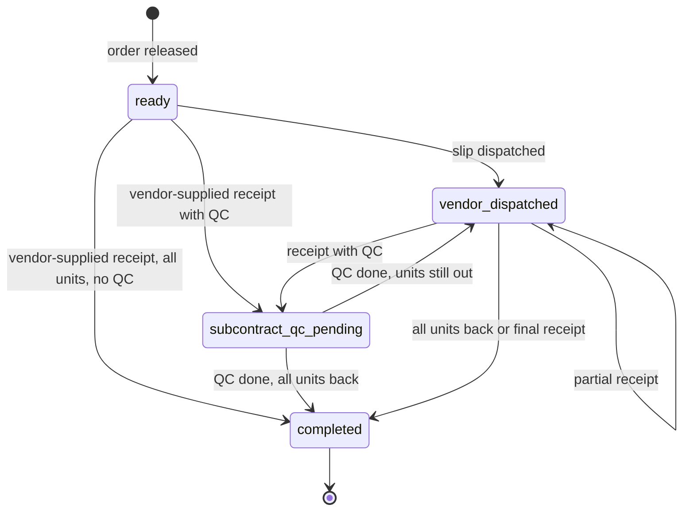
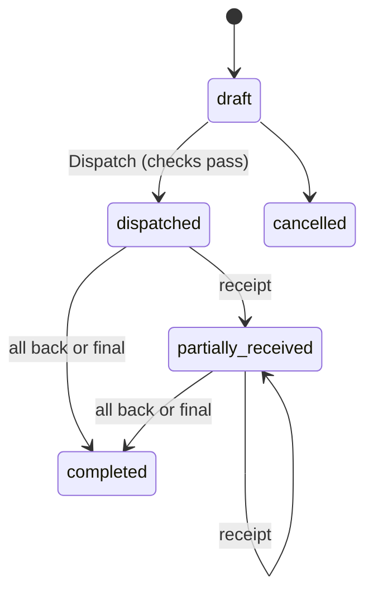

# Sub-Contracting Module — End-to-End Audit & Architecture Guide

- **Audit Date:** 2026-11-26
- **Scope:** Full read-only code & UI audit of Sub-Contracting across Routing, BOM, MRP, Production Orders, Procurement (PR/PO/GRN), Delivery Challans, Readiness, Scheduling, Capacity/Dispatch Board, Shop-Floor (MES), WIP, Quality/Rework, Costing, Accounting (GL), Analytics, Settings, Import/Export, API, and RBAC.
- **Complements:** [`docs/production_module_audit_2026-11-23.md`](production_module_audit_2026-11-23.md) (which marked *"subcontract flows end-to-end"* as Not Covered) and [`app/Domains/Production/docs/SUBCONTRACTING_GUIDE.md`](../app/Domains/Production/docs/SUBCONTRACTING_GUIDE.md).
- **Status:** Documentation only — **no application code, migrations, or database changes have been made.**
- **Fact-check 2026-11-27:**
  - every finding was traced in the current code; corrections are in **section 8** and missed issues in **section 9**
  - the user's decisions (verbatim) are in **section 10** and the resulting target flow in **section 11**
  - read sections 8–11 together with sections 1–7: where they differ, sections 8–11 win
  - the `SUBCONTRACTING_GUIDE.md` linked above does not exist (`app/Domains/Production/docs/` has no such file)

---

## 1. Plain-Language Summary (How Sub-Contracting Works)

Sub-contracting lets your factory send part (or all) of a Production Order's work to an external vendor:

1. **Routing Setup:** On a Routing, you mark an operation as **Outsourced (`is_external = true`)**, choose the **Vendor**, set how many days it takes (`Lead Time + Dispatch/Return Buffers`), set **Cost / Unit**, link a **Service Product**, and pick how materials are handled:
   - **Vendor Supplied (`vendor_supplied`):** The vendor provides their own materials and delivers finished work.
   - **Company Supplied (`company_supplied` + `bom_raw_materials`):** You send raw materials from your warehouse to the vendor via a **Delivery Challan (Gate Pass)**.
   - **Previous Op WIP Job Work (`previous_operation_wip`):** Your factory completes earlier step(s) in-house, sends that semi-finished **WIP** to the vendor via a Delivery Challan, and brings it back for subsequent steps or final receipt.
2. **Production Order & Procurement:** When an order is released, the system should generate a **Purchase Requisition (PR)** or **Purchase Order (PO)** for the vendor's service charge based on tenant policy (`manual_pr_po`, `auto_draft_po`, `auto_approved_po`), dispatch materials/WIP if needed, receive finished goods back via **GRN + Quality Check**, and update **WIP, Stock, Scheduling, and Accounting**.

### Why It Currently Breaks (The Core Problem)
Architecturally, all four production models (`pure_manufacturing`, `subcontract_complete`, `subcontract_company_material`, `hybrid`) exist in the schema and UI, **but the execution lifecycle is split across three uncoordinated receipt engines**, while a page-load readiness check wipes out vendor-dispatched statuses and inventory/accounting hooks bypass the subcontractor warehouse and WIP GL accounts.

---

## 2. Intended vs. Actual End-to-End Flow

### A. Routing & Cost Definition
- **UI:** `resources/views/modules/production/routing/create.blade.php` & `edit.blade.php`
- **DTO & Validation:** `app/Domains/Production/DTO/RoutingOperationDTO.php`, `app/Domains/Production/Requests/Concerns/ValidatesRoutingOperations.php`
- **Costing:** `app/Domains/Production/Services/RoutingOperationCostCalculator.php` (`L144`) computes:
  $$\text{cost\_per\_unit} = \text{round}(\text{subcontract\_cost\_per\_unit} \times \tfrac{100}{\text{yield}}, 4)$$
  and skips `setup_cost_per_run`.
- **Order Model Classification:** `ProductionOrder::determineProductionModelFromOperations()` (`L445-L470`) sets `effective_production_model` to `hybrid`, `subcontract_complete`, or `subcontract_company_material`.

### B. Procurement Policy Modes
Configured in `ProductionSettingsController` (`app/Domains/Production/Controllers/ProductionSettingsController.php`) and resolved by `SubcontractProcurementPolicyResolver`:
- `manual_pr_po`: Intended to create PR on MO release (or manual button), then Purchase converts PR → PO.
- `auto_draft_po`: Skips PR and creates a Draft Subcontract PO.
- `auto_approved_po`: Creates an Approved PO automatically if `quantity * unitCost <= subcontract_auto_approval_limit` (falls back to Draft PO if exceeded).

---

## 3. How Sub-Contracting Affects Scheduling & Capacity

| Area | Behavior & Impact | Source |
| :--- | :--- | :--- |
| **Forward & Backward Scheduling** | `generateForwardSchedule()` (`L424`) and `generateBackwardSchedule()` (`L624`) calculate duration as `(dispatch_buffer_days + subcontract_lead_time_days + return_buffer_days) * 1440` minutes. Because `work_center_id` is `null`, `addWorkingMinutes()` (`L1751-1760`) treats this as 24/7 calendar time, ignoring factory shifts/holidays. | `app/Domains/Production/Services/SchedulingService.php` |
| **Dispatch Board & WC Capacity** | `getDispatchBoardData()` (`L30-195`) only builds lanes for `WorkCenter -> machines / batches`, and `getWorkCenterCapacity()` (`L605-607`) returns `0.0` for external ops. Outsourced ops are invisible on the Dispatch Board, Calendar, and WC View. | `app/Domains/Production/Services/CapacityPlanningService.php` |
| **Reschedule & Partial Reschedule** | Neither `reschedule()` (`L791-898`) nor `partialReschedule()` (`L2760-2919`) checks `is_external`. `reschedule()` triggers `allocateOperationSlot()` -> false `NO_RESOURCE_ASSIGNED` warning. `partialReschedule()` calls `calculateOperationTimes()` -> returns **`0` minutes**, wiping out multi-day vendor lead times and setting `resource_id = 'WorkCenter_'`. | `app/Domains/Production/Services/SchedulingService.php` |
| **What-If Scenarios** | Scenarios pass `work_center_id = null` into `addWorkingMinutes()`, modeling vendor lead times on 24/7 time without vendor calendars or capacity constraints. | `app/Domains/Production/Services/ProductionScheduleScenarioService.php` |
| **Planning Exceptions** | `evaluateSubcontractDelayVector()` (`L567-591`) checks `subcontract_lead_time_days ?: 3`, ignoring `dispatch_buffer_days`, `return_buffer_days`, and `DeliveryChallan.expected_return_date`. `evaluateLateSupplyVector()` (`L118`, `L336`, `L346`) queries invalid PO statuses (`issued`, `confirmed`, `partially_received`) and `expected_delivery_date`. | `app/Domains/Production/Services/PlanningExceptionService.php` |

---

## 4. How Sub-Contracting Affects Shop-Floor (MES) & WIP

- **Start & Progress Log:** `MesExecutionService::startOperation()` (`L49-51`) and `ProductionExecutionService::logProgress()` (`L73-75`) block `is_external` operations.
- **MES Complete Contradiction:** `MesExecutionService::completeOperation()` (`L509-510`) explicitly permits `is_external` operations in `ready`/`running` state, wired to the **"Record Subcontract Receipt"** modal on `mes/dashboard.blade.php` (`L626-632`, `L1163-1265`). Completing via MES updates operation quantities and WIP **without** updating `PurchaseOrderItem.received_qty` or creating a `GoodsReceiptNote` (breaking 3-way match). Meanwhile, `mes/operator/operation-execution.blade.php` (`L302`, `L347`) hides all controls and states execution is strictly Procurement/GRN-driven.
- **WIP Transfers:** When a predecessor in-house op finishes, `ProductionWipService::evaluateAndExecuteWipTransfers()` (`L960-980`) moves the next external op from `waiting` to `ready` and calls `SubcontractProcurementOrchestrator::generateSubcontractRequisition()`.
- **Quality & Rework:** `QualityInspectionService::approveInspection()` (`L250-265`) invokes `SubcontractReceiptOrchestrator::processQcApproval()`. On rejection, `MesController::recordDisposition()` (`L558-625`) creates a `ProductionReworkOrder`, a `ProductionOrderRework` (`status = 'in_progress'`), and a `DC-RWK-...` Return Gate Pass via `SubcontractMaterialBalanceService::createReworkChallan()`.

---

## 5. Screen-by-Screen Matrix

| Screen / View | What It Shows / Does | Gaps & Bugs on Screen | Source |
| :--- | :--- | :--- | :--- |
| **Routing Create / Edit** | Outsourced checkbox, Vendor, Supply Type, Processing Mode (`bom_raw_materials` / `previous_operation_wip`), Lead Time, Cost/Unit, Service Product, Dispatch/Return Buffers; JS calculates `cost_per_unit * (100/yield)`. | Unchecking `is_external` fails to reset `material_supply_type` / `subcontract_input_type`. `previous_operation_wip` leaves `material_supply_type` select hidden but still submitted. | `resources/views/modules/production/routing/edit.blade.php` |
| **Routing Show** | `Outsourced` badge, Vendor name, `Subcontract Cost` in sidebar summary. | Does not show Lead Time, Buffers, Supply Type, Processing Mode, or Service Product on operation rows. | `resources/views/modules/production/routing/show.blade.php` |
| **BOM Create / Show** | `bom_type = 'subcontracting'`; `Outsourced` badge on linked routing preview. | `ProductionCostService` excludes subcontract cost from BOM `calculateRoutingCost` and `calculateTotalManufacturingCost` (shows `$0`). | `app/Domains/Production/Services/ProductionCostService.php` |
| **MRP & Production Plans** | Explodes BOM material needs. | `MrpEngineService` ignores `is_external`, `vendor_id`, `subcontract_lead_time_days`, and `subcontract_cost_per_unit` when snapshotting plan ops and computing MRP cost. | `app/Domains/Production/Services/MrpEngineService.php` |
| **Production Orders Index** | `Hybrid`/`Subcontract`, `Company Material`/`Vendor Material`, `Vendor Missing`, `QC Pending`, `Overdue` badges. | `Overdue` badge hardcodes `actual_start_time < now()->subDays(3)`. `orders.create` / `edit` have no subcontract visibility. | `resources/views/modules/production/orders/index.blade.php` |
| **Order Show (`vtab-subcontract`)** | Model card, Authoritative Cost, Vendor WIP card, Outsourced Ops table (PR, PO, Lead/Buffers, Dates, Qty/QC, Cost, Generate PR), Material Balance table. | Vendor WIP (`L975`), `$atVendorQty` (`L1018`), `$qcPending` (`L1022`) read `quantity_available` instead of `available_quantity` (always `0.00`). Dates use `$order->start_date` (`L1024-1026`). PR query misses `Op #` (`L1011`). WIP Job Work excluded from Material Balance (`L1199`). | `resources/views/modules/production/orders/show.blade.php` |
| **Order Show (Readiness / Ops / Tracking)** | Readiness column shows `Subcontracted`/`Not subcontracted`. Ops tab shows PO/Challan badges and `Subcontract` tab link. | Readiness dimension is a hardcoded stub (`READY`). Tracking drawer links only to Challans index (`L372`), not the operation's challan or PR action. | `resources/views/modules/production/orders/partials/*.blade.php` |
| **Production Dashboard** | Subcontract SLA strip + 9 pipeline tiles + Vendor Delay critical alert + OTD %. | Backed by `getSubcontractDashboardMetrics()`, whose status filters miss `vendor_dispatched` and rework `in_progress`. | `app/Domains/Production/Repositories/ProductionOrderRepository.php` |
| **Schedules (`show`, `dispatch-board`, `calendar`, `work-center-view`)** | `schedules/show` renders `SUBCONTRACT` badge, vendor, lead time, and buffers. | `dispatch-board`, `calendar`, and `work-center-view` have **zero** subcontract lanes/badges; external ops vanish from Dispatch Board. | `resources/views/modules/production/schedules/show.blade.php` |
| **MES Dashboard** | Purple highlight; `Manage Challan` or `Record Subcontract Receipt` (`vendor_supplied`); `Run QC`; `Rework/Scrap`. | `Record Subcontract Receipt` posts to `mes.complete`, bypassing PO/GRN and failing on `assertWithinReadyQty` if BOM materials exist. | `resources/views/modules/production/mes/dashboard.blade.php` |
| **Operator Touch UI** | `operation-execution` shows PR/PO/Dispatch/Return/Qty/QC/View PO banner; hides touch controls. | `operator/dashboard` & `my-operations` have zero subcontract awareness. `operation-execution` hides QC/Rework buttons (`L347`), reads wrong PR/WIP/dates. | `resources/views/modules/production/mes/operator/operation-execution.blade.php` |
| **Delivery Challans (`index`, `create`, `show`, `print`)** | CRUD, stock/WIP check UI, Dispatch Gate Pass, PDF print, Receive modal. | `create` pre-fills all `$order->bom->items` instead of op-scoped materials/remaining qty. No link to PO/GRN. | `resources/views/modules/production/subcontract/challans/*.blade.php` |
| **Subcontract Analytics** | KPI cards (OTD %, Delay, Quality, Cost Variance, WIP Value, Material Risk), Vendor Scorecard, Delayed Ops, Automation breakdown. | No RBAC permission check; skewed by `SubcontractPerformanceService` WIP/cost/automation calculation bugs. | `resources/views/modules/production/subcontract/analytics/index.blade.php` |
| **Subcontract Settings** | Configures `manual_pr_po`, `auto_draft_po`, `auto_approved_po`, and auto-approval limit. | UI states procurement triggers on **MO Release**, whereas code triggers on **Draft MO save**. | `resources/views/modules/production/settings/index.blade.php` |
| **Purchase (`PR`, `PO`, `GRN`, `Bills`)** | Subcontract badges on PR/PO/GRN; Processed WIP vs Final Output banner on GRN show. | PR `pending-items` attributes all ops' pending items to the 1st external op's vendor. PO/GRN show no Delivery Challan linkage. | `resources/views/modules/purchase/` |

---

## 6. Complete Audit Findings (20 Verified Issues)

### Critical Findings

| ID | Issue | Exact Location & Technical Detail |
| :--- | :--- | :--- |
| **C-01** | **`reconcileOperationReadiness()` overwrites `vendor_dispatched` status on page load** | [`ProductionOrderService.php#L2679-L2688`](../app/Domains/Production/Services/ProductionOrderService.php#L2679-L2688) skips `completed`, `skipped`, `cancelled`, `running`, `paused`, and `subcontract_qc_pending` — **not `vendor_dispatched`** (nor `'failed'`). Because [`ProductionOrderController::show()`](../app/Domains/Production/Controllers/ProductionOrderController.php#L256), [`MesController::dashboard()`](../app/Domains/Production/Controllers/MesController.php#L106), and [`MesController::operatorDashboard()`](../app/Domains/Production/Controllers/MesController.php#L791) call `reconcileOperationReadiness()` on every load, `'vendor_dispatched'` is immediately overwritten back to `'ready'` or `'waiting'`. |
| **C-02** | **Three competing, unsynchronized receipt engines** | 1) **GRN Approval** (`SubcontractReceiptOrchestrator`) never closes `DeliveryChallan` and adds gross `$receivedQty` (not `$acceptedQty`) to `quantity_produced` (`L117`). 2) **Challan Receive** (`SubcontractMaterialBalanceService::processReceiveActions`) never creates a GRN or updates `PurchaseOrderItem.received_qty`, yet directly flips `'Draft'` POs to `'Approved'` (`L484-486`). 3) **MES Complete** (`MesExecutionService::completeOperation`, `L509-510`) updates op/WIP without touching PO or GRN. Executing both GRN + Challan double-counts output, backflushes twice, and transfers WIP twice. |
| **C-03** | **Subcontract backflush deducts from an empty warehouse & records \$0 FG inflows** | `processDispatchActions()` ([`SubcontractMaterialBalanceService.php#L268-L292`](../app/Domains/Production/Services/SubcontractMaterialBalanceService.php#L268-L292)) writes raw `'OUT'` `StockTransaction` (`unit_cost = 0`) bypassing `StockService::recordOutflow()` and `reserved_qty`, and **never transfers stock INTO a `subcontractor` warehouse**. `backflushCompanyMaterial()` (`L94-150`) then tries to deduct from `type = 'subcontractor'`, ignores `$alreadyBackflushed` (`L132`), and loops all BOM `operationMaterials`. `processReceiveActions()` (`L335-345`) also calls `StockService::recordInflow()` on `$order->product_id` at `unitCost = 0` even on intermediate ops. |
| **C-04** | **Broken General Ledger (GL) accounting integration** | [`PostProductionConsumptionJournal.php#L35-L41`](../app/Domains/Accounting/Listeners/PostProductionConsumptionJournal.php#L35-L41) only posts `Dr WIP (1204) / Cr Inventory` for `reference_type === 'Production Material Issue'`. Neither `DeliveryChallan` dispatches nor `SubcontractBackflush` (`L145`) post to GL. Meanwhile, [`PostPurchaseBillJournal.php#L119-L166`](../app/Domains/Accounting/Listeners/PostPurchaseBillJournal.php#L119-L166) posts subcontract service bills to Purchase Expense or direct Inventory, never to WIP `1204`. |
| **C-05** | **Silent mass-assignment data loss on progress logs** | [`SubcontractProcurementOrchestrator.php`](../app/Domains/Production/Services/SubcontractProcurementOrchestrator.php) (`L66-76`, `L140-150`) writes `quantity_completed`, `status`, `log_type`, and `logged_by` to `ProductionOrderProgressLog`, none of which are in `ProductionOrderProgressLog::$fillable` (`L13-30`). |
| **C-06** | **Auto-procurement fires on Draft MO save & contradicts settings** | [`ProductionOrderService.php`](../app/Domains/Production/Services/ProductionOrderService.php) calls `orchestrateSubcontractProcurement()` during Draft creation (`L167`, `L575`, `L2408-2416`, `L2513-2521`), immediately locking the Draft MO against edits in `assertPlanCanBeRebuilt()` (`L766-779`). Even in `manual_pr_po` mode, `SubcontractProcurementOrchestrator` (`L86-88`) auto-creates a PR. `SubcontractProcurementPolicyResolver` (`L28`) also falls back `serviceProductId` to the FG `$order->product_id` if `subcontract_service_product_id` is null. |
| **C-07** | **Challan state-machine & tenant-validation gaps** | [`SubcontractDeliveryChallanController.php`](../app/Domains/Production/Controllers/SubcontractDeliveryChallanController.php): `receive()` (`L416`) only blocks `completed` (allowing **receiving `'draft'` challans**); `store()` (`L199-215`, `L252`) lacks tenant-scoped `exists:` rules and op-to-order validation. [`DeliveryChallanPolicy::dispatch()`](../app/Domains/Production/Policies/DeliveryChallanPolicy.php) (`L52`) only blocks `'dispatched'`, allowing `'completed'` challans to be re-dispatched. `processReceiveActions()` (`L478`) marks challans `'completed'` on the first receipt, breaking partial deliveries. |

### High Findings

| ID | Issue | Exact Location & Technical Detail |
| :--- | :--- | :--- |
| **H-01** | **`reschedule()` & `partialReschedule()` break external ops** | [`SchedulingService.php`](../app/Domains/Production/Services/SchedulingService.php) (`L791-898`, `L2760-2919`) omits `is_external` checks: `reschedule()` adds false `NO_RESOURCE_ASSIGNED` warnings; `partialReschedule()` calls `calculateOperationTimes()`, collapsing external duration to **`0` minutes** and writing `resource_id = 'WorkCenter_'`. |
| **H-02** | **Dispatch/return buffers ignored in PO, Challan, Exceptions & UI** | Orchestrator PO `delivery_date` (`L99-132`) and Challan `expected_return_date` (`challans/create.blade.php#L106`) ignore `dispatch_buffer_days` and `return_buffer_days`. `orders/show.blade.php` (`L1024-1026`) and `operation-execution.blade.php` (`L290-292`) derive dates from `$order->start_date` instead of scheduled op dates. `PlanningExceptionService::evaluateLateSupplyVector()` (`L118`, `L336`, `L346`) queries non-existent PO statuses (`issued`, `confirmed`, `partially_received`) and `expected_delivery_date`. |
| **H-03** | **Readiness is a stub for subcontracting, yet blocks `vendor_supplied` on material checks** | [`ProductionReadinessService.php#L1498-L1517`](../app/Domains/Production/Services/ProductionReadinessService.php#L1498-L1517) (`evaluateSubcontractDimension`) always returns `STATUS_READY` (`ready_qty = $orderQty`), ignoring PO/Challan/vendor state. Meanwhile, `evaluateMaterialDimensionPooled()` and `assertWithinReadyQty()` (`L524-735`) do not exempt `vendor_supplied` ops, blocking MES receipt if BOM materials exist. |
| **H-04** | **Multiple outsourced ops on one order collide** | Fallback PR check (`SubcontractProcurementOrchestrator#L190-198`), `PurchaseRequisitionRepository::getPendingItemsData()` (`L179-192`), `SubcontractMaterialBalanceService::getMaterialBalance()` (`L16-71`), `SubcontractReceiptOrchestrator::processQcApproval()` (`L242-244` + `L220` `max()` instead of `+=`), and `orders/show.blade.php` (`L1011-1014`) all query `->first()` or order-level IDs, mixing up Op #10 and Op #20. |
| **H-05** | **Order Cancel & Delete orphan open subcontract documents** | [`ProductionOrderService.php`](../app/Domains/Production/Services/ProductionOrderService.php) `cancel()` (`L1062-1132`) and `delete()` (`L1161-1195`) never check or block on dispatched `DeliveryChallan` records, open subcontract POs, or PRs. |
| **H-06** | **Vendor WIP displays `0.00` on Order Show & Touch UI** | [`orders/show.blade.php#L975`](../resources/views/modules/production/orders/show.blade.php#L975) (`L1018`, `L1022`) and [`operation-execution.blade.php#L282-L288`](../resources/views/modules/production/mes/operator/operation-execution.blade.php#L282-L288) sum `quantity_available` instead of [`ProductionWip::$available_quantity`](../app/Domains/Production/Models/ProductionWip.php#L31), and compare `current_routing_operation_id` against `$op->id` instead of `$op->routing_operation_id`. |
| **H-07** | **Challan `create()` pre-fills whole BOM & ignores prior dispatches** | [`SubcontractDeliveryChallanController.php#L106-L135`](../app/Domains/Production/Controllers/SubcontractDeliveryChallanController.php#L106-L135) pre-fills all `$order->bom->items` instead of operation-scoped materials minus already-dispatched qty. WIP job-work `getAvailableWipForOperation()` (`L371-402`) ignores QC holds, scrap, and `ProductionWipService::getAvailableInputWip()`. |
| **H-08** | **Dashboard KPIs & Subcontract Analytics miscalculate metrics** | [`ProductionOrderRepository::getSubcontractDashboardMetrics()`](../app/Domains/Production/Repositories/ProductionOrderRepository.php#L63-L128) queries wrong statuses (`at_vendor` misses `vendor_dispatched`; `vendor_rework` queries `pending` instead of `in_progress`; `vendor_delayed` hardcodes 3 days). [`SubcontractPerformanceService`](../app/Domains/Production/Services/SubcontractPerformanceService.php) double-counts WIP value across ops (`L334-336`), uses hardcoded `$10.0` fallback (`L342`), omits yield in cost metrics (`L255`), and misclassifies `manual_pr_po` vs `auto_draft_po` (`L400-440`). |

### Medium & Low Findings

| ID | Issue | Exact Location & Technical Detail |
| :--- | :--- | :--- |
| **M-01** | **Missing RBAC & tenant/order checks** | `subcontract.analytics` in [`web.php#L72`](../app/Domains/Production/Routes/web.php#L72) and [`SubcontractAnalyticsController`](../app/Domains/Production/Controllers/SubcontractAnalyticsController.php) (plus `menu.php`) have no permission check. [`ProductionOrderController::generateSubcontractPr()`](../app/Domains/Production/Controllers/ProductionOrderController.php#L991-L1004) doesn't verify `$operation->production_order_id === $order->id`. [`MesController::operationExecution()`](../app/Domains/Production/Controllers/MesController.php#L940) lacks `tenant_id` scoping. |
| **M-02** | **Routing validator blind spots (`RT-ISSUE-01`)** | [`ValidatesRoutingOperations.php#L200-L216`](../app/Domains/Production/Requests/Concerns/ValidatesRoutingOperations.php#L200-L216) does not verify `vendor_id` / `subcontract_service_product_id` tenant ownership or active status, allows `previous_operation_wip` on the first entry op, and doesn't sync `operation_type = 'outsourcing'` with `is_external`. |
| **M-03** | **Yield factor discrepancy** | `RoutingOperationCostCalculator` (`L144`) applies `* (100 / yield)`, whereas `ProductionCostService::calculateSubcontractCost()` (`L191`) and `SubcontractProcurementPolicyResolver` (`L29-31`) omit yield. |
| **M-04** | **Routing API, Export & Excel Import omit subcontract fields** | `routes/api.php` has zero subcontract/challan endpoints; `RoutingDetailResource` omits `subcontract_input_type` and `totals.subcontract_cost_per_unit`; [`RoutingTemplate.php`](../app/Exports/RoutingTemplate.php), [`RoutingExport.php`](../app/Exports/RoutingExport.php), and [`ProductionMasterImportService.php`](../app/Domains/Production/Services/ProductionMasterImportService.php#L524-L555) drop `material_supply_type`, `subcontract_input_type`, `subcontract_lead_time_days`, `dispatch_buffer_days`, `return_buffer_days`, and `subcontract_service_product_id`. |
| **M-05** | **Shopfloor QC diverges from Approval QC & uses unlisted status** | [`QualityInspectionService::processShopfloorInspection()`](../app/Domains/Production/Services/QualityInspectionService.php#L377-L465) skips `SubcontractReceiptOrchestrator::processQcApproval()` and hardcodes NCR `category => 'process'`. On failure, `processQcApproval()` (`L276`) sets `$op->status = 'failed'`, which is not in `ProductionOrderOperation::STATUSES`. |

---

## 7. Recommended Remediation Phases & Open Decisions

1. **Phase 1 — State Machine & Draft Safety:** Protect `'vendor_dispatched'` in `reconcileOperationReadiness()`, move procurement orchestration out of Draft MO save into `release()`, guard MO `cancel()`/`delete()` against open Challans/POs, and close `ValidatesRoutingOperations` tenant/mode gaps.
2. **Phase 2 — Unified Receipt, Inventory & GL:** Consolidate GRN, Challan Receive, and MES Receipt into one authoritative pipeline; transfer dispatched stock into `subcontractor` warehouse via `StockService`; post `SubcontractBackflush` and subcontract vendor bills to WIP (`1204`).
3. **Phase 3 — Scheduling, Readiness & Shop-Floor:** Fix `reschedule()`/`partialReschedule()` external duration preservation, repair `PlanningExceptionService` PO queries, implement real subcontract readiness, exempt `vendor_supplied` from company material blocks, and unify MES Dashboard vs. Touch UI behavior.
4. **Phase 4 — Views, Analytics, Import/Export & RBAC:** Fix `available_quantity` and multi-op queries across Blade views, repair `getSubcontractDashboardMetrics()` & `SubcontractPerformanceService`, add RBAC to Analytics, and complete Routing Excel/API fields.

### Open Business Decisions to Confirm Before Implementing
1. Should **Purchase GRN Approval** be the single inward receipt trigger (with Challan Receive delegating to GRN or redirecting to GRN)?
2. Should `vendor_supplied` operations be received **strictly via PO → GRN** (disabling MES completion for external ops), or should MES receipt auto-generate a GRN?
3. Should Delivery Challan dispatch perform a real **Stock Transfer (`Main Store` → `Subcontractor Warehouse`)** so backflush and GL `1204` reconcile automatically?
4. Should external operations render on a dedicated **"Outsourced Vendors"** lane on the **Dispatch Board**?

---

## 8. Fact-check of sections 1–7 (2026-11-27, traced in the current code)

**Status words:**
- **Open:** not fixed.
- **Applied:** coded, not yet checked by the user.
- **Verified:** checked by the user (only the user writes it).

**Verdict words:**
- **CONFIRMED:** the doc is right.
- **PARTLY:** the core holds, but details are wrong.
- **WRONG:** the claim does not hold.

| ID | Verdict | Correction / addition | Status |
|---|---|---|---|
| Header | WRONG link | `app/Domains/Production/docs/SUBCONTRACTING_GUIDE.md` does not exist. | Open |
| C-01 | CONFIRMED, wider | The overwrite also runs every 5 minutes through the scheduled `production:reconcile-readiness` (`routes/console.php` 40-42). It also runs after MES complete, QC, WIP transfer, GRN receipt, scheduling and `release()`. A `'failed'` status is overwritten too. | Open |
| C-02 | CONFIRMED | GRN adds the gross received quantity to the **operation's** `quantity_produced`. Double counting and double backflush are confirmed; "transfers WIP twice" was not proven. | Open |
| C-03 | PARTLY | **Not silent:** backflush from the never-filled subcontractor warehouse throws "Insufficient stock" (`StockService::recordOutflow` 561-565), so the challan receipt or QC approval rolls back. With no subcontractor warehouse it silently consumes nothing. **FG inflow:** skipped for WIP job work, but posted for every `bom_raw_materials` external operation, intermediate ones included. | Open |
| C-04 | CONFIRMED, exact | The challan dispatch fires **no stock event at all** (raw insert, value 0). Subcontract bills post **Dr Inventory**, not Purchase Expense: the PO line has no `line_type`, so it defaults to `'stock'`. | Open |
| C-05 | CONFIRMED, wider | None of the 4 keys is a column of `production_order_progress_logs`. Adding them to `$fillable` would raise SQL errors, so they must be mapped (`logged_by` → `recorded_by`, `quantity_completed` → `quantity_produced`). The same dropped keys are in `SubcontractMaterialBalanceService` (3 places) and `SubcontractReceiptOrchestrator`. | Open |
| C-06 | PARTLY | **Lines:** the direct calls are at 338, 1835, 2411 and 2516; L167/L575 only call `snapshotPlannedOperations`. `release()` calls it too (870-876). **Lock:** only plan rebuilds are blocked; header edits still save. **Manual mode:** the PR matches the Settings text; the bug is the timing (draft save instead of release). | Open |
| C-07 | CONFIRMED | **Tenant:** the `exists:` rules ignore tenant scopes, but `ProductionOrderOperation::find` *is* tenant-scoped. **Real gaps:** operation-to-order, operation is external, vendor match, MO status. **Re-dispatch:** a completed challan can be dispatched again, deducting stock again and resetting the operation. | Open |
| H-01 | PARTLY | `reschedule()` keeps the stored duration; only the false NO_RESOURCE_ASSIGNED warning is real. `partialReschedule` gives 0 minutes only when the operation has no planned times. **L605-607 is in `getDailyLoad()`, not `getWorkCenterCapacity()`, which actually counts external lead days as work-centre load.** Backward scheduling misses `isOutsourced()`. The dispatch board method runs L30-301. | Open |
| H-02 | PARTLY | **Views:** `orders/show` and the touch UI *do* apply the buffers, but anchor on the order start date. **PO:** `delivery_date` starts from `now()`. **PO statuses** are Title Case (`Draft`, `Approved`, `Partially Received`, `Completed`, `Cancelled`) and the column is `delivery_date`. **The late-supply check can never fire:** Carbon 3 `diffInDays` is signed, and POs are not filtered to the order. | Open |
| H-03 | CONFIRMED | **Lines:** `evaluateSubcontractDimension` is at 1502-1517, `assertWithinReadyQty` at 524-572, the pooled check at 599-772. **By design:** the subcontract dimension is information only (UR-04). **`company_supplied` blocked too:** challan dispatch never updates reservations. | Open |
| H-04 | CONFIRMED | The same `->first()` / `max()` pattern is in 10+ more places. `max()` at L220 is a partial-QC accumulation bug. | Open |
| H-05 | CONFIRMED | Reuse the PO/PR check already in `assertPlanCanBeRebuilt()`. | Open |
| H-06 | CONFIRMED | — | Open |
| H-07 | CONFIRMED | A WIP job-work draft counts against itself, because `dispatched_wip_qty` is saved at draft. | Open |
| H-08 | CONFIRMED | `material_exceptions` is really the at-vendor count. Fix rework with `whereIn(['pending', 'in_progress'])`, because `logRework` still writes `'pending'`. | Open |
| M-01 | PARTLY | **True:** analytics and `generateSubcontractPr`. **Defence-in-depth only:** `MesController::operationExecution` *is* tenant-scoped by the global scope. **Addition:** the analytics controller falls back to tenant `?? 1`. | Open |
| M-02 | PARTLY | **Wrong part:** vendor and service-product tenant ownership **is** checked (`tenantExists`). **Still true:** no active / service-type check, `previous_operation_wip` allowed on the first operation, and the API does not sync `operation_type`. | Open |
| M-03 | CONFIRMED | `calculateTotalManufacturingCost` also leaves out `scrap_adjustment`. | Open |
| M-04 | CONFIRMED | `RoutingExport` also drops vendor code and cost, so exported external operations can't be re-imported. | Open |
| M-05 | CONFIRMED | **Lines:** now 327-491 (NCR at L459 / L663). **Effect:** shopfloor inspections are created already `approved`, so `processQcApproval` never runs. A partial acceptance leaves the operation stuck in `subcontract_qc_pending`. | Open |
| §4–5 | mostly CONFIRMED | **Routing edit:** the subcontract fields are `disabled` when not external, so nothing wrong is saved through the form. **Touch UI:** hides the touch panel, not all controls. **`determineProductionModelFromOperations`:** *computes* the model; the stored `production_model` is set in `ProductionOrderService`. | Open |

## 9. Issues sections 1–7 miss (2026-11-27)

| ID | Issue | Status |
|---|---|---|
| N-01 | Challan dispatch is a raw OUT at ₹0: no FIFO, no reservation release, no stock event, and nothing is put into the subcontractor warehouse. | Open |
| N-02 | Backflush from that empty warehouse throws. On the GRN path the GRN stays saved (the listener runs after commit) while the production update fails. | Open |
| N-03 | Backflush runs twice (on receipt and again on QC pass), takes every BOM material, and ignores `$alreadyBackflushed`. It also runs for WIP job work, because the routing form saves `company_supplied` even for `previous_operation_wip`. | Open |
| N-04 | FG inflow at ₹0 drags the moving-average cost down. FG is credited at an intermediate operation and again when the order completes. | Open |
| N-05 | GRN subcontract lines skip stock, but the bill debits Inventory: the ledger shows inventory that doesn't exist. | Open |
| N-06 | `calculateSubcontractCost` raises MySQL error 1242 when an order has 2+ external operations. It also includes cancelled POs. | Open |
| N-07 | Challan scrap is reset to 0 when the order page is viewed (`reconcileOperationQuantities`). | Open |
| N-08 | The QC-pending log stores the received quantity, and the WIP transfer counts it before acceptance. | Open |
| N-09 | `processQcApproval` treats `partially_passed` as failed, uses `max()` instead of adding, and its `'failed'` status is overwritten (C-01). | Open |
| N-10 | MES complete is allowed from READY, which is exactly the state C-01 produces. | Open |
| N-11 | Challan remarks over 255 characters cause an SQL error that rolls back the receipt. | Open |
| N-12 | `ProductionOrderOperation::STATUSES` is not enforced; `vendor_dispatched` and `subcontract_qc_pending` are not in it. | Open |
| N-13 | A WIP transfer raises a PR whatever the policy (a PR next to an auto PO). | Open |
| N-14 | The duplicate-PR check `LIKE "%Op #1%"` also matches Op #10. Its fallback returns any PR of the order, and cancelled PRs come back as "generated". | Open |
| N-15 | PR→PO conversion links the first external operation, takes the product's preferred vendor (not the operation's), and its rate uses `unit_cost ?? estimated_cost` (₹0 wins). Duplicate Draft POs are possible. Editing a Draft PO deletes the operation link (`PurchaseOrderService::updateOrder` 291-341). The PR line has no `production_order_operation_id`. | Open |
| N-16 | The screens show "Awaiting PR / PO" even when documents exist: they check `source_type` 'ProductionOrder' while PRs are saved as `'mo'`, and `$poItem->purchaseOrder` doesn't exist (the relation is `order()`). | Open |
| N-17 | Challan receipt approves a Draft PO by writing its status directly, skipping the approval workflow and the PR `ordered_qty` sync. | Open |
| N-18 | The default lead time is 0 / 1 / 3 / 3 / 7 days depending on the screen, and the PO date starts from `now()`. | Open |
| N-19 | Rework challans are created already `dispatched`, with no stock check, and go through the full receipt again (FG inflow plus backflush). | Open |
| N-20 | Challan store and dispatch don't check MO status, that the operation is external, or the vendor. Material balance "sent" is order-wide, so another operation's challan can block completion. `SubcontractReturn` / `SubcontractScrap` are never written. | Open |
| N-21 | `getWorkCenterCapacity` counts external lead days as work-centre load. | Open |
| N-22 | `reschedule()` ignores operation dependencies. `partialReschedule()` marks the first pending operation READY no matter what. | Open |
| N-23 | The planning late-supply check can never fire (signed `diffInDays`, wrong PO statuses). | Open |
| N-24 | `release()` has no transaction, so a failure leaves a released order with partial side effects. | Open |
| N-25 | MRP snapshots alternative operations too. | Open |
| N-26 | Routing export → import loses external operations (vendor and cost dropped). | Open |
| N-27 | The plan, reservation, Material Requisition, issue and readiness code never look at `material_supply_type` or WIP job work. Vendor-supplied materials are planned and requestable, and they block readiness until issued. | Open |
| N-28 | The store-side issue (`MaterialRequestService::issue`, reference "Production Order") posts **no GL entry and no WIP cost**. Only the order-screen issue posts Dr WIP 1204. This affects **all** production orders. | Open |
| N-29 | Only a GRN updates `purchase_order_items.received_qty` and the PO status (`GoodsReceiptNoteService` 219-246). The vendor bill form needs a GRN, and a PO-only bill (API) is checked 2-way against the ordered quantity. `AutoCreateVendorBillOnGrnApproved` exists but is not registered. | Open |
| N-30 | Automatic PR/PO creation runs at `ProductionOrderService` 338, 875, 1835, 2411 and 2516, and at `ProductionWipService` 965-971. The only button ("Generate PR", order Subcontract tab) always makes a PR; there is no PO button and no MES button. | Open |

## 10. User decisions (verbatim log)

| # | Question | Answer (verbatim) | Effect |
|---|---|---|---|
| D-1 | Which path is the single receipt? | "Keep all, sync them" | **Replaced by SC-02.** |
| D-2 | How `vendor_supplied` is received | "MES receipt makes a GRN" | **Replaced by SC-02 / SC-03.** |
| D-3 | Dispatch stock handling | "we need to dicusses this in details, as In some cases, those goods would have been direct. Please request me in the material requisition. While in some cases the materials do not exist as those are WIP and we do not exactly track of WIP product. So we will need to handle this case carefully and with a detailed discussion." | Discussed through D-3a and SC-01. |
| D-3a | How company material leaves the store | "We need to check. I'm not sure what happens when. There is a contract. And how much is requested. So we need to first check that and then we will decide how the things are going to get handled." | Traced (N-27, N-28), then answered by SC-01. |
| D-3b | How much WIP a challan may send | no preference given | **Open.** |
| D-3c | Is the vendor's holding a visible, valued balance? | no preference given | **Open.** Largely covered by the dispatch-slip tracking in SC-01. |
| D-4 | When PR/PO is raised | "only on button from order screen and MES floor, This in further but yeah those what it should be linked." | **No automatic PR/PO.** Raised by a button on the order screen and on the MES floor; button details later. |
| SC-01 | Materials of outsourced operations, per mode | see the full quote below | Target flow in section 11. |
| SC-02 | Receipt only from the Subcontracting menu and the shop floor? | "Yes, only menu + floor" | The Purchase GRN screen is not used for subcontract work. |
| SC-03 | How do the PO and the vendor bill stay in step? | "System GRN behind it" | Every menu or floor receipt creates a stock-free system GRN with the accepted quantity. PO, bill and 3-way match work as today. |
| SC-04 | Work comes back and no approved PO exists yet | no preference given | **Open.** Proposal: block with a button to raise the PR/PO. |
| SC-05 | Which operations use "Previous OP materials" | "Dependent: on, changeable, But parallel OPS can also use." | On by default for dependent operations, can be unticked; parallel operations may use it too. |

**SC-01 (verbatim):**

> It will be simple. Go and track and then update. While creating at the bomb level, This will improve for other operations also currently per operation it says no material required or used
> Instant we will update. To give an option of. Previous OP Materials. And this will be by default selected. For those operations that. Are dependent on their previous operations.
> So any operation using the material. The previous operation is by default dependent on the previous operation, so only those operations that are independent of the previous operations will be able to select this option.
> This makes our vendor tracking also easy if raw materials will be submitted at this place. Then it means vendor uses those raw materials and the flow will request those materials from the store. It will be kept. At the production floor. And then a separate dispatch slip can be generated from the. Dispatch option once the materials get are received. So this will again generate a interlinking. And hence we can track this materials through those dispatch slips that which material stays at which vendor.
> And for them cases where vendors its own materials. We will show in the bomb also. That window uses its own material and then that. Material or you can say when. We will give it a term. Then that material will be the. Material accordingly can be set accordingly in the bowl and other places and then. Also accordingly.
> Show for material received. We will not use purchase GRN. For material receipt, those material can either be received from the subcontracting menu. Or from the shop floor. As they are going to directly received on the shop floor.
>
> Also tell me how does this impact the PO and PR processes?

The 4 open business decisions in section 7 are answered by D-1..D-4 and SC-01..SC-05; the Dispatch Board lane (question 4) is still open.

## 11. Target subcontract flow (from SC-01..SC-05; coded 2026-11-27 — see sections 12–13)

| # | Rule | Source | Status |
|---|---|---|---|
| TF-01 | **BOM:** every operation gets a **"Previous OP materials"** option (the operation works on the previous operation's output). It is on by default for operations that depend on the previous one and can be unticked; parallel operations may use it too. The operation can still carry raw materials. | SC-01, SC-05 | Applied 2026-11-27 |
| TF-02 | **BOM, outsourced operation:** materials the vendor brings are marked with a term still to name (e.g. "Vendor-supplied"). They are shown in the BOM and elsewhere, but are not requested from the store and never block readiness. | SC-01 | **Replaced 2026-11-28** (see §14) |
| TF-03 | **Company material for the vendor:** raw materials on an outsourced operation are requested through the normal Material Requisition and issued to the production floor. The store issue is the **only** stock-out. | SC-01 | Applied 2026-11-27 |
| TF-04 | **Dispatch slip:** a Delivery Challan is made from a floor "Dispatch" option, from the material issued for that operation (plus the previous operation's output for WIP job work). **No second stock deduction.** The slip records which material or WIP is at which vendor, against which operation. | SC-01 | Applied 2026-11-27 |
| TF-05 | **PR/PO by button only** (order screen and MES floor), linked to the operation, with the operation's vendor and subcontract rate. Every automatic path is removed (draft save, release, WIP transfer, auto-PO modes). | D-4 | **Replaced 2026-11-28** (see §14) |
| TF-06 | **Receipt only from the Subcontracting menu or the shop floor.** Each receipt creates a stock-free **system GRN** with the accepted quantity. It moves the PO's received quantity and status, and the bill and 3-way match work from it. The system GRN must not re-run the production receipt (no double count). | SC-02, SC-03 | **Replaced 2026-11-28** (see §14) |
| TF-07 | The subcontract bill posts as a service / WIP cost, not Inventory (subcontract PO lines get a non-stock `line_type`). | follows SC-03 | **Replaced 2026-11-28** (see §14) |
| TF-08 | **No backflush at receipt** (the material was already issued). The receipt records consumed / returned / scrapped against the dispatch slip, and unused material comes back to the floor or store. | follows SC-01 | Applied 2026-11-27 |
| TF-09 | **No FG stock** at an intermediate outsourced operation; FG enters only through the order's normal finished-goods receipt. | follows SC-01 | Applied 2026-11-27 |
| TF-10 | **QC on receipt** works as for an in-house operation (the operation's QC plans, accepted quantity only). | proposal | Applied 2026-11-27 |
| TF-11 | **Receipt with no approved PO:** blocked, with a button to raise the PR/PO. | SC-04 | **Replaced 2026-11-28** (see §14) |

**Still open:**
- D-3b
- D-3c
- SC-04
- the name of the vendor-supplied term
- N-28: should the store-side issue post Dr WIP 1204 (affects all orders)?
- the over-receipt rule (GRN refuses more than the PO quantity, MES allows +20%)
- the Dispatch Board lane

**Seeder follow-up (after the code changes):** the test data needs job-work vendors, one service product per outsourced operation, and outsourced routing operations in each mode (vendor-supplied, company material, previous-operation WIP). Recorded later in `docs/production_seeder_audit_2026-11-26.md`.

## 12. Implementation log (2026-11-27; user said "apply all the changes … tell me everything")

Status of every line: **Applied** (coded, `php -l` clean, not run or tested by me). Only the user writes Verified.

**Done so far:**
- **Phase 1**
  - 6 automatic PR/PO triggers removed (`ProductionOrderService` ×5, `ProductionWipService` ×1).
  - C-01: `reconcileOperationReadiness` skips `vendor_dispatched` / `subcontract_qc_pending`.
  - N-12: statuses added to `ProductionOrderOperation::STATUSES`.
  - N-24: `release()` runs in one transaction.
  - H-05: cancel and delete are guarded by `assertNoOpenSubcontractDocuments`.
- **Purchase**
  - N-15: PR line → operation link; PR→PO uses the operation's vendor and rate, a separate subcontract PO, and `line_type` expense + account 1204.
  - PO edit keeps the production links.
  - SC-02: the GRN screen refuses subcontract lines.
  - SC-03: system GRN `source_type`, and the listener skips system GRNs.
- **Data**
  - Migration `2026_11_27_100000_subcontract_flow_rework.php`.
  - New model `ProductionSubcontractReceipt`.
  - Challan statuses and quantity fields.
- **Services**
  - `SubcontractMaterialBalanceService` rewritten: no stock movement on dispatch, dispatch checks, material use at receipt, rework slip.
  - New `SubcontractReceiptService`: the one receipt, no-PO block, system GRN, QC hand-off.
  - New `SubcontractDates`.
  - QC hook in `QualityInspectionService::processShopfloorInspection`.
  - Legacy `SubcontractReceiptOrchestrator`: no backflush, no `failed` status, partial passes add up.
- **Phase 2/3: button, dispatch, receipt**
  - `SubcontractProcurementOrchestrator` rewritten:
    - button only; follows Settings (PR / Draft PO / auto-approved PO)
    - one document per operation; cancelled ones never count
    - setup errors are shown, not swallowed
    - service product required (no FG fallback)
    - PO line is expense + 1204; PO date from `SubcontractDates`
  - "Raise PR / PO" on the order screen (`orders.generate-subcontract-pr`, M-01 ownership check) and on the MES floor (`mes.subcontract-procure`).
  - MES `completeOperation` refuses outsourced operations (N-10).
  - New `mes.subcontract-receive` route and modal. The MES dashboard shows Raise PR / PO, Dispatch, Record subcontract receipt and the "Partly received" badge.
  - Dispatch slip screens (`challans/create`, `show`) rewritten:
    - lines come from the BOM
    - units of work sent
    - sent / used / returned / at vendor
    - the receipts list with the system GRN
  - `SubcontractDeliveryChallanController` rewritten:
    - tenant-scoped validation
    - operation / vendor / order checks
    - receive goes through the receipt service
  - `DeliveryChallanPolicy`: dispatch only a draft; receive only while the slip is at the vendor.
  - The repository stores the units sent, line type and required quantity.
  - `orders/show` Subcontract tab:
    - H-06: units at vendor from the slips
    - N-16: PR / PO per operation
    - H-02: dates from `SubcontractDates`
    - "Raise PR / PO" label
    - material balance per material
  - The touch UI `operation-execution` gets the same fixes.
- **Phase 4: BOM**
  - Migration columns `production_boms.operation_input_flags` and `production_routing_operation_materials.supplied_by`.
  - BOM form:
    - "Previous OP materials" switch per operation (default on for dependent operations; parallel operations may tick it; the first operation cannot)
    - "Vendor-supplied" switch on material rows of outsourced operations
    - the "no material" notice reads "Uses the previous operation's output" when the switch is on
  - DTOs, validation, save, copy and BOM show updated.
  - The order snapshot copies `uses_previous_op_output`.
  - N-27: vendor-supplied materials are left out of the plan (`ProductionOrderEngineeringService::isVendorSuppliedAllocation`) and out of `getExpectedComponents` (material resolve, readiness, requests).
- **Phase 5: scheduling, planning, analytics, routing, import/export**
  - `SchedulingService`:
    - `reschedule()` and `partialReschedule()` (forward and backward): an outsourced operation runs from its start for buffers + lead days in working time, with no false "no resource" warning
    - resource key `Vendor_<id>` for outsourced operations without a work centre
    - backward scheduling also checks `isOutsourced()`
  - `CapacityPlanningService::getWorkCenterCapacity`: outsourced operations no longer count as work-centre load (N-21).
  - `PlanningExceptionService`:
    - late supply: real PO statuses (`Approved` / `Partially Received`), the `delivery_date` column, only POs for this order or its planned materials, positive day count (N-23, H-02)
    - subcontract delay: due date from the slip at the vendor, else `SubcontractDates`; positive day count
  - `ProductionOrderRepository::getSubcontractDashboardMetrics` (H-08):
    - awaiting PR/PO = open outsourced operations of live orders with no PO
    - ready for dispatch = not vendor-supplied, nothing at the vendor
    - at vendor / delayed / partly received = from dispatch slips (expected-back date, not a fixed 3 days)
    - rework = `pending` + `in_progress`
    - material exceptions = closed slips whose material was not fully accounted for
  - `SubcontractPerformanceService` (H-08):
    - vendor WIP = units on slips at the vendor; value per unit from the order's WIP card, read once per order; no ₹10 fallback
    - delivery: first real slip's dispatch and expected-back dates; signed Carbon diff fixed; planned days = buffers + lead
    - cost: yield applied; all bill lines added up
    - "auto-approval skipped" notes matched case-insensitively
  - `SubcontractAnalyticsController` (M-01): `authorize('viewAny', DeliveryChallan)`; `require_tenant_id()` (no tenant 1 fallback).
  - `ProductionCostService::calculateSubcontractCost` (N-06, M-03): `whereIn` (no MySQL 1242), cancelled POs skipped, yield applied, all bill lines added up.
  - `SubcontractProcurementPolicyResolver` (M-03): PO rate = rate × 100 ÷ yield %; the PO quantity stays the output target, so good units close the PO.
  - Routing (M-02):
    - validator refuses an inactive vendor, a non-service or inactive service product, and "previous operation WIP" on the first operation
    - `RoutingOperationDTO`: an outsourced operation is always saved as type `outsourcing` (web and API)
  - Routing import/export (M-04, N-26):
    - export adds vendor code, subcontract cost (active currency), supply type, input type, lead and buffer days, service product SKU
    - the template adds the same columns, plus a sample outsourced row
    - the import reads, checks and saves them
    - `RoutingDetailResource` adds `subcontract_input_type` and `totals.subcontract_cost_per_unit`
  - `MrpEngineService` (N-25): alternative operations are no longer snapshotted into the plan.
  - Orders list: "Overdue" = a slip at the vendor past its expected-back date (or vendor-supplied work past the `SubcontractDates` date), not "started more than 3 days ago".
  - Purchase GRN screen (SC-02): subcontract lines are left out of the pending list, the PO picker and the line loader.
  - Production Settings: the procurement-mode text now says the **Raise PR / PO** button creates the document (nothing is automatic).
  - `PurchaseRequisitionRepository::getPendingItemsData` (H-04): the subcontract line is tied to its own operation (PR line link, else a unique service product, else an exact "Op #N" match), not the order's first outsourced operation.

### 12.1 Status per finding (2026-11-27)

| ID | Status | Note |
|---|---|---|
| C-01 | Applied | Also: the legacy QC path no longer writes `failed`. |
| C-02 | Applied | One receipt service; the GRN path is blocked and system GRNs are skipped by the listener. |
| C-03 | Applied | No stock on dispatch, no backflush, no FG at receipt. |
| C-04 | Applied | Material GL stays at the store issue; subcontract PO lines are expense + 1204. |
| C-05 | Applied | Progress logs use real columns. |
| C-06 | Applied | Button only. |
| C-07 | Applied | — |
| H-01 | Applied | N-22 (dependencies in `reschedule`) is still open. |
| H-02 | Applied | — |
| H-03 | Partly | Vendor-supplied no longer blocks. Company material still has to be issued before receipt (TF-03, by design). The subcontract readiness dimension stays information-only (UR-04). |
| H-04 | Partly | Fixed: PR line, PR→PO, pending list, PO edit, QC adds up. The other `->first()` spots were not each re-audited. |
| H-05 | Applied | — |
| H-06 | Applied | — |
| H-07 | Applied | — |
| H-08 | Applied | — |
| M-01 | Applied | `MesController::operationExecution` left as is: the global tenant scope already covers it. |
| M-02 | Applied | — |
| M-03 | Partly | Fixed for subcontract cost (routing, order, analytics, PO). **Open:** `calculateTotalManufacturingCost` still leaves out `scrap_adjustment`; changing it moves every BOM total. |
| M-04 | Partly | Export, template, import and the API resource are done. **Open:** no API endpoints for subcontract / slips. |
| M-05 | Applied | — |
| N-01 – N-06 | Applied | — |
| N-07 | Applied | The receipt writes vendor scrap into the progress log, which the reconcile keeps (max of scrap rows vs log). |
| N-08 – N-19 | Applied | — |
| N-20 | Partly | Checks done, and "sent" is per operation. Returns and scrap are kept on the slip lines; the `SubcontractReturn` / `SubcontractScrap` tables are still not written. |
| N-21, N-23 – N-27 | Applied | — |
| N-22 | **Open** | Not changed. |
| N-28 | **Open** | Store-side issue GL: affects all orders; your decision. |
| N-29 | Applied | System GRN. **Open:** `AutoCreateVendorBillOnGrnApproved` is still not registered (not touched). |
| N-30 | Applied | — |

### 12.2 Assumptions (my reading of your decisions; please check)

- **A-01 "Previous OP materials" default:** on when the operation has a previous operation and is not parallel. It can be ticked on a parallel operation, and cannot be set on the first operation.
- **A-02 Vendor term:** the term is **"Vendor-supplied"** (`supplied_by = vendor`). The switch shows only on material rows of outsourced operations. An operation whose routing mode is `vendor_supplied` treats **all** its materials as vendor-supplied.
- **A-03 Units of work:** a dispatch slip carries "units of work sent". For WIP job work, that is what the vendor can return. For company material only, it is still the cap for units received on that slip.
- **A-04 How much WIP a slip can send (D-3b, no preference given):** the previous operation's produced quantity − units already on sent slips for this operation (drafts and rework slips don't count).
- **A-05 Vendor holding (D-3c, no preference given):** tracked on the slip, per material: sent − used − returned − scrapped. It is **not** a separate valued stock balance.
- **A-06 Material use:** at each receipt, material used = units processed × company material per unit, capped at what is still at the vendor. Returns are entered on the receipt and move **no stock**: material comes back to the floor where it was issued.
- **A-07 SC-04 (no preference given):** a receipt is refused unless an **Approved** or **Partially Received** PO exists for the operation. The screen shows the Raise PR / PO button.
- **A-08 Over-receipt:** units received (good + rejected + scrapped) can never exceed what is still open on the PO, net of receipts waiting for QC, nor the units still at the vendor on the slip. The old +20% MES allowance does not apply to subcontract receipts. A **rework** slip coming back skips the PO check, because the work was already ordered once.
- **A-09 QC:** if the operation has QC plans, the receipt waits as "QC pending". The normal shop-floor inspection then books the accepted quantity and creates the system GRN; rejects go to the GRN as rejected.
- **A-10 Rejected / scrapped at receipt:** both go to the system GRN's rejected quantity, so the vendor is not paid for them through the 3-way match.
- **A-11 Yield on the PO:** rate × 100 ÷ yield % per good unit, so the PO amount matches the routing's subcontract cost.
- **A-12 Who may see subcontract analytics:** anyone who may view dispatch slips (no new permission row added).
- **A-13 Vendor-supplied with no slip:** the receipt is recorded straight against the operation; there is nothing to dispatch.

### 12.3 Decisions I took on my own (not asked)

- **O-01** The dispatch slip has a **draft** stage: create as draft or dispatch at once. Only a draft can be dispatched; a dispatched slip is never re-dispatched.
- **O-02** New slip statuses `partially_received` and `completed`. A slip is completed when every unit came back, or when the receipt is ticked **final** (the rest is treated as not coming back).
- **O-03** New table `production_subcontract_receipts` (number `SCR-YYYYMM-####`): one row per receipt, linking the slip, the progress log and the system GRN.
- **O-04** Cancel and delete of an order are blocked while a slip is at the vendor, a subcontract PO is open, or a subcontract PR is not fully ordered.
- **O-05** MES "Complete" is refused for outsourced operations; they are finished only by receipts.
- **O-06** The legacy `SubcontractReceiptOrchestrator` and the GRN listener are kept for old data, but skip system GRNs and no longer backflush.
- **O-07** Analytics WIP value uses the order's WIP card value per unit. If the order has no WIP card, it uses the product's unit cost; there is no made-up ₹10.
- **O-08** In the orders list, a vendor-supplied operation with a PO is "Overdue" once the `SubcontractDates` date has passed.
- **O-09** The routing import treats blank subcontract columns as the form defaults (`company_supplied`, `bom_raw_materials`, 0 days).
- **O-10** **Other modules touched** (each change is additive and limited to subcontract lines):
  - Purchase: GRN service and screen, PR service and repository, PO service, GRN and PR item models
  - Accounting: none

### 12.4 Not done / still open

- **N-28:** should the store-side issue post Dr WIP 1204? (affects all orders)
- **N-22:** `reschedule()` dependency order.
- **M-03 rest:** `scrap_adjustment` in the BOM total.
- **M-04 rest:** no API endpoints for subcontract / slips.
- `AutoCreateVendorBillOnGrnApproved` is not registered.
- **Dispatch Board:** no vendor lane.
- **Seeders:** subcontract test data comes next, when you ask.
- **Migration** `2026_11_27_100000_subcontract_flow_rework` must be run: `php artisan migrate`.
- Nothing has been run, tested or committed.

## 13. New subcontract flow (as coded 2026-11-27)

### 13.1 End to end

### 13.2 Receipt, QC and system GRN

### 13.3 Operation and slip states

The readiness reconcile never overwrites `vendor_dispatched` or `subcontract_qc_pending`.

### 13.4 What each document does now

| Document | Stock | GL | PO / Bill |
|---|---|---|---|
| Material Requisition + order-screen issue | OUT of store | Dr WIP 1204 (unchanged) | — |
| Store-side issue | OUT of store | none (**N-28 open**) | — |
| Dispatch slip | none | none | — |
| Subcontract receipt | none (FG only through the order's normal FG receipt) | none | creates the system GRN |
| System GRN | none | none | PO received qty and status |
| Vendor bill | — | Dr WIP 1204 (expense line, account 1204) | 3-way match on the system GRN |

## 14. Simplified flow (2026-11-28) — replaces parts of §10–13

Dictated by the user and logged verbatim in `docs/production_ui_rules_review_2026-11-27.md` (SF-1..SF-5). Status: **Applied 2026-11-28** (not run or tested).

| Area | Rule now |
|---|---|
| Routing | Outsourced op = Vendor · Dispatch time · Processing time · Receipt time (days + hours, stored as hours, calendar time, ⓘ hints). No supply type, processing mode, rate or service product. Leaves our floor at op start; back = start + dispatch + processing + receipt. |
| BOM | Outsourced op: "Previous OP materials" tick + "Vendor-supplied materials" tick (op level) + material rows (always ours). At least one is required. The per-row vendor switch (TF-02 / A-02) is gone. |
| PR / PO | None. D-4, TF-05, TF-07 and the procurement setting are removed. |
| Dispatch | Only when something of ours goes (rows or previous output). Buttons redirect to the slip page. |
| Receipt | Receipt page (MES redirects, no popup). Writes a stock-free GRN without a PO (`source_type subcontract_receipt`). Qty typed by the user, ≤ units still at the vendor (no slip: ≤ op target still open); rejects → rework slip or scrap; returned / lost leftovers; partial receipts + "final". No PO check (TF-11 / SC-04 / A-07 replaced). |
| Vendor bill (interim) | "Create vendor bill" on the receipt → Service Bill pre-filled, head "Job Work" → account 5034 Job Work Charges. Order cost and analytics read job-work cost from bills linked to receipt GRNs. |
| Cost | Outsourced ops cost ₹0 in routing / BOM ("charged on vendor bill"). |
| Still open | GST job-work items, N-22, N-28, scrap_adjustment, API endpoints, Dispatch Board lane. |
