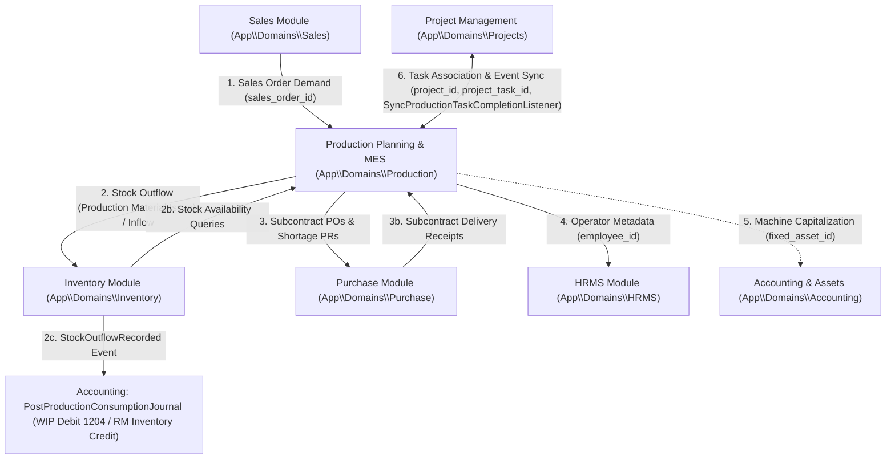
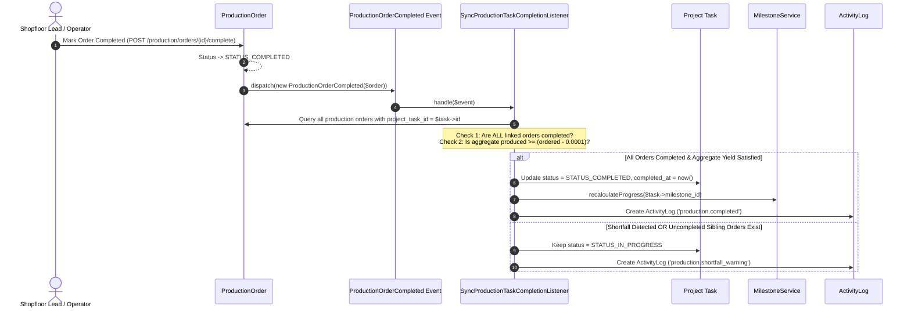

# Production Module — ERP Cross-Module Integrations

> **Module:** Production Planning & MES (`wm-product-saas`)  
> **Target Document:** `docs/user-manuals/production/INTEGRATIONS.md`  
> **Audience:** Technical Architects, Integration Developers, Systems Analysts  
> **Standards:** Implementation-Verified Inter-Module Touchpoints

---

## 1. ERP Integration Topology

The Production module acts as the core manufacturing engine within the multi-tenant ERP suite. It interfaces with six adjacent functional domains while maintaining strict architectural boundaries.



---

## 2. Integration with Inventory Domain (`App\Domains\Inventory`)

The Inventory domain is Production's primary operational partner. All physical warehouse inventory movements flow through `App\Domains\Inventory\Services\StockService`. Direct SQL manipulation of warehouse stock tables from Production is strictly prohibited.

### 2.1 Raw Material Reservation
* **Trigger:** Creation of a `ProductionOrder` or approval of a `ProductionPlan`.
* **Participating Entities:** `ProductionOrderReservation`, `ProductWarehouseStock`.
* **Mechanism:** Net component requirements are computed from the BOM. The system inserts `ProductionOrderReservation` records. This creates a soft reservation that decrements available-to-promise inventory while leaving physical `on_hand` unchanged until actual issuance.

### 2.2 Raw Material Issuance (Outflow & Accounting Event)
* **Trigger:** Storekeeper executes **Issue Material** on `/production/orders/{order}/issue` via `ProductionMaterialService::issueMaterial()`.
* **Service Invocation:**
  ```php
  $transaction = \App\Domains\Inventory\Services\StockService::recordOutflow(
      $res->tenant_id,
      $res->product_id,
      $warehouseId,
      $quantity,
      'Production Material Issue',
      $res->production_order_id
  );
  ```
* **Database & Accounting Impact:**
  * Inserts record into `stock_transactions` (`type = 'OUT'`, `reference_type = 'Production Material Issue'`, `reference_id = $order->id`, `total_value = quantity * unit_cost`).
  * Decrements physical `on_hand` count in `product_warehouse_stocks`.
  * Increments issued quantity in `production_order_issues` and updates reservation status.
  * Dispatches `App\Domains\Inventory\Events\StockOutflowRecorded($transaction)`.
  * **Automatic General Ledger Posting:** Listened to by `App\Domains\Accounting\Listeners\PostProductionConsumptionJournal`. Automatically posts a double-entry journal:
    * **Debit:** Work-in-Progress Account (`fallbackCode = '1204'`, Asset).
    * **Credit:** Raw Material Inventory Account (`AccountResolverService::resolveInventoryAccount($product)`).
    * **Journal Source:** `Journal::SOURCE_PRODUCTION` (`'production'`).
    * **Idempotency Key:** `reference_type = 'stock_transaction'`, `reference_id = $transaction->id`.

### 2.3 Operational Scrap Outflow
* **Trigger:** Operator logs operational scrap on `/production/mes/{op}/scrap`.
* **Mechanism:** If material was already issued from stores to the shopfloor, `StockService::recordOutflow()` writes down the damaged quantity to process scrap. Intermediate WIP scrap does not deduct warehouse finished goods stock because intermediate WIP has not yet been received into inventory.

### 2.4 Finished Goods Intake (Inflow)
* **Trigger:** Final operation completion or order completion (`receiveFinishedGoods()`).
* **Service Invocation:**
  ```php
  app(\App\Domains\Inventory\Services\StockService::class)->recordInflow(
      $tenantId,
      $order->product_id,
      $destinationWarehouseId,
      $quantityProduced,
      "Production Receipt #{$order->order_number}",
      $order->id
  );
  ```
* **Database Impact:**
  * Inserts record into `stock_transactions` (`type = 'inflow'`).
  * Increments `product_warehouse_stocks.on_hand` in the destination finished goods warehouse.
  * Creates `ProductionOrderReceipt` record.
* **Quarantine Handling:** If quality inspection indicates `quarantine`, the system automatically substitutes the commercial warehouse with the designated plant quarantine warehouse (`quarantine_warehouse_id`).

---

## 3. Integration with Purchase Domain (`App\Domains\Purchase`)

### 3.1 MRP Shortage to Purchase Requisition
* **Trigger:** Planner runs MRP on `/production/plans/{plan}/run-mrp` and selects **Generate PR**.
* **Participating Entities:** `production_plan_requirements`, `purchase_requisitions`, `purchase_requisition_items`.
* **Mechanism:** Net shortages calculate gross BOM requirement minus on-hand inventory. The system maps missing items into a new Purchase Requisition in `draft` state, notifying the purchasing department to initiate supplier RFQs.

### 3.2 Subcontract Procurement Automation
* **Trigger:** Production Order release containing a subcontract routing operation (`is_subcontract = true`).
* **Orchestrator:** `App\Domains\Production\Services\SubcontractProcurementOrchestrator`.
* **Policy Resolver:** `SubcontractProcurementPolicyResolver`.
* **Workflow Logic:**
  ```mermaid
  flowchart TD
      Rel["Release Order with Subcontract Operation"] --> Policy{"Evaluate Policy & Threshold"}
      Policy --> |Mode: auto_approved_po & Total <= Limit| AutoPO["Generate Approved PurchaseOrder"]
      Policy --> |Mode: auto_draft_po OR Total > Limit| DraftPO["Generate Draft PurchaseOrder (Review Required)"]
      Policy --> |Mode: manual_pr_po| PR["Generate PurchaseRequisition (Manual PO Flow)"]
  ```
* **Database Impact:**
  * Populates `purchase_orders` and `purchase_order_items`.
  * Populates `production_order_operations.purchase_order_id` and `purchase_order_item_id`.
  * Reconciles external vendor costs against planned routing expenses.

---

## 4. Integration with Sales Domain (`App\Domains\Sales`)

### 4.1 Make-to-Order Demand Links
* **Foreign Key:** `production_orders.sales_order_id` and `production_plans.sales_order_id`.
* **Business Purpose:** Directly links manufacturing work orders to the customer sales order that initiated the demand.
* **Data Flow:**
  * Customer order code is displayed on shopfloor travelers and dispatch boards.
  * When the production order completes, sales dispatchers can view ready-to-ship finished goods linked directly to their customer order ID.

### 4.2 Customer Traceability Traversal
* **Service:** `LotTraceabilityService`.
* **Mechanism:** In the event of an upstream supplier quality defect, the graph traversal engine follows:
  `Raw Supplier Lot` → `Production Issue` → `Production Batch` → `Production Order` → `Sales Order (sales_orders)` → `Customer (customers)`.
  Enables targeted customer notifications rather than broad, costly product recalls.

---

## 5. Integration with Accounting Domain (`App\Domains\Accounting`)

### 5.1 Fixed Asset Linking
* **Foreign Key:** `machines.fixed_asset_id` (references `fixed_assets.id`).
* **Business Purpose:** Capital equipment on the factory floor (presses, CNC machines, injection molders) is linked to capitalized balance sheet assets. This enables depreciation records in Accounting to correlate with machine operating hours and maintenance cost history in Production.

### 5.2 Manufacturing Costing & General Ledger Integration

* **Trace of Production Transactions to the General Ledger:**

| Transaction / Action | Domain Service | Event Dispatched | Downstream GL Impact | Automated Journal Details |
| :--- | :--- | :--- | :--- | :--- |
| **Raw Material Issue** (`/production/orders/{id}/issue`) | `ProductionMaterialService::issueMaterial` | `StockOutflowRecorded` (`reference_type = 'Production Material Issue'`) | **Automated GL Journal** | **Dr. WIP (1204)**<br>**Cr. Raw Material Inventory**<br>Source: `production`, idempotent by `stock_transaction_id` via `PostProductionConsumptionJournal`. |
| **Finished Goods Receipt** (`receiveFinishedGoods`) | `StockService::recordInflow` | None (`reference_type = 'Production Receipt'`) | Valuation & Stock Updated | Updates `product_warehouse_stocks` on-hand quantity & weighted average cost. **No automated GL journal entry** is triggered directly; FG capitalization is handled via periodic inventory valuation adjustments. |
| **Operational Scrap Logging** (`/mes/{op}/scrap`) | `StockService::recordOutflow` | `StockOutflowRecorded` (`reference_type = 'Production Scrap'`) | Stock Deducted Only | Process scrap deducts inventory. Skipped by `PostProductionConsumptionJournal` (only handles `Production Material Issue`) and `PostCogsJournal`. |
| **Maintenance Spare Parts Issue** (`issueSparePart` or Store Queue) | `StockService::recordOutflow` | `StockOutflowRecorded` (`reference_type = 'MaintenanceWorkOrder'`) | Stock Deducted & MWO Cost Updated | Updates `spare_parts_cost` and `total_cost` on `production_maintenance_work_orders`. Does not post a GL journal directly. |
| **Subcontract PO Execution** | `SubcontractProcurementOrchestrator` | Purchase Order Events | Handled via Purchase / AP | Purchase invoices against subcontract POs follow standard Accounts Payable voucher workflows. |

* **Cost Aggregation within Production:**
  * Direct material consumption cost, standard labor run cost, machine overhead rate, subcontract fees, and manual cost adjustments (`production_cost_adjustments`) are aggregated and stored on `production_orders`.
  * Failure handling: If WIP or Inventory chart-of-accounts are not configured, `PostProductionConsumptionJournal` logs a warning and stores the error in `PostingFailureRecorder` without crashing the shopfloor issuance transaction.

---

## 6. Integration with HRMS Domain (`App\Domains\HRMS`)

### 6.1 Operator Assignment & Skill Verification
* **Identifier:** `production_operator_assignments.operator_id` (maps to `App\Domains\HRMS\Models\Employee.id`).
* **Code Identifier:** `CodeService` formats operator barcodes as `OPR:{employee_id}` using `Employee.employee_id`.
* **Business Rule:** Before an operator is assigned to a high-precision work center, `OperatorSkillController` verifies that the employee possesses the required skill certifications in `production_operator_skills`.

---

## 7. Integration with Project Management Domain (`App\Domains\Projects`)

### 7.1 Relationship & Data Flow Architecture
The Production module integrates with the Project Management domain to support project-driven manufacturing (Make-to-Project), linking physical shopfloor execution directly to project delivery milestones and operational tasks.

* **Database Association:** Migration `2026_10_03_000003_add_project_links_to_production_orders_table.php` established indexed foreign keys on `production_orders`:
  * `project_id`: Nullable foreign key constrained to `projects.id` (`nullOnDelete`).
  * `project_milestone_id`: Nullable foreign key constrained to `project_milestones.id` (`nullOnDelete`).
  * `project_task_id`: Nullable foreign key constrained to `project_tasks.id` (`nullOnDelete`).
  * Composite indexes: `production_orders_tenant_project_idx` (`['tenant_id', 'project_id']`) and `production_orders_tenant_task_idx` (`['tenant_id', 'project_task_id']`).
* **Eloquent Relationships:** `App\Domains\Production\Models\ProductionOrder` defines:
  ```php
  public function project(): BelongsTo
  {
      return $this->belongsTo(\App\Domains\Projects\Models\Project::class, 'project_id');
  }

  public function projectMilestone(): BelongsTo
  {
      return $this->belongsTo(\App\Domains\Projects\Models\Milestone::class, 'project_milestone_id');
  }

  public function projectTask(): BelongsTo
  {
      return $this->belongsTo(\App\Domains\Projects\Models\Task::class, 'project_task_id');
  }
  ```
* **Supported Navigation & Creation Directions:**
  1. **Initiation from Project Task Workspace:** In the Project Management workspace, actionable manufacturing tasks display an explicit action button navigating to `/production/orders/create?project_id={id}&project_task_id={id}`.
  2. **Prefilled Context:** The Production Order create screen detects these parameters, renders a "Linked to Project" contextual banner, and preselects the target product and quantity derived from the project task's milestone item.
  3. **Task-Level Direct Linking:** Alternatively, users can link existing production orders to a task via `TaskController::linkProductionOrder` (`POST /tasks/{task}/production-orders`), strictly scoped to the same tenant, company, and branch.
  4. **Reverse Navigation:** Production order list and detail screens (`production.orders.index`, `production.orders.show`) display interactive badges linking directly back to the parent Project workspace and Task card.

### 7.2 Creation, Scoping & Validation Pipeline
Form submission and persistence are protected by multi-layer security and business consistency checks in `StoreProductionOrderRequest`:
* **Tenancy Enforcement:** Verifies that the supplied `project_id`, `project_task_id`, and `project_milestone_id` exist within the active `tenant_id` resolved by `require_tenant_id()`.
* **Structural Hierarchy Validation:** Confirms that the specified `project_task_id` and `project_milestone_id` legitimately belong to the specified `project_id`. Mismatched hierarchy triggers immediate validation errors.
* **Company & Branch Isolation:** Enforces strict boundary isolation between tenant entities. If the project belongs to Company A or Branch X, a Production Order originating under Company B or Branch Y is rejected:
  * Company mismatch error: `projects.company_mismatch_error` ("Project belongs to a different company.").
  * Branch mismatch error: `projects.branch_mismatch_error` ("Project belongs to a different branch.").
* **Persistence & Audit Logging:** In `ProductionOrderService::create()`, when `project_id` is present, the service persists the association and automatically records an audit entry in `project_activity_logs` via `ActivityLogService::record()` with event type `production.created` ("Production Order {order_number} created from Project Task").

### 7.3 Event-Driven Completion Synchronization
Synchronization between shopfloor execution and project delivery is entirely automated through event-driven architecture, avoiding manual double-entry:



* **Canonical Event:** When an order transitions to `STATUS_COMPLETED`, `ProductionOrder::save()` or `ProductionExecutionService` dispatches `App\Domains\Production\Events\ProductionOrderCompleted($order)`.
* **Registered Listener:** `App\Domains\Projects\Listeners\SyncProductionTaskCompletionListener` (registered in `AppServiceProvider.php` line 584) listens for this event.
* **Decoupled Guard:** If the completed order does not have `project_task_id`, the listener returns immediately with zero overhead.
* **Aggregate Yield & Sibling Evaluation:**
  1. The listener queries all `ProductionOrder` records sharing the same `tenant_id` and `project_task_id`.
  2. It evaluates whether **every** linked sibling order has achieved `status === ProductionOrder::STATUS_COMPLETED`.
  3. It aggregates output volume across all linked orders:
     $$\text{Total Ordered} = \sum \text{quantity\_ordered}, \quad \text{Total Produced} = \sum \text{quantity\_produced}$$
  4. It evaluates the aggregate yield satisfaction condition with floating-point tolerance:
     $$\text{Total Ordered} \le 0 \quad \text{OR} \quad \text{Total Produced} \ge (\text{Total Ordered} - 0.0001)$$
* **Successful Task & Milestone Completion:**
  * When all linked orders are completed and aggregate yield is satisfied, the listener updates `Task.status = Task::STATUS_COMPLETED` and stamps `completed_at = now()`.
  * If the task is associated with a milestone (`task->milestone_id`), the listener triggers `MilestoneService::recalculateProgress($task->milestone_id)`, dynamically updating the milestone's overall completion percentage based on completed task weights.
  * Records an audited `ActivityLog` entry (`event_type = 'production.completed'`) capturing total good output, order numbers, and actor metadata.
* **Shortfall & Sibling Order Safeguards:**
  * If sibling production orders remain in progress, or if completed orders experienced quality scrap/rejection resulting in a net yield shortfall ($\text{Total Produced} < \text{Total Ordered} - 0.0001$), the task **safely remains `IN_PROGRESS`**.
  * The listener logs an audited warning in `project_activity_logs` (`event_type = 'production.shortfall_warning'`) detailing the shortfall quantity or open sibling orders, alerting project managers without prematurely closing the delivery scope.

### 7.4 Architectural Invariants & Integration Boundaries
To prevent architectural coupling, the system strictly enforces the following boundaries:
1. **Manufacturing Ownership:** Production is the authoritative domain for Bills of Materials, routings, operations, work centers, machines, operator execution, scrap, and rework. Project Management models never duplicate or bypass manufacturing domain rules.
2. **Standalone Independence:** Production Orders operate completely and reliably without project links. Linking is entirely optional; unlinked discrete orders proceed through planning, execution, and closure without evaluating project listeners.
3. **Downstream Boundaries:** Task completion via production sync does **not** automate billing, invoice creation, revenue recognition, purchase order generation, or inventory dispatch to customers. Invoicing and delivery follow their respective commercial workflows in the Projects, Sales, and Accounting domains.
