# Production Planning & Manufacturing Execution (MES) — Documentation Suite

> **Application:** Multi-Tenant SaaS ERP (`wm-product-saas`)
> **Module:** Production Planning & Shopfloor MES (`app/Domains/Production`)
> **Framework:** Laravel 12 / PHP 8.3 / MySQL / Domain-Driven Design (DDD)
> **Location:** `docs/user-manuals/production/`
> **Verification Status:** Source-Verified & Cross-Document Aligned (October 2026)

---

## 1. Overview & Documentation Index

This directory contains the canonical documentation suite for the **Production Planning & Manufacturing Execution (MES)** module of `wm-product-saas`. The documentation is compiled from an evidence-based audit of active domain models (74 Eloquent models), domain services (79 services), web/API controllers (69 controllers), policies (13 policies), database migrations, and cross-domain integrations (Inventory, Accounting, Purchasing, Sales, HRMS, and Project Management).

| Document | File | Target Audience | Primary Focus & Contents |
|---|---|---|---|
| **End-User Manual** | [`USER_MANUAL.md`](USER_MANUAL.md) | Planners, Operators, Leads, QC | Complete operational handbook: navigation, step-by-step UI actions, fields, statuses, material issuing, MES console, and source-based control checklist. |
| **Developer Manual** | [`DEVELOPER_MANUAL.md`](DEVELOPER_MANUAL.md) | Software Engineers, Architects | 4-layer DDD architecture, model relations, domain services, MRP algorithms, finite scheduling, REST API catalog, and extension points. |
| **Implementation Audit** | [`IMPLEMENTATION_AUDIT.md`](IMPLEMENTATION_AUDIT.md) | Technical Leads, Auditors | Feature-by-feature verification matrix, codebase references, database schema mappings, verified capabilities, and technical boundaries. |
| **Cross-Module Integrations** | [`INTEGRATIONS.md`](INTEGRATIONS.md) | Systems & Integration Engineers | Formal integration contracts with Inventory (`StockService`), Accounting (`PostProductionConsumptionJournal`), Purchasing, Sales, and Project Management. |
| **Manufacturing Workflows** | [`WORKFLOWS.md`](WORKFLOWS.md) | Process Engineers, Consultants | 7 end-to-end Mermaid workflow diagrams: Demand-to-Order, Shopfloor MES, WIP transfers, Quality/Rework, Subcontracting, Maintenance, and Accounting. |
| **Business Use Cases** | [`USE_CASES.md`](USE_CASES.md) | Product Managers, QA Engineers | 11 industrial scenarios with complete preconditions, step-by-step execution, alternate flows, database impacts, and acceptance criteria. |
| **Troubleshooting Playbook** | [`TROUBLESHOOTING.md`](TROUBLESHOOTING.md) | Support Engineers, SysAdmins | Diagnostic procedures, error resolution playbooks, and verified, safe, read-only SQL diagnostic queries for operational anomalies. |
| **Frequently Asked Questions** | [`FAQ.md`](FAQ.md) | All Personas | 12 practical operational and technical answers covering BOM revisions, yield math, GL boundaries, overflow batches, and project sync. |
| **Industry Glossary** | [`GLOSSARY.md`](GLOSSARY.md) | New Users, Business Analysts | Standardized manufacturing terminology reference (BOM, Routing, OEE, MRP, Andon, WIP, NCR, CAPA, Remnants, Gate Pass). |
| **Roles & Permissions** | [`ROLES_AND_PERMISSIONS.md`](ROLES_AND_PERMISSIONS.md) | Security Leads, Admins | Role-Based Access Control (RBAC) matrix, 13 domain policies, 21 permission keys, controller gates, and tenant boundary enforcement. |
| **Documentation QA Report** | [`DOCUMENTATION_QA_REPORT.md`](DOCUMENTATION_QA_REPORT.md) | Release Leads, QA Auditors | Comprehensive multi-phase QA audit report, cross-document consistency findings, test evidence record, and acceptance certification. |

---

## 2. Recommended Entry Points by Persona

Select the appropriate starting document based on your role and operational objective:

* **For Normal End Users (Planners, Machine Operators, Storekeepers, QC Inspectors):**
  Start with [`USER_MANUAL.md`](USER_MANUAL.md) for day-to-day navigation, screen-by-screen actions, and shopfloor execution.
* **For Developers & Maintainers:**
  Start with [`DEVELOPER_MANUAL.md`](DEVELOPER_MANUAL.md) for system architecture, service contracts, data structures, and APIs.
* **For System Architects & Code Auditors:**
  Start with [`IMPLEMENTATION_AUDIT.md`](IMPLEMENTATION_AUDIT.md) for feature matrices, schema mappings, and verified implementation status.
* **For Integration & Cross-Module Engineers:**
  Start with [`INTEGRATIONS.md`](INTEGRATIONS.md) for touchpoints with Inventory, Accounting, Purchasing, Sales, and Project Management.
* **For Support Engineers & System Administrators:**
  Start with [`TROUBLESHOOTING.md`](TROUBLESHOOTING.md) for diagnostic workflows and read-only SQL investigation queries.
* **For Security Administrators:**
  Start with [`ROLES_AND_PERMISSIONS.md`](ROLES_AND_PERMISSIONS.md) for permission keys, policies, and authorization gates.
* **For QA Leads & Release Reviewers:**
  Start with [`DOCUMENTATION_QA_REPORT.md`](DOCUMENTATION_QA_REPORT.md) for audit history, cross-document consistency verification, and evidence records.

---

## 3. Persona-Based Reading Paths

```mermaid
graph TD
    subgraph End_User_Path["End-User & Operational Path"]
        EU1["README.md"] --> EU2["USER_MANUAL.md"]
        EU2 --> EU3["WORKFLOWS.md"]
        EU3 --> EU4["TROUBLESHOOTING.md"]
        EU4 --> EU5["FAQ.md"]
    end

    subgraph Technical_Path["Developer & Technical Path"]
        DEV1["README.md"] --> DEV2["DEVELOPER_MANUAL.md"]
        DEV2 --> DEV3["IMPLEMENTATION_AUDIT.md"]
        DEV3 --> DEV4["INTEGRATIONS.md"]
        DEV4 --> DEV5["ROLES_AND_PERMISSIONS.md"]
    end

    subgraph Consulting_Path["Business & QA Path"]
        BI1["README.md"] --> BI2["USE_CASES.md"]
        BI2 --> BI3["WORKFLOWS.md"]
        BI3 --> BI4["GLOSSARY.md"]
        BI4 --> BI5["DOCUMENTATION_QA_REPORT.md"]
    end
```

---

## 4. Key Architectural Standards & Domain Boundaries

When maintaining or extending the Production module:
1. **Repository & Service Layering:** Controllers never perform direct Eloquent queries or unvalidated persistence. Operations encapsulate transactional boundaries (`DB::transaction`) inside domain services.
2. **Base Currency Standardization:** All monetary fields (`labor_cost_rate`, `machine_cost_rate`, `actual_cost`, etc.) are calculated and stored in **Base Currency**. Display formatting utilizes `format_currency()` or `active_currency_symbol()`.
3. **Tenant & Organizational Isolation:** Strictly enforces multi-tenancy and organizational consistency (`tenant_id`, `company_id`, `branch_id`). Cross-company dispatches or project associations are blocked at the request validation layer.
4. **Automated Inventory & Accounting Boundaries:**
   * Material issues trigger `StockOutflowRecorded`, prompting `PostProductionConsumptionJournal` to post automated WIP journal vouchers (Dr. WIP 1204 / Cr. Raw Materials).
   * Finished goods receipts record inventory inflow at moving-average cost without automated GL posting; finished goods capitalization and WIP clearing occur via periodic accounting valuation.
   * Maintenance work order completion triggers `MaintenanceWorkOrderJournalService` (Dr. Repairs 5530 / Cr. Spares 1200, Creditors 2015, Outstanding Expenses 2070).
5. **Event-Driven Project Synchronization:** When linked to project deliverables, order completion dispatches `ProductionOrderCompleted`, enabling `SyncProductionTaskCompletionListener` to evaluate sibling order completion and aggregate good-yield thresholds ($\sum \text{quantity\_produced} \ge \sum \text{quantity\_ordered} - 0.0001$).
