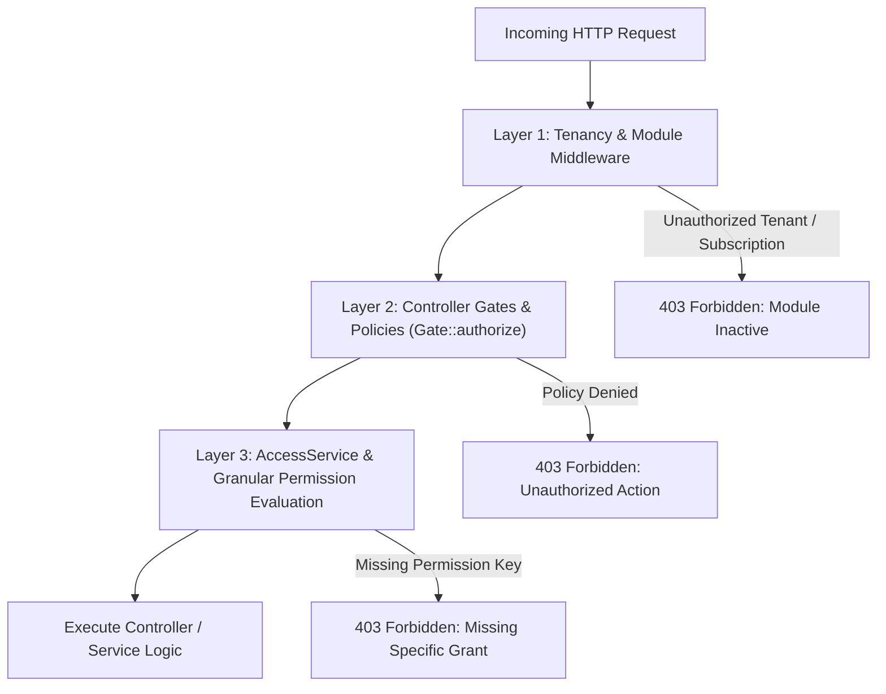

# Production Module — Roles, Permissions & Security Architecture

> **Module:** Production Planning & MES (`wm-product-saas`)  
> **Target Document:** `docs/user-manuals/production/ROLES_AND_PERMISSIONS.md`  
> **Audience:** Security Engineers, System Administrators, Compliance Officers, Technical Leads  
> **Standards:** Implementation-Verified RBAC & Multi-Tenant Authorization

---

## 1. Authorization Architecture Overview

Authorization in the Production module is enforced across three sequential security layers:

### 1.1 The 3 Security Layers

1. **Layer 1: Module & Tenant Middleware**
   * `ResolveTenant`: Resolves tenant context from domain/subdomain/header and applies tenant database scoping.
   * `EnsureTenantModuleAccess`: Inspects `tenants.modules` to confirm the tenant has an active subscription to the `production` module.
2. **Layer 2: Controller Gates & Domain Policies**
   * Before executing business logic, controllers execute `Gate::authorize('action', $model)`.
   * Evaluated by 13 dedicated Policy classes in `app/Domains/Production/Policies/`.
3. **Layer 3: Granular Permission Bridge (`AccessService`)**
   * Models and policies invoke `$user->hasProductionPermission('permission.key', $tenantId)`.
   * Enforced via `App\Models\Concerns\HasProductionPermissions` delegating to `App\Services\Access\AccessService`.
   * Evaluates role grants, user-specific overrides, and tenant boundary constraints.

---

## 2. Production Domain Policies Catalog (13 Policies)

All Production policies reside in `app/Domains/Production/Policies/` and are registered in `AppServiceProvider`:

| Policy Class | Enforced Entity | Policy Methods | Core Authorization Logic |
|---|---|---|---|
| `ProductionOrderPolicy` | `ProductionOrder` | `viewAny`, `view`, `create`, `update`, `delete`, `release`, `issue`, `return`, `logProgress`, `receiveFg`, `complete`, `close`, `cancel` | `viewAny`: true; `view`: tenant match; `create`: `production.order.create` or `admin`; `update`/`release`/`issue`/`return`/`logProgress`/`receiveFg`/`complete`/`close`: order not frozen + (`production.order.update` or `admin`); `cancel`: not completed/closed/cancelled + (`production.order.cancel` or `admin`) |
| `ProductionBomPolicy` | `ProductionBom` | `viewAny`, `view`, `create`, `update`, `delete`, `submit`, `approve`, `reject` | `approve`: `production.bom.approve` or `admin`; `create`: `production.bom.create`; `update`: `production.bom.update`; enforces revision locking |
| `RoutingPolicy` | `Routing` | `viewAny`, `view`, `create`, `update`, `delete`, `approve`, `cancel` | `approve`: `production.routing.approve`; `create`: `production.routing.create`; `update`: `production.routing.update`; `cancel`: `production.routing.cancel`; prevents editing locked routings |
| `ProductionSchedulePolicy` | `ProductionSchedule`| `viewAny`, `view`, `create`, `delete`, `release`, `cancel` | `create`/`release`/`cancel`: `production.schedule.manage` or `admin` |
| `WorkCenterPolicy` | `WorkCenter` | `viewAny`, `view`, `create`, `update`, `delete` | `create`/`update`/`delete`: `production.work_center.manage` or `admin` |
| `MachinePolicy` | `Machine` | `viewAny`, `view`, `create`, `update`, `delete` | `create`/`update`/`delete`: `production.machine.manage` or `admin` |
| `ProductionPlanPolicy` | `ProductionPlan` | `viewAny`, `view`, `create`, `update`, `release`, `mrp`, `approve`, `cancel` | `create`: `production.planning.create`; `update`/`release`/`mrp`: `production.planning.update` or `admin`; `approve`: `production.planning.approve`; `cancel`: `production.planning.cancel` |
| `QualityPlanPolicy` | `ProductionQualityPlan` | `viewAny`, `create`, `update`, `delete` | `create`/`update`/`delete`: `production.quality.manage` or `admin` |
| `QualityInspectionPolicy` | `ProductionQualityInspection` | `viewAny`, `create`, `approve` | `create`: `production.quality.manage` or `admin`; `approve`: `production.quality.approve` or `admin` |
| `QualityManagementPolicy` | `ProductionNcr`, `ProductionCapa`, `ProductionReworkOrder` | `viewAny`, `create`, `update`, `approve` | `create`/`update`: `production.quality.manage` or `admin`; `approve`: `production.quality.approve` or `admin` |
| `ManufacturingIntelligencePolicy` | Reports, Andon, Alerts | `viewAny`, `view` | `production.intelligence.view` or `admin` |
| `ShiftPolicy` | `ProductionShift` | `viewAny`, `create`, `update`, `delete` | `create`/`update`/`delete`: `production.work_center.manage` or `admin` |
| `CalendarPolicy` | `ProductionCalendar` | `viewAny`, `create`, `update`, `delete` | `create`/`update`/`delete`: `production.work_center.manage` or `admin` |

---

## 3. Production Permission Keys Reference

The following table documents all verified granular permission strings registered in `RbacSeeder.php` and enforced across policies, middleware, and controllers:

| Permission String | Entity | Action | Permitted Operations |
|---|---|---|---|
| `production.work_center.manage` | `work_center` | `manage` | Create, update, and configure Work Centers, Shifts, Calendars, and subcontract settings |
| `production.machine.manage` | `machine` | `manage` | Create and maintain Machine master records, operational parameters, and maintenance links |
| `production.routing.create` | `routing` | `create` | Define new manufacturing routing headers and sequence steps |
| `production.routing.update` | `routing` | `update` | Modify operation runtimes, work center assignments, and tooling requirements on draft routings |
| `production.routing.approve` | `routing` | `approve` | Formally approve routing revisions for production release |
| `production.routing.cancel` | `routing` | `cancel` | Cancel or obsolete superseded routing versions |
| `production.bom.create` | `bom` | `create` | Create new Bill of Materials headers, components, and parameterized formulas |
| `production.bom.update` | `bom` | `update` | Modify raw material quantities, scrap percentages, and item lines on draft BOMs |
| `production.bom.approve` | `bom` | `approve` | Formally approve BOM revisions for MRP and production release |
| `production.planning.create` | `planning` | `create` | Create aggregate production plans and forecast schedules |
| `production.planning.update` | `planning` | `update` | Update production plans, execute MRP engine runs, and release plans to shopfloor |
| `production.planning.approve` | `planning` | `approve` | Formally authorize master production plans |
| `production.planning.cancel` | `planning` | `cancel` | Cancel unreleased or superseded master production plans |
| `production.order.create` | `order` | `create` | Create discrete production work orders, including project-linked orders |
| `production.order.update` | `order` | `update` | Release orders, issue raw materials, record returns, log progress, receive finished goods, complete, and close orders |
| `production.order.cancel` | `order` | `cancel` | Cancel uncompleted or draft production orders |
| `production.mes.execute` | `mes` | `execute` | Start, pause, resume, and complete shopfloor operations, report Andon alerts, and log scrap on MES terminals |
| `production.schedule.manage` | `schedule` | `manage` | Create production schedules, adjust Gantt dispatch board, level capacity, and release schedules |
| `production.intelligence.view` | `intelligence` | `view` | Access Executive Dashboard, Live Andon Board, Manufacturing Reports, Alerts, and KPI Targets |
| `production.quality.manage` | `quality` | `manage` | Manage Quality Plans, record inspections, log NCRs, CAPAs, Rework Orders, and Scrap Disposals |
| `production.quality.approve` | `quality` | `approve` | Formally approve quality inspection results, NCR dispositions, and CAPA resolutions |
| `production.cost_adjustment.create` | `cost_adjustment` | `create` | Record manual cost adjustments (rework, tooling, scrap write-offs) on production orders |
| `production.cost_adjustment.update` | `cost_adjustment` | `update` | Edit or review posted manual cost adjustment entries |
| `production.orders.view` | `order` | `view` | View production orders and linked badges (checked in TaskController and cross-module UI navigation) |

---

## 4. Standard ERP Role-to-Permission Matrix

In `wm-product-saas`, users are assigned roles that bundle specific permission sets:

| Role Name | Description | Default Production Permissions Granted |
|---|---|---|
| **System Admin (`admin`)** | Full technical and administrative control | Full access across all permissions (bypasses individual checks) |
| **Plant Manager** | Complete operational authority over manufacturing | All `production.*` permissions except developer APIs |
| **Production Planner** | Master scheduling and inventory planning | `planning.create`, `planning.update`, `order.create`, `order.update`, `bom.create`, `bom.update`, `schedule.manage`, `intelligence.view` |
| **Process / Manufacturing Engineer** | Product structure and routing definitions | `bom.create`, `bom.update`, `bom.approve`, `routing.create`, `routing.update`, `routing.approve`, `work_center.manage`, `machine.manage` |
| **Shopfloor Supervisor / Lead** | Daily shift supervision and dispatching | `order.update`, `mes.execute`, `intelligence.view`, `quality.manage` |
| **Machine Operator** | Workstation execution | `mes.execute`, `orders.view` (scoped to assigned operations) |
| **Quality Inspector (QC)** | Quality assurance and compliance | `quality.manage`, `quality.approve`, `intelligence.view` |
| **Warehouse Storekeeper** | Material picking and store fulfillment | `order.update` (issue/return raw materials, receive finished goods) |
| **Maintenance Engineer** | Machinery uptime and PM execution | `machine.manage`, `work_center.manage`, `intelligence.view` |
| **Plant Financial Controller** | Cost accounting and variance auditing | `cost_adjustment.create`, `cost_adjustment.update`, `intelligence.view` |

---

## 5. UI Visibility vs. Backend Enforcement Security Check

* **UI Directive Checks:** Blade templates conditionally display action buttons using `@can(...)` or `@if(auth()->user()->hasProductionPermission(...))` directives. For example, the **Approve BOM** button is only rendered if the user has `production.bom.approve`.
* **Backend Invariant:** Hiding an element in the browser does not constitute security. If an operator bypasses the UI and dispatches a direct HTTP POST request to `/production/boms/{id}/approve`, the controller executes `Gate::authorize('approve', $bom)`, resulting in an immediate `403 Forbidden` response.
* **Tenant Boundary Protection:** Even if a user possesses the `admin` role in Tenant A, attempting to view or modify an order in Tenant B triggers a 403 or 404 response because all database queries are scoped by `require_tenant_id()`.

---

## 6. Cross-Module Authorization: Production & Project Management Integration

The integration between Production and Project Management spans distinct permission boundaries:

### 6.1 Creating a Linked Production Order from Production
* **Route & Action:** `POST /production/orders` with `project_id`, `project_milestone_id`, and `project_task_id`.
* **Required Permission:** `production.order.create` (or `admin`).
* **Cross-Module Verification:** `StoreProductionOrderRequest` validates that the project, milestone, and task exist and strictly match the authenticated user's `tenant_id`, `company_id`, and `branch_id`. No Project Management editing permission is required to create a production order with project attributes.

### 6.2 Linking an Existing Production Order from Project Management
* **Route & Action:** `POST /projects/{project}/tasks/{task}/link-production-order` (`projects.tasks.link-production-order`).
* **Required Project Permission:** `projects.tasks.update` (or project-level `projects.projects.update`, evaluated via `TaskPolicy::update($user, $task)`).
* **Required Production Permission:** `production.orders.view` or `production.view` (enforced via `TaskController::canViewProduction()`, also satisfied by role-based bypasses for `tenant_owner` or `super_admin`).
* **Unlinking Permission:** `DELETE /projects/{project}/tasks/{task}/production-orders/{productionOrder}` (`projects.tasks.unlink-production-order`) requires `projects.tasks.update` or `projects.projects.update`.

### 6.3 Automated Completion Synchronization Security Context
* **Listener Execution:** When a shopfloor operator or supervisor completes a production order (`POST /production/orders/{id}/complete`), the `ProductionOrderCompleted` event triggers `SyncProductionTaskCompletionListener`.
* **Decoupled System Execution:** The listener operates with system authority to evaluate aggregate yield and update `tasks.status` and `milestones.progress_percentage`. Shopfloor operators completing orders do **not** need Project Management permissions for the background task synchronization to succeed.
* **Commercial Boundary Protection:** Automated completion synchronization does **not** generate customer deliveries or sales invoices. Downstream commercial milestone billing remains gated by `projects.billing.generate_invoice` and Project Management financial policies.
