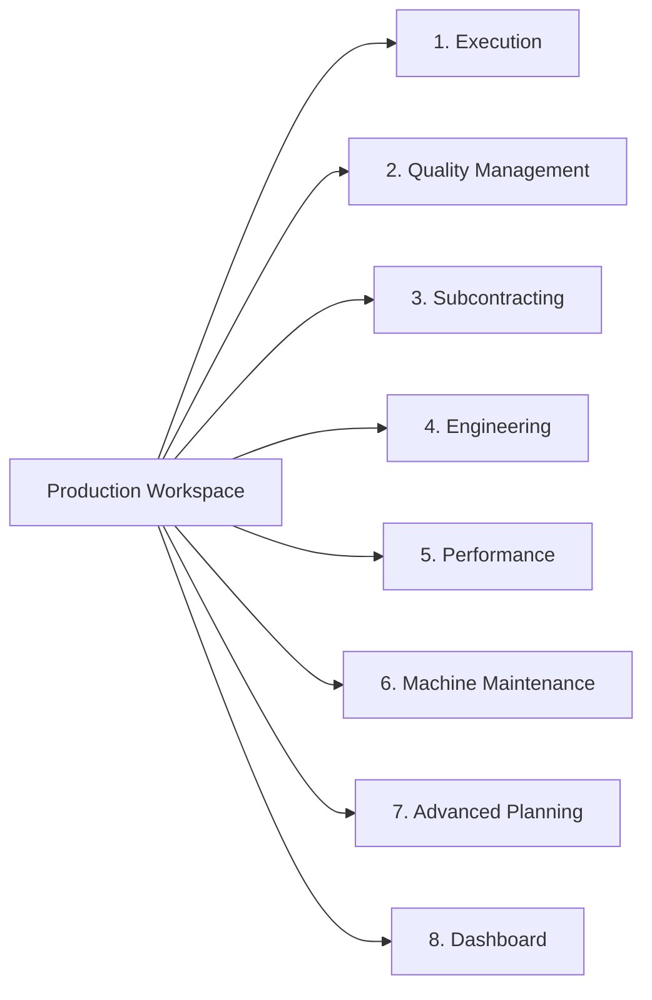
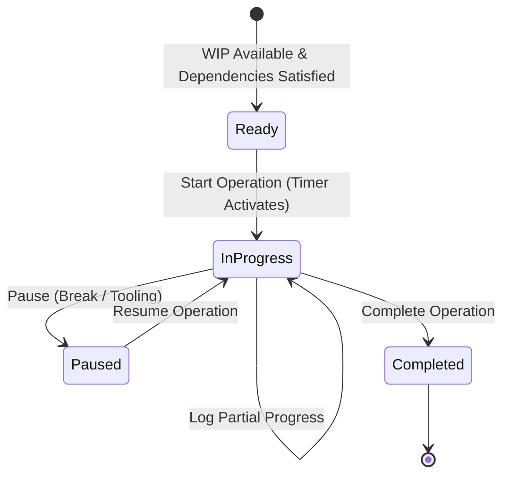

# Production Planning & Manufacturing Execution (MES) — End-User Manual

> **Product:** Multi-Tenant SaaS ERP (`wm-product-saas`)  
> **Module:** Production Planning & Shopfloor MES  
> **Audience:** Production Planners, Manufacturing Managers, Shopfloor Operators, QC Inspectors, Storekeepers, Maintenance Engineers  
> **Version:** 2.1 (Current Baseline Verified — October 2026)

---

## 1. Introduction & Navigation Overview

The Production Planning & Manufacturing Execution (MES) module is an industrial-grade enterprise solution designed for discrete, batch, and hybrid manufacturing environments. It covers the entire manufacturing lifecycle from demand planning, Bill of Materials (BOM) engineering, and finite capacity scheduling to shopfloor execution, quality inspection, equipment maintenance, and lot genealogy traceability.

> [!NOTE]
> For security architectures, role matrices, and granular permission keys governing each screen, consult [ROLES_AND_PERMISSIONS.md](file:///c:/Users/windo/Documents/GitHub/wm-product-saas/docs/user-manuals/production/ROLES_AND_PERMISSIONS.md). For end-to-end business process diagrams and accounting impact boundaries, refer to [WORKFLOWS.md](file:///c:/Users/windo/Documents/GitHub/wm-product-saas/docs/user-manuals/production/WORKFLOWS.md).

### 1.1 Complete Sidebar Navigation Structure

All Production module features are organized under the **Production** group in the primary sidebar navigation (base URL `/production`). The menu is divided into 8 functional sections:

| Section | UI Menu Item | Web Route | Target Personas | Purpose |
|---|---|---|---|---|
| **Root** | **Production Dashboard** | `/production/dashboard` | Plant Managers, Planners | High-level plant KPIs, active order status, machine states, and daily output pacing |
| **Execution** | **Production Orders** | `/production/orders` | Planners, Production Leads | Discrete work orders, material reservations, picking slips, and FG receipts |
| **Execution** | **Shop Floor (MES)** | `/production/mes` | Machine Operators, Leads | Touchscreen operator console, operation timers, progress logs, and scrap |
| **Execution** | **Work-in-Progress (WIP)** | `/production/wip` | Shopfloor Leads, Supervisors | Intermediate floor stock balances, inter-stage transfers, and FG conversions |
| **Execution** | **Job Cards / Operations** | `/production/mes/operator/my-operations` | Machine Operators | Filtered personal execution queue of assigned operations across machines |
| **Execution** | **Operator Dashboard** | `/production/mes/operator` | Operators, Technicians | Dedicated touch-friendly interface for starting, pausing, and logging progress |
| **Execution** | **Barcode Scanner** | `/production/mes/scanner` | Operators, Storekeepers | Camera and hardware barcode/QR scanner for rapid lot and work card intake |
| **Execution** | **Work Center Board** | `/production/mes/work-centers` | Department Supervisors | Work-center level status boards, active jobs, and line balancing |
| **Execution** | **Machine Board** | `/production/mes/machines` | Maintenance, Supervisors | Live operational status cards for all production machinery and downtime indicators |
| **Execution** | **Production Timeline** | `/production/mes/timeline` | Schedulers, Plant Leads | Chronological event stream of shopfloor progress, starts, pauses, and completions |
| **Execution** | **Lot Traceability** | `/production/mes/traceability` | Quality Leads, Compliance | Bidirectional lot genealogy: Raw Material Lot → Batch → Finished Good → Sales Order |
| **Execution** | **Scan Logs** | `/production/scan-logs` | Systems Leads, Auditors | Audited scan event history with timestamps, device identifiers, and scan results |
| **Quality** | **Quality Dashboard** | `/production/quality/dashboard` | QC Managers | Inspection pass/fail ratios, defect trends, open NCR counts, and CAPA metrics |
| **Quality** | **Quality Plans** | `/production/quality-plans` | Quality Engineers | Checklists, tolerance ranges, and inspection frequency templates |
| **Quality** | **Quality Inspections** | `/production/quality/inspections` | QC Inspectors | First-piece, in-process, and final inspection logs and parameter recording |
| **Quality** | **Deviations** | `/production/quality/deviations` | Quality Leads, Engineers | Formal "Use As Is" temporary authorizations for minor non-critical variances |
| **Quality** | **NCR** | `/production/quality/ncrs` | QC Inspectors, Leads | Non-Conformance Reports for defects, root causes, and formal dispositions |
| **Quality** | **CAPA** | `/production/quality/capas` | Quality Managers | Corrective & Preventive Action investigations, 5-Why analysis, and closure tracking |
| **Quality** | **Rework Orders** | `/production/quality/rework` | Shopfloor Leads, QC | Dedicated rework jobs with material requisitions, operations, and cost tracking |
| **Quality** | **Scrap Disposals** | `/production/quality/scrap` | Stores, Quality Leads | Formal quarantine scrap write-offs, disposal authorizations, and salvage salvage |
| **Subcontracting** | **Delivery Challans / Gate Passes** | `/production/subcontract/delivery-challans` | Stores, Subcontract Team | Outward statutory delivery challans, vendor shipments, and processed return intake |
| **Subcontracting** | **Vendor SLA & Analytics** | `/production/subcontract/analytics` | Subcontract Executives | Vendor turnaround times, reject percentages, delivery delays, and vendor SLA scores |
| **Subcontracting** | **Subcontract Settings** | `/production/settings` | Plant Administrators | Auto-approval thresholds, PO generation policies, and remnant retention settings |
| **Engineering** | **Bills of Materials (BOM)** | `/production/boms` | Manufacturing Engineers | Multi-level product structures, scrap allowances, and parametric formulas |
| **Engineering** | **Routing** | `/production/routing` | Process Engineers | Sequential manufacturing steps, runtimes, work centers, and subcontract services |
| **Engineering** | **ECO / Engineering Changes** | `/production/ecos` | Engineering Leads | Formal Engineering Change Orders, revision sign-offs, and effectivity dates |
| **Engineering** | **Work Centers** | `/production/work-centers` | Industrial Engineers | Plant departments, work cells, rated capacities, and hourly overhead rates |
| **Engineering** | **Machines** | `/production/machines` | Plant Engineers | Machinery records, fixed asset connections, operational states, and PM logs |
| **Engineering** | **Operator Skills** | `/production/operator-skills` | Plant HR, Supervisors | Competency matrix, machine certifications, and operator qualification levels |
| **Engineering** | **Shifts** | `/production/shifts` | Production Planners | Shift timings, break windows, and nominal capacity schedules |
| **Engineering** | **Calendars** | `/production/calendars` | Master Schedulers | Plant holiday calendars, working weekends, and scheduled facility downtime |
| **Performance** | **Variance & Performance** | `/production/variances` | Operations Controllers | Planning exceptions, standard vs actual runtime variances, and ECO suggestions |
| **Performance** | **Executive Dashboard** | `/production/intelligence/dashboard` | Executives, Operations VPs | Overall Equipment Effectiveness (OEE = Availability × Performance × Quality) |
| **Performance** | **Live Andon Board** | `/production/intelligence/andon` | Plant Floor Monitors | Real-time full-screen visual Andon board flashing breakdown and starvation alarms |
| **Performance** | **Manufacturing Reports** | `/production/intelligence/reports` | Controllers, Planners | Standard vs actual cost reports, material consumption variance, and batch reports |
| **Performance** | **Production Alerts** | `/production/intelligence/alerts` | Production Managers | Automated exception warnings: delayed operations, scrap spikes, and bottlenecks |
| **Performance** | **KPI Targets** | `/production/kpi-targets` | Plant Leadership | Target setting for OEE, scrap percentage, on-time completion, and labor efficiency |
| **Maintenance** | **Maintenance Dashboard** | `/production/maintenance/dashboard` | Maintenance Engineers | Active breakdown cards, technician assignments, downtime hours, and spare parts |
| **Maintenance** | **Work Orders** | `/production/maintenance/work-orders` | Maintenance Leads | Corrective breakdown tickets, technician assignments, spares, and completion |
| **Maintenance** | **PM Schedules** | `/production/maintenance/schedules` | Plant Maintenance Leads | Calendar and meter-based preventive maintenance intervals and work order triggers |
| **Advanced Planning** | **Production Plans** | `/production/plans` | Master Schedulers | Aggregate demand plans, multi-level MRP explosion, and shortage conversion |
| **Advanced Planning** | **Production Schedules** | `/production/schedules` | Schedulers, Dispatch Leads | Gantt scheduling, capacity leveling, conflict alerts, and schedule release |
| **Advanced Planning** | **Calendar Schedule View** | `/production/schedules/calendar` | Schedulers | Month, week, and day calendar view of production commitments and machine runs |
| **Advanced Planning** | **Capacity Planning** | `/production/capacity` | Master Planners | Work center load vs capacity histograms and overload mitigation suggestions |
| **Advanced Planning** | **Planning Scenarios / What-if** | `/production/schedules/scenarios` | Strategic Schedulers | Sandbox schedule modeling, scenario comparison, capacity leveling, and promotion |
| **Advanced Planning** | **Planning Exceptions / At-Risk** | `/production/planning-exceptions` | Material Schedulers | Early-warning dashboard for orders with delayed components, missing routings, or bottlenecks |

---

## 2. Master Data Management

Accurate master data is the prerequisite for all manufacturing automation, MRP calculations, finite capacity scheduling, and inventory valuation.

### 2.1 Work Centers

Work Centers represent physical production areas, assembly cells, or machining bays.

* **Navigation:** `Production → Engineering → Work Centers` (`/production/work-centers`)
* **Required Permission:** `production.work_center.manage` (or `admin`)
* **Step-by-Step Creation:**
  1. Open **Production → Engineering → Work Centers** (`/production/work-centers`) and click **Create Work Center**.
  2. Enter the **Work Center Code** (e.g., `WC-CNC-01`, `WC-WELD-BAY`) and **Name** (e.g., `CNC Turning Cell 1`).
  3. Enter **Capacity Per Hour** (nominal throughput in standard units).
  4. Specify **Cost Per Hour** (direct labor/operating rate) and **Overhead Rate** (plant burden rate) in active currency.
  5. Enter **Efficiency** percentage (e.g., `90.00%`).
  6. Click **Save Work Center**. The new work center displays in the directory list.
* **Costing Engine Integration:** The system uses `cost_per_hour` and `overhead_rate` divided by 60.0 multiplied by actual operational minutes to calculate labor and machine absorption costs on completed work orders and rework orders.

### 2.2 Machines & Fixed Asset Interlinking

Machines represent individual equipment units deployed within a parent Work Center.

* **Navigation:** `Production → Engineering → Machines` (`/production/machines`)
* **Required Permission:** `production.machine.manage` (or `admin`)
* **Creating a Machine:**
  1. Open **Production → Engineering → Machines** (`/production/machines`) and click **New Machine**.
  2. Select the parent **Work Center** from the dropdown.
  3. Specify **Machine Code**, **Manufacturer**, **Model**, and **Serial Number**.
  4. (Optional) Select an existing Fixed Asset record from the **Fixed Asset Link** dropdown to connect maintenance history to capitalized balance sheet assets.
  5. Click **Save Machine**.
* **Operating States:** `Active`, `Idle`, `Under Maintenance`, `Breakdown`, or `Decommissioned`.
* **MES Interlock:** When a machine enters `Breakdown` or `Under Maintenance`, the MES operator terminal immediately blocks operators from starting operations on that unit.

### 2.3 Bills of Materials (BOM)

A Bill of Materials defines the hierarchical recipe of components, raw materials, and sub-assemblies required to manufacture one unit of a finished product.

* **Navigation:** `Production → Engineering → Bills of Materials` (`/production/boms`)
* **Required Permissions:** `production.bom.create`, `production.bom.update`, `production.bom.approve`
* **Step-by-Step Creation & Approval Workflow:**
  1. Open **Production → Engineering → Bills of Materials** (`/production/boms`) and click **Create BOM**.
  2. Select the target **Product** and specify the base output quantity (default `1.0000`).
  3. Under the **Components Table**, click **Add Component**. Select the raw material SKU, enter the required quantity per unit, specify the unit of measure (UOM), and enter the expected scrap allowance percentage (e.g., `2.5%`).
  4. Click **Save BOM**. The new BOM is saved in `Draft` status.
  5. Review the structure and click **Submit for Approval**. The status changes to `Pending Approval`. *(Technical reference: `POST /production/boms/{bom}/submit`)*
  6. An authorized engineer or manager opens the pending BOM and clicks **Approve BOM**. The status updates to `Approved`. *(Technical reference: `POST /production/boms/{bom}/approve`)*
* **Rules & Best Practices:**
  * Only `Approved` BOMs can be linked to Production Plans and Production Orders.
  * Once approved, a BOM is permanently locked to protect historical traceability. To change an approved BOM, open the BOM record and click **Create Revision**. The system creates an editable `v2` draft clone, leaving the active approved revision untouched until the new version is approved. *(Technical reference: `POST /production/boms/{bom}/create-revision`)*
  * **Parametric Formulas:** For dimensional products (e.g., custom cutting of glass, pipes, or sheet metal), click **Formula Preview** on the BOM screen to evaluate dynamic quantity expressions based on parent dimensions. *(Technical reference: `/production/boms/preview-formula`)*

### 2.4 Production Routings & Automatic Model Derivation

A Routing defines the step-by-step sequence of operations required to manufacture a product.

* **Navigation:** `Production → Engineering → Routing` (`/production/routing`)
* **Required Permissions:** `production.routing.create`, `production.routing.update`, `production.routing.approve`
* **Step-by-Step Creation:**
  1. Open **Production → Engineering → Routing** (`/production/routing`) and click **Create Routing**.
  2. Select the target **Product** and enter the routing name.
  3. Under **Operations Sequence**, click **Add Operation**:
     * `sequence`: Execution order (e.g., `10`, `20`, `30`). Always space sequences by 10s to permit later insertion of intermediate steps.
     * `work_center_id`: Primary Work Center responsible for the operation.
     * `setup_time_minutes`: Machine preparation time independent of batch volume.
     * `processing_time_minutes`: Standard runtime required per unit.
     * `labor_cost_rate` & `machine_cost_rate`: Standard operating costs per hour.
     * **Outsourced Operations:** If an operation is performed by a third-party vendor (e.g., powder coating, galvanizing, heat treatment), toggle **Is External / Subcontract**, select the vendor, specify `subcontract_cost_per_unit`, and define `subcontract_lead_time_days`.
  4. Click **Save Routing** to save the definition in `Draft` status.
  5. Review the operation sequence, click **Submit for Approval**, and have an authorized manager click **Approve Routing**. The routing status updates to `Approved`. *(Technical reference: `POST /production/routing/{routing}/approve`)*

#### Dynamic Production Model Derivation
> [!IMPORTANT]
> **No Manual Model Selection Required:** Users no longer choose a "Production Model" from a dropdown. The system automatically and authoritatively derives the order's manufacturing model directly from the configured Routing operations:
>
> * **Pure Manufacturing (`pure_manufacturing`):** All routing operations are internal.
> * **Hybrid Manufacturing (`hybrid`):** The routing contains a mixture of internal shopfloor operations and external subcontract operations.
> * **Complete Subcontracting (`subcontract_complete`):** All operations are external and the vendor provides the raw material (`material_supply_type = 'vendor_supplied'`).
> * **Company Material Subcontracting (`subcontract_company_material`):** All operations are external, but the company supplies raw materials to the subcontractor.

---

## 3. Production Planning & Material Requirements (MRP)

### 3.1 Creating Aggregate Production Plans

Production Plans consolidate manufacturing requirements across multiple finished goods over a defined planning horizon (weekly, monthly, or quarterly).

* **Navigation:** `Production → Advanced Planning → Production Plans` (`/production/plans`)
* **Required Permissions:** `production.planning.create`, `production.planning.update`, `production.planning.approve`, `production.planning.view`
* **Step-by-Step Instructions:**
  1. Open **Production → Advanced Planning → Production Plans** (`/production/plans`) and click **Create Production Plan**.
  2. Select the target **Product** and specify the **Planned Quantity**.
  3. Set the **Planned Start Date** and **Planned End Date**.
  4. (Optional) Select an existing **Sales Order** to tag Make-to-Order customer commitments.
  5. Select the **Approved BOM** and **Approved Routing** from the dropdowns (pre-filtered to approved versions).
  6. Click **Save Plan**. The plan is created in `Draft` status.
  7. Click **Submit for Approval**. An authorized manager opens the plan and clicks **Approve Plan**. The status changes to `Approved`. *(Technical reference: `POST /production/plans/{plan}/submit` and `POST /production/plans/{plan}/approve`)*

### 3.2 Running MRP & Shortage Analysis

* **Navigation:** Open **Production → Advanced Planning → Production Plans** (`/production/plans`) and select the plan.
* **Triggering MRP:** On the plan details screen, click **Run MRP Engine**. *(Technical reference: `POST /production/plans/{plan}/run-mrp`)*
  *(Note: Planners can run the MRP engine while the plan is in `Draft` or `Pending Approval` to simulate component demand before formal approval, as well as on `Approved` or `MRP Generated` plans).*
* **MRP Output:**
  * **Gross Requirements:** Component quantities calculated from multi-level BOM multipliers and scrap allowances.
  * **Usable Supply Breakdown:** Current physical inventory across active raw material warehouses combined with incoming open Purchase Order (PO) and open Work Order (WO) supply due before the plan start date.
  * **Net Shortage:** Calculated deficit taking into account minimum order quantities (MOQ) and order multiples.
* **Material Shortage Management:** The MRP table provides operational visibility into component deficits and coverage status (`COVERED` vs. `SHORTAGE`). Purchasing teams utilize the Procurement module to issue supplier purchase orders for identified raw material shortages, while subcontract routing shortages are fulfilled via the subcontract PR action on released production orders.

### 3.3 Releasing Plans to Production Orders

1. When materials and schedules are verified, open the approved plan and click **Release Plan**. The plan status transitions to `Released`. *(Technical reference: `POST /production/plans/{plan}/release`)*
2. Click **Create Production Order** from the plan header action bar to spawn executable manufacturing orders with prefilled quantities and dates. *(Technical reference: `POST /production/plans/{plan}/create-order`)*

---

## 4. Production Orders & Material Logistics

### 4.1 Production Order Creation & Fields

Production Orders represent discrete manufacturing jobs executed on the factory floor.

* **Navigation:** `Production → Execution → Production Orders` (`/production/orders`)
* **Required Permissions:** `production.order.create`, `production.order.update`, `production.orders.view`
* **Order Status Progression:**
  `Draft` → `Released` → `In Progress` → `Completed` → `Closed` (or `Cancelled`).
* **Step-by-Step Creation:**
  1. Open **Production → Execution → Production Orders** (`/production/orders`) and click **Create Production Order**.
  2. (Optional) Under **Sales Order Request**, select an existing sales order item to prefill product SKU and ordered quantity.
  3. Select the **Target Product** (`product_id`) to manufacture.
  4. Select the **Bill of Materials** (`bom_id`) and **Process Routing** (`routing_id`), dynamically pre-filtered to approved versions.
  5. Select the **Production Mode** (`standard`, `batch`, `serial`, or `batch_and_serial`).
  6. Enter **Quantity to Manufacture** (`quantity_ordered`). As soon as quantity is entered, the live **Component Requirements & Stock Availability Table** renders below, showing required vs available warehouse stock and estimated material costs.
  7. Set the **Planned Start Date** (`start_date`) and **Planned End Date** (`end_date`).
  8. (Optional) Enter operational notes in **Remarks** (`description`).
  9. Click **Create Production Order**. The order saves in `Draft` status.

> [!TIP]
> ### Terminology Check: Production Model vs. Production Mode
>
> It is vital not to confuse **Production Model** with **Production Mode**:
>
> | Attribute | Production Model | Production Mode |
> |---|---|---|
> | **Definition** | The engineering & supply-chain execution structure (Who makes it & where). | The lot traceability & inventory serialization discipline (How it is tracked). |
> | **Options** | `pure_manufacturing`, `hybrid`, `subcontract_company_material`, `subcontract_complete`. | `standard`, `batch`, `serial`, `batch_and_serial`. |
> | **Selection** | **Derived automatically** by the system from configured Routing operations. | **Selected manually** by the planner on the Production Order create form. |
> | **Location in UI** | Evaluated internally; reflected in operation dispatches and costing rollups. | Explicit radio/dropdown selection on `/production/orders/create`. |

#### Project Management Integration & Completion Synchronization
When manufacturing activities fulfill customer deliverables or project deliverables:
* **Two Entry Points for Linking:**
  1. **Direct Link from Task Details Drawer:** In the Project Management task workspace, open the task details drawer and click **Link Production Order**, select the order from the list, and confirm the link. *(Technical reference: `POST /projects/{project}/tasks/{task}/link-production-order`, requiring `projects.tasks.update` and `production.orders.view`)*
  2. **Prefilled Context from Task View:** In Project Management, click the task's **Create Production Order** action (or navigate to `/production/orders/create?project_id={id}&project_task_id={id}`). The order creation screen detects the query parameters, displays an interactive **Linked to Project** banner with project and task codes, prefills product and quantity, and stores reference parameters.
* **Organizational Consistency Invariants:** The system enforces strict matching on `tenant_id`, `company_id`, and `branch_id`. Mismatches throw validation errors (`projects.company_mismatch_error` or `projects.branch_mismatch_error`).
* **Authoritative Completion Synchronization (`SyncProductionTaskCompletionListener`):**
  * When a linked production order transitions to `completed` via `ProductionOrderService::completeOrder()`, the system evaluates all sibling production orders linked to `project_task_id`:
    1. **Sibling Gate:** If any sibling order remains in `draft`, `released`, or `in_progress`, the project task remains in `IN_PROGRESS`.
    2. **Aggregate Good Yield Gate:** If all sibling orders are completed, the listener verifies total output against planned demand:
       $$\sum \text{quantity\_produced} \ge \left( \sum \text{quantity\_ordered} - 0.0001 \right)$$
  * **Success Path:** If the aggregate output meets or exceeds the ordered total, the system automatically transitions the project task to `Completed` (`completed_at = now()`), logs an audited completion event (`production.completed`) in `project_activity_logs`, and calls `MilestoneService::recalculateProgress()` to update the parent milestone's weighted percentage.
  * **Shortfall Path:** If output is deficient due to operational scrap or rejected parts, the task remains `IN_PROGRESS` and records a shortfall warning (`production.shortfall_warning`) with the deficit delta in `project_activity_logs`. The approved operational resolution is for production planning to review inventory demand and conditionally issue an authorized supplementary production order.
  * **Safeguard Bypass Caution:** Project Management status transitions (`PATCH /projects/{project}/tasks/{task}/status`) allow authorized users with `projects.tasks.update` to set task status to `Completed` directly because task-level transitions evaluate task dependency blockers rather than manufacturing yield. However, doing so **bypasses production completion safeguards** and desynchronizes physical yield auditability. Manual task completion must never be used as a routine shortcut for incomplete manufacturing orders.
  * **Commercial Boundary Protection:** Automated completion synchronization updates task operational status and milestone progress only. It does **not** generate customer delivery notes, sales invoices, or accounting revenue vouchers. Commercial billing remains gated by `projects.billing.generate_invoice` and Project Management financial policies.

### 4.2 Material Soft-Reservation & Picking Slips

* **Automatic Soft-Reservation:** Upon order creation, the system inserts `ProductionOrderReservation` records. This reserves physical warehouse inventory for the order, preventing other sales or work orders from consuming the same stock.
* **Printing Picking / Requisition Slips:**
  1. Open **Production → Execution → Production Orders** and select the required Production Order.
  2. Click **Print Requisition Slip** (or select **Print Traveler** from the Actions menu). *(Technical reference: `/production/labels/orders/{id}`)*
  3. Hand the physical document to the warehouse team. It lists required SKU codes, bin locations, lot suggestions, and exact quantities.

### 4.3 Material Issuing (Storekeeper Workflow)

When goods physically depart the warehouse for the production line:
1. Open **Production → Execution → Production Orders**, open the required Production Order, and click **Issue Material**. *(Technical reference: `POST /production/orders/{order}/issue`)*
2. In the issuance modal, select the source warehouse, verify component quantities against required amounts, and select or enter raw material lot/batch numbers.
3. Click **Confirm Issuance**.
4. **Expected Result & Status:**
   * Order status advances to `In Progress` if this is the initial material issue.
   * Issued quantities update on the order's Material tab.
   * **Inventory Impact:** Decrements physical warehouse inventory immediately (`StockService::recordOutflow`).
   * **General Ledger Impact:** The inventory outflow event automatically posts a balanced double-entry journal voucher:
     * **Debit:** Work-in-Progress (WIP Account `1204` / Asset).
     * **Credit:** Raw Material Inventory Asset Account.

### 4.4 Material Returns, Additional Requests & Remnants

* **Unused Material Returns:** If excess stock was issued, open the Production Order, switch to the Material tab, and click **Return Material**. In the modal, select the component line, enter the quantity returned to stores, select the receiving warehouse bin, and click **Confirm Return**. *(Technical reference: `POST /production/orders/{order}/return`)*
* **Request Additional Material:** If unexpected damage or defects occur on the shopfloor, click **Request Additional Material** on the order screen. Select the required SKU and quantity, enter a reason, and click **Submit Request** to raise a supplementary material requisition for storekeeper fulfillment. *(Technical reference: `POST /production/orders/{order}/request-additional-material`)*
* **Remnant Allocation:** Planners can click **Allocate Remnant** on the order screen to assign offcut sheet metal or bar stock from previous jobs, reducing new raw material consumption. *(Technical reference: `POST /production/orders/{order}/allocate-remnant`)*

### 4.5 Receiving Finished Goods

When operations finish and goods pass final inspection:
1. Open the Production Order and click **Receive FG**. *(Technical reference: `POST /production/orders/{order}/receive-fg`)*
2. In the receipt modal, specify:
   * **Quantity Produced:** Good finished units to receive into stock.
   * **Scrap Quantity:** Any rejected units identified during final handling.
   * **Destination Warehouse:** Select the finished goods warehouse.
   * **Batch / Lot Code:** Enter or confirm batch number (or generate serial numbers if operating in serial mode).
3. Click **Confirm Receipt**.
4. **Expected Result & Accounting Impact:**
   * Physical finished goods stock increases in the destination warehouse at weighted-average unit cost (`StockService::recordInflow`).
   * The order's completed output counter increments.

### 4.6 Production Order Completion Prerequisites

To close manufacturing execution and finalize an order:
1. Open **Production → Execution → Production Orders**, open the order, and click **Complete Order**. *(Technical reference: `POST /production/orders/{order}/complete`)*
2. The system executes automated validation (`ProductionOrderCompletionValidator`) to enforce the following prerequisites before permitting status transition:
   * **All Operations Terminal:** Every operation in the order must be `completed`, `skipped`, or `cancelled`. No operation may remain `ready`, `in_progress`, or `paused`.
   * **Zero Operations in Quality Hold:** No operations may be held in quality inspection or pending clearance.
   * **All Subcontract Challans Terminal:** All subcontract delivery challans must be `completed`, `cancelled`, or `rejected`.
   * **Zero Open Defect Tickets:** All linked Non-Conformance Reports (NCRs) must have dispositions resolved.
   * **Zero Active WIP Quality Holds:** No intermediate WIP may remain in `quality_hold` or active `rework`.
   * **Vendor Material Balance Reconciled:** If company raw material was issued to an external subcontractor, remaining unconsumed/unreturned company material must equal zero.
3. **Expected Result:** Upon validation success, order status transitions to `Completed`. If linked to a project task, completion synchronization logic (`SyncProductionTaskCompletionListener`) evaluates sibling orders and aggregate good-yield thresholds to update the project task.

---

## 5. Shopfloor Execution (MES) Operator Console

The Manufacturing Execution System (MES) is designed for touchscreens, mobile tablets, and industrial shopfloor terminals.

* **Terminal URLs:**
  * Full MES Dashboard: `/production/mes`
  * Touch Operator Dashboard: `/production/mes/operator`
  * My Assigned Operations: `/production/mes/operator/my-operations`
* **Required Permissions:** `production.mes.execute`, `production.orders.view`

### 5.1 Step-by-Step Operator Sequence

1. **Locate Work:** Open **Production → Execution → Job Cards / Operations** (`/production/mes/operator/my-operations`) to view your assigned operations queue, or open the touch console at **Production → Execution → Operator Dashboard** (`/production/mes/operator`) and tap your designated Work Center or Machine card.
2. **Start Operation:** On the assigned operation card showing `ready` state, click **Start Operation**. *(Technical reference: `POST /production/mes/{op}/start`)*
   * The live on-screen timer begins running.
   * Operation status updates to `in_progress`.
   * Assigned machine state automatically switches to `Active`.
3. **Pauses & Break Management:** When pausing for shift breaks or machine tooling changes, click **Pause Operation**. Select a standardized reason from the dialog (`Lunch Break`, `Tooling Change`, `Inspection Wait`) and confirm. The timer pauses and machine state switches to `Idle`. When work restarts, click **Resume**. *(Technical reference: `POST /production/mes/{op}/pause` and `POST /production/mes/{op}/resume`)*
4. **Logging Progress & Over-Production Handling:**
   * Throughout the shift, click **Log Progress** on the active operation card to record partial output. *(Technical reference: `POST /production/mes/{op}/log-progress`)*
   * In the dialog, enter the good quantity completed so far, plus any rejected or scrapped units, and click **Submit Progress**.
   * **Automatic Batch Overflow:** If reported output exceeds the batch planned quantity (`actual_quantity > planned_quantity`), the system caps the parent batch at its planned quantity and automatically creates a linked **Overflow Batch** for the excess units to preserve lot traceability.
   * **Automatic Quality Routing on Defect / Scrap:**
     * Logging rejected parts (`rejected > 0`) automatically creates an open Non-Conformance Report (`NCR-AUTO-...`) and initiates a child Rework Order.
     * Logging scrap (`scrapped > 0`) automatically creates an auto-NCR (`disposition = scrap`) and initiates a Scrap Disposal entry.
5. **Complete Operation:** When the batch run finishes, click **Complete Operation** on the operation card. *(Technical reference: `POST /production/mes/{op}/complete`)*
   * In the completion modal, enter actual setup minutes (`setup_time_actual`) and actual processing minutes (`processing_time_actual`).
   * Confirm final good output, operational scrap, and rejected counts.
   * Click **Submit Completion**.
   * **Expected Result:** The operation status advances to `completed`, the timer stops, the machine returns to `Idle`/`Ready`, and automated WIP transfers unlock the successor operation in the routing sequence.

### 5.2 Andon Alarms & Remnants Tracking

* **Andon Alerts:** If an immediate safety hazard, machine crash, or material starvation occurs, click the prominent red **Andon Alert** button on the operator console. In the popup modal, select the alert severity and failure category, enter a brief description, and click **Broadcast Alert**. The alert immediately flashes on the full-screen Live Andon Board (`/production/intelligence/andon`) and notifies shopfloor leads. *(Technical reference: `POST /production/mes/{op}/andon-alert`)*
* **Remnants & Offcuts:** When cutting sheet metal, pipes, or bar stock, click **Record Remnant** on the active operation card. In the modal, enter measured offcut dimensions, quantity, and storage bin location, then click **Save Remnant** to register usable remnants back in the inventory catalog. *(Technical reference: `POST /production/mes/{op}/remnant`)*
* **Barcode Scanner Intake:** Open **Production → Execution → Barcode Scanner** (`/production/mes/scanner`) to use an on-device camera or connected USB HID barcode scanner for instant job card lookup, lot intake, and serial tracking without manual keyboard entry.

---

## 6. Work-in-Progress (WIP) Management

WIP represents semi-finished goods that have completed one operation but have not yet been finished into final warehouse stock.

* **Navigation:** `Production → Execution → Work-in-Progress (WIP)` (`/production/wip`)
* **Required Permissions:** `production.order.update`, `production.mes.execute`
* **Step-by-Step Core Actions:**
  * **Inter-Stage Transfer:** Move completed output batches from an upstream Work Center buffer to a downstream Work Center:
    1. Open **Production → Execution → Work-in-Progress (WIP)** (`/production/wip`) and locate the active batch row.
    2. Click **Transfer WIP**. *(Technical reference: `POST /production/wip/{wip}/transfer`)*
    3. In the modal dialog, select the destination Work Center, enter the transfer quantity, and click **Confirm Transfer**.
    4. **Expected Result:** The batch balance transfers to the receiving Work Center queue.
  * **WIP Adjustment:** If goods are damaged in transit between machines:
    1. Open the WIP record on `/production/wip` and click **Adjust WIP**. *(Technical reference: `POST /production/wip/{wip}/adjust`)*
    2. In the adjustment modal, enter the scrap or damaged quantity, select the reason code, and click **Confirm Adjustment** to record an audited write-down.
  * **Convert WIP to Finished Goods:** When the final routing stage concludes:
    1. Open the completed WIP record and click **Convert WIP to Finished Goods**. *(Technical reference: `POST /production/wip/{wip}/convert` or `/production/wip/orders/{order}/convert-fg`)*
    2. In the conversion dialog, select the destination finished goods warehouse, verify batch/serial information, and click **Confirm Conversion**. Finished goods inventory updates immediately.

---

## 7. Quality Inspection, NCR, Rework & Scrap

### 7.1 Quality Inspections

* **Navigation:** `Production → Quality Management → Quality Inspections` (`/production/quality/inspections`)
* **Required Permissions:** `production.quality.manage`, `production.quality.approve`
* **Inspection Types:** First-Piece Inspection, In-Process Check, Pre-Packaging Audit, and Incoming Subcontract Receipt Inspection.
* **Step-by-Step Execution:**
  1. Open **Production → Quality Management → Quality Inspections** (`/production/quality/inspections`) and select the pending inspection record.
  2. In the inspection form, enter measured dimensions or parameter test values against standard tolerances. Out-of-tolerance values highlight in red. *(Technical reference: `POST /production/quality/inspections/{id}/results`)*
  3. **Inspection Decision:** If all checks pass, click **Approve & Accept** to clear goods for production. If parameters fail, click **Reject** to record the failure and automatically spawn a Non-Conformance Report (NCR). *(Technical reference: `POST /production/quality/inspections/{id}/approve`)*

### 7.2 Non-Conformance Reports (NCR)

When goods fail inspection, an NCR is generated automatically.

* **Navigation:** `Production → Quality Management → NCR` (`/production/quality/ncrs`)
* **Required Permissions:** `production.quality.manage`, `production.quality.approve`
* **Applying Dispositions:**
  1. Open **Production → Quality Management → NCR** (`/production/quality/ncrs`) and select the open NCR record.
  2. Review the defect details, photos, and inspection notes, then click **Apply Disposition**. *(Technical reference: `POST /production/quality/ncrs/{id}/disposition`)*
  3. In the disposition modal, select the appropriate resolution:
     * **Rework:** Routes defective parts to Rework management and generates a dedicated Rework Order (`RWK-XXXXX`).
     * **Scrap:** Condemns the material and initiates formal disposal write-off under `/production/quality/scrap`.
     * **Deviation (Use As Is):** Requires formal engineering approval under `/production/quality/deviations`.
     * **Return to Vendor:** Applicable for defective subcontract services or supplier components.
  4. Enter justification notes and click **Confirm Disposition**. The NCR status updates to `Dispositioned`.

### 7.3 Dedicated Rework Orders Workflow
When defective goods require specialized repair operations:

* **Navigation:** `Production → Quality Management → Rework Orders` (`/production/quality/rework`)
* **Required Permissions:** `production.quality.manage`, `production.order.update`
* **Lifecycle & Costing Stages:**
  1. **Review Rework Order & Planned Estimate (`cost_estimate`):**
     * Open **Production → Quality Management → Rework Orders** (`/production/quality/rework`) and open the rework order (`/production/quality/rework/{id}`).
     * Review the header information, linked NCR reference, and planned estimate (`cost_estimate`). If not explicitly set during creation, `ReworkService::createReworkOrder()` dynamically evaluates it via `calculateDynamicCostEstimate()` based on planned operation minutes (default 30 mins per stage) and assigned resource rates.
  2. **Requesting Repair Materials from Store:**
     * If replacement hardware or repair materials are needed, click **Request Material from Store** in the rework details view (`#requestMaterialModal`). *(Technical reference: `POST /production/quality/rework/{id}/request-material`)*
     * In the modal, select component SKU, enter quantity, and select the target rework stage, then click **Submit Requisition** to generate an official Store Requisition Slip.
     * Storekeepers fulfill the request under Inventory Material Requests, and issued parts automatically appear on the rework order's Material tab. *(Technical reference: `POST /production/quality/rework/{id}/issue-material`)*
  3. **Executing Rework Operations:**
     * On the rework operations table, locate the waiting operation and click **Start Op**. Operation status changes to `running`. *(Technical reference: `POST /production/quality/rework/ops/{id}/start`)*
     * Once repairs conclude, click **Complete Op**. In the completion dialog, enter actual setup and processing minutes and click **Submit**. *(Technical reference: `POST /production/quality/rework/ops/{id}/complete`)*
     * **Actual Cost Accumulation:** Non-material costs accumulate dynamically into `production_rework_orders.actual_cost` using Work Center hourly rates (`cost_per_hour` and `overhead_rate`) and machine rates (`machine_cost_rate`).
  4. **Automated Order Completion & Cost Adjustments:**
     * When **all** operations are completed, the rework order transitions to `completed`.
     * Non-material expenses (labor + machine + overhead) automatically roll up into `production_cost_adjustments` records on the parent Production Order under category `rework_expense`. Materials are excluded from this adjustment to prevent double-counting against store outflow records (`ProductionOrderIssue`).
  5. **Failing Unviable Rework:**
     * If repairs prove physically impossible or economically unviable, click **Fail Rework & Move to Scrap** in the rework details view (`#failReworkModal`). *(Technical reference: `POST /production/quality/rework/{id}/fail`)*
     * Enter the failure reason and confirm. The rework status changes to `failed`, and the defective quantity is permanently condemned to process scrap.

---

## 8. Subcontracting Management (Current Baseline)

When manufacturing involves external third-party processing (e.g., electroplating, heat treatment, powder coating):

### 8.1 Outsourced Routing Operations

* In Routing configuration, toggle an operation as **Is External / Subcontract**, assign a Vendor, specify `subcontract_cost_per_unit`, and set `subcontract_lead_time_days`.
* Setting `material_supply_type` defines whether raw materials are provided by the vendor (`vendor_supplied`) or issued by the company (`company_supplied`).
* The system automatically derives `hybrid` or `subcontract_company_material` as the order's production model.

### 8.2 Subcontract Delivery Challan (Gate Pass) Workflow

Raw materials or intermediate WIP sent to a vendor must be accompanied by an official statutory Delivery Challan.

* **Navigation:** `Production → Subcontracting → Delivery Challans / Gate Passes` (`/production/subcontract/delivery-challans`)
* **Required Permissions:** `production.order.update`, `inventory.stock.transfer`
* **Step-by-Step Execution:**
  1. Open **Production → Subcontracting → Delivery Challans / Gate Passes** (`/production/subcontract/delivery-challans`) and click **Create Delivery Challan**.
  2. Select the parent Production Order and the outsourced Operation. Material lines prefill automatically based on operation WIP or BOM raw materials.
  3. Specify vehicle registration number, transporter name, LR number, driver name, and dispatch date.
  4. Click **Save Challan** to save the record in `Draft` status.
  5. When the material is loaded at the factory gate, click **Dispatch Challan**. *(Technical reference: `POST /production/subcontract/delivery-challans/{challan}/dispatch`)*
     * Validates that stock or WIP is physically available.
     * Enforces company and branch isolation (cannot dispatch cross-company).
     * Deducts inventory stock if raw materials were issued.
     * Status updates to `Dispatched`.
  6. Click **Print Gate Pass** to generate the official statutory transit slip for the driver. *(Technical reference: `/production/subcontract/delivery-challans/{challan}/print`)*
  7. When processed goods return to the factory gate:
     * Open the dispatched challan and click **Receive Goods**. *(Technical reference: `POST /production/subcontract/delivery-challans/{challan}/receive`)*
     * In the receiving modal, enter Received Quantity, Accepted Quantity, Rejected Quantity, Scrapped Quantity, and Destination Warehouse.
     * Confirm that total returned units (`accepted + rejected + scrapped`) equal dispatched units.
     * Click **Confirm Receipt**. The system records operation progress, logs received quantities, marks the challan as `Completed`, and transfers accepted units to the downstream WIP buffer.

### 8.3 Vendor SLA & Analytics

* **Navigation:** `Production → Subcontracting → Vendor SLA & Analytics` (`/production/subcontract/analytics`)
* Tracks vendor turnaround speed, on-time delivery rates, reject percentages, and active open challans per subcontractor.

---

## 9. Plant Maintenance & Equipment Reliability

Equipment reliability directly governs production scheduling capacity and uptime.

* **Navigation:** `Production → Machine Maintenance → Maintenance Dashboard` (`/production/maintenance/dashboard`)
* **Required Permissions:** `production.machine.manage`, `production.work_center.manage`

### 9.1 Corrective Breakdown Workflow

1. **Report Breakdown:** When a machine crashes or malfunctions unexpectedly, open **Production → Machine Maintenance → Maintenance Dashboard** (`/production/maintenance/dashboard`) and click **Report Breakdown**. In the modal, select the machine, enter failure symptoms, select severity (`low`, `medium`, `high`, `critical`), and click **Submit Breakdown**. *(Technical reference: `POST /production/maintenance/work-orders/breakdown`)*
2. **Automated Interlock:** Machine state switches to `Breakdown` / `Under Maintenance`. The MES operator console immediately blocks operators from starting new operations on that unit.
3. **Technician Assignments:** Open the created work order, navigate to the **Technicians** tab, and click **Assign Technician**. Select the mechanic or electrician and save. Hourly wage rates derive from HRMS salary structures. *(Technical reference: `POST /production/maintenance/work-orders/{id}/assignments`)*
4. **Spare Parts Requisition:** Open the **Spare Parts** tab and click **Request Spare Part**. Select the required spare SKU and quantity, then click **Submit Request**. Storekeepers fulfill parts from physical warehouse inventory. *(Technical reference: `POST /production/maintenance/work-orders/{id}/spares`)*
5. **Complete Work Order:** When repairs conclude and machine tests pass, click **Complete Work Order**. *(Technical reference: `POST /production/maintenance/work-orders/{id}/complete`)*
   * The downtime record closes and machine status returns to `Active`.
   * **Automated General Ledger Impact:** The system automatically posts a balanced double-entry journal voucher via `MaintenanceWorkOrderJournalService`:
     * **Debit:** `5530` — Repairs & Maintenance Expense (for total eligible repair costs).
     * **Credit:** `1200` — Spare Inventory Asset (for consumed parts).
     * **Credit:** `2015` — Creditors for Expenses (for external mechanic labor costs).
     * **Credit:** `2070` — Outstanding Expenses (for accrued unpaid overhead expenses).
6. **Cancellation Safeguard:** Work orders that have already started (`in_progress` status or `actual_start` logged) cannot be cancelled. If an unstarted work order is cancelled by clicking **Cancel Work Order**, any issued spares are automatically returned to inventory via `StockService::recordInflow()`. *(Technical reference: `POST /production/maintenance/work-orders/{id}/cancel`)*

### 9.2 Preventive Maintenance (PM) Schedules

* **Navigation:** `Production → Machine Maintenance → PM Schedules` (`/production/maintenance/schedules`)
* Set up recurring maintenance intervals (calendar days or operating run hours).
* Click **Generate Due Work Orders** from the PM schedule list header to automatically convert upcoming maintenance windows into actionable maintenance work orders. *(Technical reference: `POST /production/maintenance/schedules/generate-work-orders`)*

---

## 10. Lot Traceability & Label Printing

### 10.1 Standardized Industrial Label Printing

Labels are rendered in clean, printer-friendly HTML and format directly on thermal barcode printers (Zebra, TSC, Brother, Honeywell):

* **Order Traveler:** Open the Production Order details view and click **Print Traveler** *(Technical reference: `/production/labels/orders/{id}`)* — Full work order traveler with barcode, routing steps, and inspection sign-off blocks.
* **Batch Barcode Tag:** Open the Batch record and click **Print Batch Tag** *(Technical reference: `/production/labels/batches/{id}`)* — Pallet/tote tag with batch number, product SKU, and quantity.
* **Individual Serial QR Code:** Open the Serialized Unit view and click **Print QR Label** *(Technical reference: `/production/labels/serials/{id}`)* — 2D QR code label for high-value discrete units.
* **Product SKU Label:** Open the Product inventory master and click **Print SKU Barcode** *(Technical reference: `/production/labels/products/{id}/sku`)* — Standard warehouse SKU bin label.

### 10.2 Bidirectional Genealogy Query

* **Navigation:** `Production → Execution → Lot Traceability` (`/production/mes/traceability`)
* **Required Permission:** `production.orders.view`
* **Search:** In the search field, enter a finished good serial number, internal batch code, or supplier raw material lot number, then click **Search Genealogy**.
* **Results:**
  * **Backward Genealogy:** Finished Unit Serial → Production Batch → Work Centers & Timestamps → Raw Material Supplier Lots & Purchase Invoices.
  * **Forward Genealogy:** Defective Supplier Raw Material Lot → Consumed Production Batches → Finished Goods Serials → Customer Sales Orders & Delivery Notes.

---

## 11. Reports, Dashboards & Performance Analytics

* **Executive Dashboard:** Open **Production → Performance → Executive Dashboard** (`/production/intelligence/dashboard`) to monitor live plant OEE (Availability × Performance × Quality), machine state distributions, and output pacing.
* **Live Andon Board:** Open **Production → Performance → Live Andon Board** (`/production/intelligence/andon`) to display a full-screen plant floor monitor showing real-time machine alarms, starving work centers, and maintenance calls.
* **Planning Exceptions & At-Risk Orders:** Open **Production → Advanced Planning → Planning Exceptions / At-Risk** (`/production/planning-exceptions`) for a proactive warning matrix identifying jobs at risk of delay due to component shortages, overdue predecessor operations, or maintenance holds.
* **Variance & Performance:** Open **Production → Performance → Variance & Performance** (`/production/variances`) to analyze standard vs actual runtimes and material usage. Click **Create ECO** to feed engineering changes directly back to product engineering.
* **Manufacturing MIS Reports:** Open **Production → Performance → Manufacturing Reports** (`/production/intelligence/reports`):
  1. Select the required report type: Production Orders Summary, Material Consumption & Scrap Variance, Manufacturing Cost Absorption, or Machine Downtime & MTBF/MTTR Analysis.
  2. Select the date range, plant/branch, and filtering criteria, then click **Generate Report**.
  3. **Exporting:** Click **Export CSV**, **Export Excel**, or **Export PDF** in the report actions toolbar to download data, with all monetary values denominated in the active tenant currency symbol. *(Technical routes: `/production/intelligence/reports/{type}/export`, `/export-excel`, `/export-pdf`)*

---

## 12. Common User Mistakes & Troubleshooting Tips

For comprehensive SQL diagnostic queries and safe recovery procedures, consult [TROUBLESHOOTING.md](file:///c:/Users/windo/Documents/GitHub/wm-product-saas/docs/user-manuals/production/TROUBLESHOOTING.md).

| Mistake / Issue | Common Symptom | Root Cause | Recommended Resolution |
|---|---|---|---|
| **Cannot start MES operation** | Error: "Machine under maintenance or breakdown" | The machine assigned to this operation is currently in `Breakdown` or `Under Maintenance` state | Complete the active Maintenance Work Order on `/production/maintenance/dashboard` to restore the machine to `Active`. |
| **Material Issuance blocked** | "Insufficient stock available in warehouse" | Warehouse on-hand stock is lower than required quantity, or stock is stored in a different warehouse | Transfer stock from the central warehouse to the production floor warehouse, or check `/production/plans` to verify MRP procurement status. |
| **BOM cannot be selected on Order** | BOM does not appear in dropdown | BOM is still in `Draft` or `Pending Approval` state | Open the BOM in `/production/boms`, submit it, and have an authorized manager click **Approve BOM**. |
| **Cannot complete Production Order** | Error: "There are operations that have not been completed, skipped, or cancelled" | One or more operations are still in `ready`, `in_progress`, or `paused` state | Open the Order details Operations tab, verify that every operation is finished, and complete or skip remaining operations. |
| **Completion blocked by NCR** | Error: "Open Non-Conformance Reports (NCRs) require disposition" | An unresolved defect was logged against this order | Open `/production/quality/ncrs`, select the open ticket, and apply a formal disposition (`rework`, `scrap`, or `deviation`). |
| **Subcontract Delivery Challan cross-company error** | Error: "This delivery challan belongs to a different company" | User attempted to dispatch or receive a challan under a different active company context | Switch to the owning company using the top-bar company selector before processing the challan. |
| **Dispatch Board dragging disabled** | Operations cannot be rescheduled | Operation sequence is toggled as **Locked** (`is_locked = true`) | Click the padlock icon on the Dispatch Board operation card to unlock it prior to rescheduling. |
| **Linked Project Task remains In-Progress** | Task status does not update to `Completed` after Production Order finishes | Sibling orders are incomplete or aggregate good yield is short | Check Issue 7 in [TROUBLESHOOTING.md](file:///c:/Users/windo/Documents/GitHub/wm-product-saas/docs/user-manuals/production/TROUBLESHOOTING.md). Verify that all sibling orders are completed and good output satisfies ordered target. Do not use manual status update as a routine shortcut. |

---

## 13. Source-Based UI & Control Reference Checklist

> **Source/UI reference check:** The documented controls, routes, and interactive form fields below were cross-checked against the current Blade templates and controller definitions. Live browser execution testing is recommended during User Acceptance Testing (UAT) before treating this checklist as runtime operational evidence.

When auditing the production UI or conducting end-user training, refer to this structural control checklist cross-referenced from application source code:

| Screen Identifier | Target Route | Documented UI Elements & Controls to Verify |
|---|---|---|
| **Production Dashboard** | `/production/dashboard` | Active Orders counter, Production Flow ribbon, Machine Status donut, and Action Center shortcuts. |
| **BOM Engineering View** | `/production/boms/{id}` | Status badge (`Draft` / `Approved`), version pill, component hierarchy table, scrap percentage column, and "Create Revision" button. |
| **Routing View** | `/production/routing/{id}` | Sequential operations table, setup & runtimes, Work Center badges, and external subcontract indicators. |
| **Production Plan View** | `/production/plans/{id}` | Plan status badge (`Draft` / `Approved` / `Released`), planned dates, "Run MRP Engine" button, and shortage summary table. |
| **Production Order Create** | `/production/orders/create` | Sales Order request prefill, target product select, BOM & Routing dropdowns, Production Mode selector, and live BOM Explosion table. |
| **Production Order Show** | `/production/orders/{id}` | Header badge, Material Reservations tab, Operations sequence list, "Issue Material", "Print Requisition", and "Receive FG" buttons. |
| **MES Operator Terminal** | `/production/mes` | Operation status cards, active execution timer, "Start", "Pause", "Log Progress", and red "Andon Alert" button. |
| **WIP Management View** | `/production/wip` | Floor balance cards, "Transfer WIP" action, "WIP Adjustment", and "Convert to Finished Goods". |
| **Quality Inspections Log** | `/production/quality/inspections` | Inspection checklist log, tolerance comparison, "Approve & Accept", and "Reject" buttons. |
| **Rework Order Details** | `/production/quality/rework/{id}` | Linked NCR badge, operations list, "Request Material", "Issue Material", and cost summary table. |
| **Subcontract Delivery Challans**| `/production/subcontract/delivery-challans` | Outward Gate Pass table, vehicle registration input, "Dispatch Challan", and "Receive Goods" reconciliation modal. |
| **Maintenance Dashboard** | `/production/maintenance/dashboard` | Active breakdown cards, technician assignments, downtime hours, and PM schedules summary. |
| **Traceability Explorer** | `/production/mes/traceability` | Dual-direction search bar, interactive lot hierarchy tree, supplier purchase order link, and linked customer sales order cards. |
| **Manufacturing Reports** | `/production/intelligence/reports` | Date range filter, format selection buttons ("Export CSV", "Export Excel", "Export PDF"), and active tenant currency symbol. |
