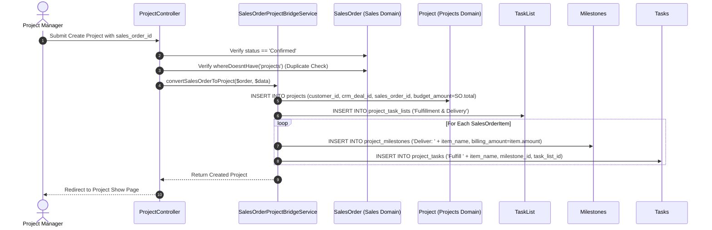
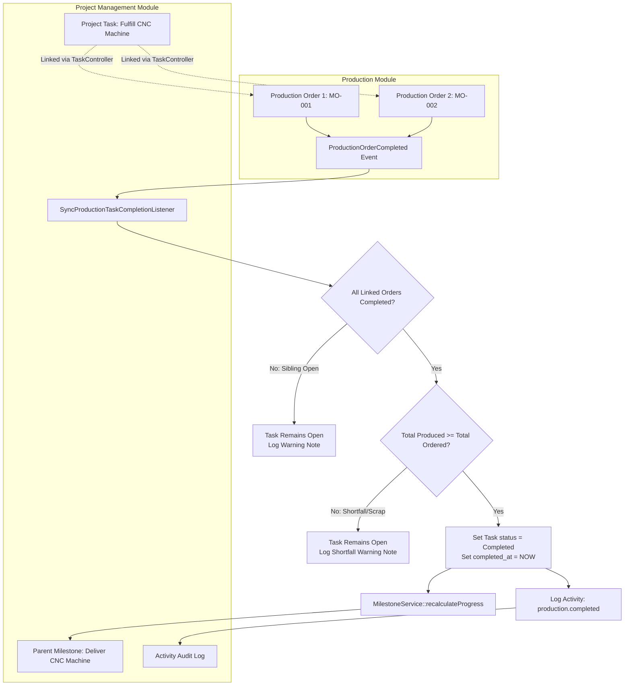
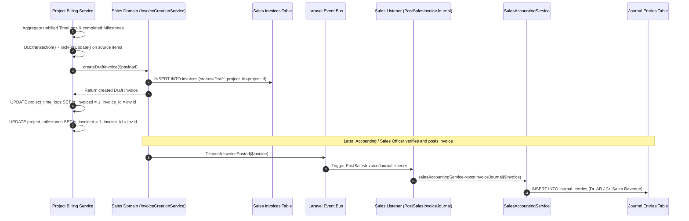

# Project Management Module — Cross-Module ERP Integrations

## 1. Executive Integration Summary

A critical objective of enterprise ERP architecture is defining strict domain boundaries and preventing data redundancy. The Project Management module in `wm-product-saas` is designed to be an operational orchestrator rather than an isolated silo. It leverages foundational ERP data structures (such as Users, Customers, Products, Sales Orders, Production Orders, Purchase Requisitions, and Invoices) while maintaining strict segregation of duties.

### Integration Relationship Taxonomy
To eliminate ambiguity, cross-module relationships are categorized into five verified technical levels:
1. **Direct Automated Integration**: Modules exchange transactional data synchronously via domain service calls within database transactions.
2. **Direct Reference Only**: Foreign key relationship storing canonical entity IDs without mutating the external module.
3. **Event-Driven Integration**: Decoupled asynchronous or synchronous handling via Laravel event buses and listeners.
4. **Manual Business-Process Handoff**: Workflow coordination achieved administratively by ERP users without automated software coupling.
5. **No Integration Found**: Verified as completely absent in database schema and code.

---

## 2. Master ERP Integration Matrix

| ERP Module | Relationship Level | Technical Mechanism | Canonical Owner | Automated? | Implementation Evidence | Operational Boundaries & Behavior |
| :--- | :--- | :--- | :--- | :--- | :--- | :--- |
| **Sales** | **Direct Automated Integration** | 1. One-click conversion of confirmed Sales Orders to projects via `SalesOrderProjectBridgeService`. 2. Project billing aggregates unbilled deliverables and invokes `SalesInvoiceCreationService::createDraftInvoice()`. | **Sales Domain** (`App\Domains\Sales\Models\SalesOrder`, `Invoice`) | **Fully Automated** | `SalesOrderProjectBridgeService.php` `ProjectBillingService.php` `ProjectController::store()` | Only `Confirmed` Sales Orders can be converted. Duplicate conversion is strictly blocked via `whereDoesntHave('projects')` and pre-store validation. Invoices are generated in `Draft` status in the Sales `invoices` table. |
| **Production** | **Direct Event-Driven & Bidirectional Linking** | 1. Project tasks link to `ProductionOrder` records via foreign keys (`project_id`, `project_milestone_id`, `project_task_id`). 2. `SyncProductionTaskCompletionListener` consumes `ProductionOrderCompleted` events. | **Production Domain** (`App\Domains\Production\Models\ProductionOrder`) | **Fully Automated** | `TaskController::linkProductionOrder()` `SyncProductionTaskCompletionListener.php` `ProjectShow::manufacturingSummary` | Task auto-completes **only** when all linked production orders are completed and aggregate yield satisfies ordered quantity (`totalProduced >= totalOrdered`). Shortfalls keep the task open and log activity warnings. Orders not linked to projects operate independently. |
| **Purchase** | **Direct Linking Integration** | Project tasks link directly to `PurchaseRequisitionItem` records via foreign key `project_task_id`. | **Purchase Domain** (`App\Domains\Purchase\Models\PurchaseRequisitionItem`) | Semi-Automated (Manual linking & status sync) | `TaskController::linkPurchaseRequisition()` `TaskController::unlinkPurchaseRequisition()` | Scoped strictly to matching company and branch. Requisition line status is visible within the task workspace. |
| **CRM** | **Direct Reference & Conversion Inheritance** | Foreign keys `projects.customer_id`, `crm_deal_id`, and `client_contact_id`. Autocomplete endpoint `/projects/search-clients`. Inherited on Sales Order conversion. | **CRM Domain** (`App\Domains\CRM\Models\Customer`, `Deal`, `Contact`) | Semi-Automated (Lookup, link & auto-inheritance) | `create_projects_table.php` `ProjectController::searchClients()` `SalesOrderProjectBridgeService.php` | Project Management never creates or modifies CRM customers directly. Deletion of CRM customers is restricted if active projects reference them. |
| **Accounting** | **Event-Driven Integration (Via Sales)** | Project billing creates Sales invoice; Sales posts invoice and emits `InvoicePosted`; Sales listener `PostSalesInvoiceJournal` posts General Ledger entries. | **Accounting Domain** (`App\Domains\Accounting\Models\JournalEntry`) | **Fully Automated (Via Sales)** | `App\Domains\Sales\Listeners\PostSalesInvoiceJournal.php` `ProjectBillingTest.php` | Project Management never writes directly to `journal_entries` or GL tables. All accounting entries flow through official Sales invoice posting. |
| **Inventory** | **Product-Master Dependency Only** | Resolves active 'Service' products from `products` table (`item_type = 'Service'`) for invoice line items. | **Inventory Domain** (`App\Domains\Inventory\Models\Product`) | Semi-Automated (Catalog lookup) | `ProjectBillingService::resolveServiceProduct()` | **Zero physical inventory stock movements, warehouse reservations, or item ledger transactions are triggered by Project Management.** |
| **HRMS** | **Direct Reference & Staffing Roles** | Relies on canonical `App\Models\User`. Staffing managed via `project_members` with dedicated `rate_per_hour` (client billing) and `cost_per_hour` (internal cost). | **HRMS / Shared ERP** (`App\Models\User`, `App\Domains\HRMS\Models\Employee`) | Semi-Automated (User binding) | `create_project_members_table.php` `ProjectNotificationService.php` | No direct payroll deduction or biometric punch ingestion into project timesheets. |
| **Notification Center** | **Event-Driven Integration** | Dispatches 12 domain events to `ProjectNotificationListener` registered in `AppServiceProvider`. | **ERP Core Notifications** | **Fully Automated** | `AppServiceProvider.php` `ProjectNotificationTest.php` | In-app alerts and email dispatches (`SendProjectNotificationEmailJob`) respect recipient preferences. |

---

## 3. Deep-Dive: Sales Order Conversion to Project

Enterprise delivery often originates from a signed sales contract. The Project Management module provides a native bridge (`SalesOrderProjectBridgeService`) to convert a confirmed commercial order into a delivery project:

### Key Business Rules:
1. **Confirmed Status Requirement**: Only orders with `status === 'Confirmed'` can be converted. Draft, Pending Approval, or Cancelled orders are rejected with validation errors.
2. **Duplicate Prevention**: The system strictly prevents duplicate conversion. Available orders are filtered via `whereDoesntHave('projects')`, and `ProjectController::store()` enforces `$order->projects()->exists()` validation.
3. **Automatic WBS Generation**: The bridge automatically creates a default Task List titled `Fulfillment & Delivery`. For each order line item, it generates:
   - A **Milestone** titled `Deliver: {Item Name}` with the item billing amount and shipment due date.
   - A linked **Task** titled `Fulfill {Item Name}` with quantity and item specifications in the description.
4. **Commercial Traceability**: The project show page displays active badges linking directly to the source Sales Order, CRM Deal, and Client Contact.

---

## 4. Deep-Dive: Manufacturing & Procurement Task Integration

Project deliverables frequently require custom manufacturing on the shop floor or specialized procurement. Project Management integrates bidirectionally with Production Orders and Purchase Requisitions:

### Detailed Integration Mechanics:
1. **Task-Level Linking**:
   - In the task workspace, authorized users can link active Production Orders (`projects.tasks.link-production-order`) and Purchase Requisition lines (`projects.tasks.link-purchase-requisition`).
   - The database stores `project_id`, `project_milestone_id`, and `project_task_id` directly on the `production_orders` table, and `project_task_id` on the `purchase_requisition_items` table.
2. **Company & Branch Scope Protection**:
   - `TaskController` validates that any linked Production Order or Purchase Requisition belongs strictly to the **same company and branch** as the parent project. Cross-branch or cross-company linking is rejected with validation exceptions.
3. **Automated Completion & Aggregate Yield Rule**:
   - On shop-floor completion, `ProductionOrderCompleted` triggers `SyncProductionTaskCompletionListener`.
   - The listener queries all Production Orders linked to the task:
     - All linked orders must reach `ProductionOrder::STATUS_COMPLETED`.
     - The aggregate good produced quantity across all linked orders must satisfy the aggregate ordered quantity:
       $$\sum \text{quantity\_produced} \ge \left(\sum \text{quantity\_ordered} - 0.0001\right)$$
   - When both conditions are met, the task status automatically updates to `Completed`, sets `completed_at`, and calls `MilestoneService::recalculateProgress($task->milestone_id)`.
   - If any sibling order remains open or if scrap causes an aggregate quantity shortfall, the task safely remains open, and a `production.shortfall_warning` is recorded in the project activity audit drawer.
4. **Decoupled Shop-Floor Execution**:
   - Standard Production Orders not linked to any project continue to function independently without project management overhead (`if (! $order->project_task_id) return;`).
5. **Project Overview Manufacturing Summary**:
   - When a project has linked production jobs, `ProjectController::show()` aggregates all linked orders into an executive widget displaying total orders, order statuses, physical completion progress percentage, and total actual manufacturing cost (split into direct material and direct labor costs via `ProjectReportService::getProjectProductionCost()`).

---

## 5. Deep-Dive: Sales & Accounting Invoicing Pipeline

In `wm-product-saas`, **Sales owns all customer invoicing**, and **Accounting owns the General Ledger**:

### Key Technical Facts:
1. **Invoice Generation Prerequisites**:
   - Project must be assigned to an active CRM customer (`$project->customer_id`).
   - Tenant Inventory catalog must contain at least one active product with `item_type = 'Service'` to serve as the line item code.
   - Authenticated user must possess both `projects.billing.generate_invoice` (or `projects.projects.update`) **AND** `sales.invoices.create`.
2. **Pessimistic Locking & Double-Billing Prevention**:
   - In `ProjectBillingService::generateInvoice()`, source records are pessimistically locked via `lockForUpdate()`.
   - Within the same database transaction, `is_invoiced` is set to `true` and `invoice_id` is set to the created invoice ID on both `project_time_logs` and `project_milestones`, permanently preventing double-billing.
3. **General Ledger Boundary**:
   - Project Management has **zero direct dependencies** on `JournalEntry`, `ChartOfAccount`, or `GeneralLedgerService`.
   - Accounting integration is 100% event-driven via Sales: posting the Sales invoice dispatches `InvoicePosted`, triggering `PostSalesInvoiceJournal` to write balanced double-entry journals into the General Ledger.

---

## 6. Deep-Dive: Tenant, Company & Branch Scope Boundaries

Multi-tenant and organizational boundaries are strictly enforced across all integration points:

1. **Branch-Scoped Entity Sequencing**:
   - Projects and project codes (`PRJ-0001`, `PRJ-0002`) are partitioned per tenant branch. Projects in different branches increment independently without code collision (`ProjectBranchIsolationTest`).
2. **Child Inheritance**:
   - Task lists, milestones, and tasks inherit `company_id` and `branch_id` from their parent project.
3. **Cross-Boundary Linking Guard**:
   - When linking Sales Orders, Production Orders, or Purchase Requisitions, the application verifies that the foreign entity matches the project's tenant, company, and branch. Attempts to associate cross-branch records trigger validation exceptions.
