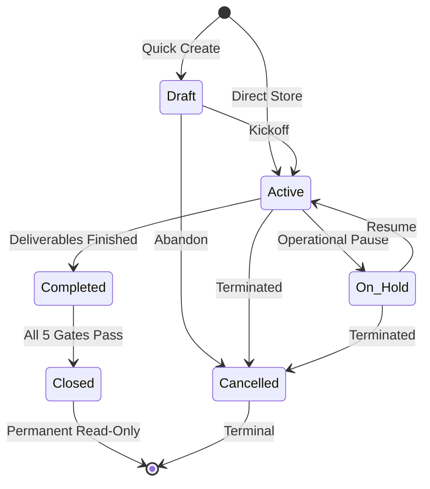
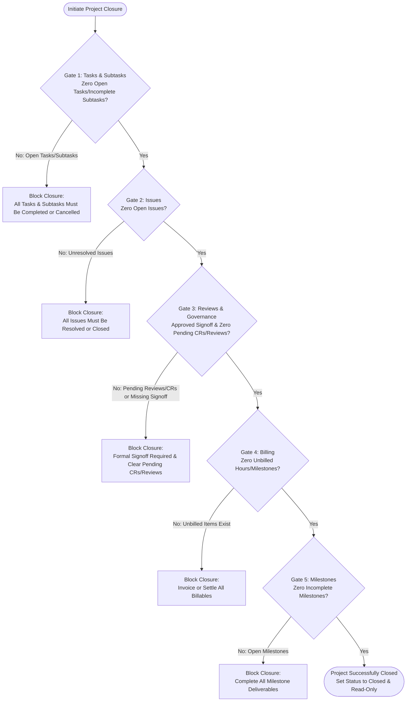

# Project Management Module — End-User Operations Manual

## 1. Module Overview & Navigation

The Project Management module provides a comprehensive ERP environment for planning, executing, monitoring, and closing customer-facing and internal projects. It tightly connects project deliverables to commercial sales orders, manufacturing shop-floor execution, procurement requisitions, time tracking, customer billing, and formal audit closure gates.

### Core Architecture & Integration Map
- **Commercial & Sales**: Direct one-click conversion of confirmed Sales Orders into delivery projects, linking milestones and fulfillment tasks to individual order line items, CRM deals, and customer contacts.
- **Shop-Floor Manufacturing**: Direct bidirectional association between Project Tasks and Production Orders. Production yield and job completion automatically synchronize task progress and recalculate milestone completion percentages.
- **Procurement & Inventory**: Direct association between Project Tasks and Purchase Requisitions for project-specific material sourcing. Invoicing validates against active service items in the Inventory catalog.
- **Time Tracking & Billing**: Granular billable and non-billable time logs, manager timesheet approval queues, and automatic generation of draft Sales Invoices in the accounting ledger.
- **Governance & Quality**: Formal User Acceptance Testing (UAT), Project Reviews, Change Requests (CR) with scope/schedule/budget impact tracking, and automated 5-Gate closure verification.

### Navigation Entry Points
All Project Management features are accessible from the primary ERP sidebar under the **Revenue Cycle** section:
- **Executive KPI Dashboard**: `/projects/dashboard` (`projects.dashboard`)
- **Project Directory / Portfolio**: `/projects` (`projects.index`)
- **Milestones Directory**: `/projects/milestones` (`projects.milestones.index`)
- **Tasks Directory**: `/projects/tasks` (`projects.tasks.index`)
- **Timesheet Approval Queue**: `/projects/timesheets/approval` (`projects.timesheets.approval`)
- **Analytical Reports Directory**: `/projects/reports` (`projects.reports.index`)

Direct project sub-workspaces:
- **Project Overview & Details**: `/projects/{project}` (`projects.show`)
- **Milestone & Task Lists Workspace**: `/projects/{project}/milestones/{milestone}/workspace` (`projects.milestones.workspace`)
- **Task Details Workspace**: `/projects/{project}/tasks/{task}` (`projects.tasks.show`)
- **Gantt & CPM Timeline**: `/projects/{project}?tab=timeline` or `/projects/{project}/timeline` (`projects.timeline.index`)

---

## 2. Project Setup & Lifecycle Management

### 2.1 Creating a Project (Two Supported Methods)

Navigate to **Revenue Cycle → Projects** (`/projects`) and click the **+ New Project** button.

```
+-----------------------------------------------------------------------+
|                         Create New Project                            |
+-----------------------------------------------------------------------+
|  Source: [ Select Confirmed Sales Order (Optional)                v]  |
|                                                                       |
|  Project Code: [ PRJ-0042        ] (Auto-generated per Branch)        |
|  Project Name: [ Enterprise ERP Implementation                    ] * |
|  Client:       [ Acme Corporation                                 v]  |
|  Owner:        [ Jane Doe (Project Director)                      v] * |
|  Manager:      [ John Smith (Senior PM)                           v]  |
|                                                                       |
|  Start Date:   [ 2026-11-01      ] *   End Date: [ 2027-04-30     ]   |
|  Priority:     [ High            v] *  Status:   [ Active         v] * |
|                                                                       |
|  Budget Type:  [ Time & Material v]    Billing:  [ Milestone Based v] |
|  Budget Amount:[ $ 150,000.00    ]     Hours:    [ 1,200.00       ]   |
|                                                                       |
|  Description:                                                         |
|  [ Full scope ERP rollout including inventory, sales, & projects.  ] |
+-----------------------------------------------------------------------+
|                              [ Cancel ]  [ Create Project (Primary) ] |
+-----------------------------------------------------------------------+
```

#### Method A: Standalone Project Creation
1. **Source Sales Order**: Leave as `— None (Standalone Project) —`.
2. **Project Code**: Auto-populated based on the current tenant branch sequence (e.g. `PRJ-0001`). Can be customized if unique.
3. **Project Name**: Full descriptive title (Required, string up to 255 characters).
4. **Client (Customer)**: Autocomplete lookup selecting active customers from CRM. Optional for internal projects.
5. **Project Owner**: Mandatory canonical ERP user responsible for overall delivery. Must have active collaborator access.
6. **Project Manager**: Designated operational manager handling daily task and milestone approvals.
7. **Start Date & End Date**: Start date is mandatory. End date is optional but cannot be earlier than the start date.
8. **Priority**: Choose from `Low`, `Medium`, `High`, or `Critical`.
9. **Status**: Initial status options: `Draft` or `Active` (a new project cannot start as `On Hold`).
10. **Budget Type**: Choose between `Fixed` or `Time & Material`.
11. **Billing Method**: Choose from `Project Based`, `Milestone Based`, `Task Based`, or `User Based`.
12. **Budget Amount & Budget Hours**: Financial allocation in tenant currency and planned labor hours.
13. Click **Create Project**.

#### Method B: Conversion from a Confirmed Sales Order
1. In the **Sales Order** dropdown, select an eligible order. The system displays only sales orders where:
   - Order status is strictly `Confirmed`.
   - The order has not already been converted into a project (`whereDoesntHave('projects')`).
   - The order belongs to the user's active branch and tenant scope.
2. When selected, the system automatically:
   - Pulls the **Customer**, **CRM Deal**, and **Client Contact** into the project.
   - Sets the project **Budget Amount** equal to the Sales Order total amount.
   - Creates a default Task List titled `Fulfillment & Delivery`.
   - Creates a **Milestone** for every order line item (e.g., `Deliver: Industrial CNC Milling Machine`).
   - Creates a linked **Task** under the milestone for each item (e.g., `Fulfill 2x Industrial CNC Milling Machine`).
3. Review auto-populated dates and team assignments, then click **Create Project**.

### 2.2 Project Status State Machine
Projects transition through six canonical lifecycle states:



- **Draft**: Initial scoping state. Child entities (tasks, milestones) can be drafted without triggering external notifications.
- **Active**: Normal execution state. Time tracking, task updates, shop-floor linking, and reviews are enabled.
- **On Hold**: Temporarily paused. Time logging and scheduling updates are restricted.
- **Completed**: All delivery work has concluded. Awaiting formal closure audit.
- **Closed**: Terminal state. Can only be reached if all **5 Quality & Financial Gates** pass. Once closed, the project is strictly read-only and immutable.
- **Cancelled**: Abandoned or terminated project. Cannot be reopened.

### 2.3 Inline Field Editing on Show Page
Authorized managers (`projects.projects.update`) can edit fields directly in place on `/projects/{project}` without opening full edit modals:
- Hover over Client, Priority, Status, Start/End Dates, Budget Type, Billing Method, Budget Amount, or Description.
- Click the field to open the inline editor, select or enter the new value, and click the checkmark button.
- If invalid values are provided (e.g. moving End Date before Start Date), the inline editor displays a validation alert and restores the original value.

### 2.4 Managing Collaborators & Project Team
Expand the **Details & Collaborators** accordion on the Project Overview page (`/projects/{project}`):
1. Under **Team Members**, click **+ Add Member**.
2. Select an ERP user from the current tenant.
3. Assign a role: `Project Manager`, `Technical Lead`, `Member`, or `Viewer`.
4. Configure labor and billing rates:
   - `rate_per_hour`: Client billing rate per hour, used for client billing calculations on Time & Material (T&M) projects and unbilled deliverable valuation.
   - `cost_per_hour`: Internal labor cost rate per hour, used for project profitability tracking, cost consumption calculations, and internal expense reporting.
   - `budget_hours`: Allocated labor hour cap for this team member on the project.
5. Protection Rules:
   - The Project Owner and Project Manager cannot be deactivated or removed as collaborators while assigned to the project.
   - Inactive collaborators cannot be assigned as milestone owners.

---

## 3. Work Breakdown Structure, Tasks & Subtasks

### 3.1 Task Lists & Milestones
Tasks must be organized within structured **Task Lists**, which may optionally be linked to specific project **Milestones**:
- Navigate to the project's **Milestones** tab (`/projects/{project}?tab=milestones`) and click **Workspace** on the target milestone (`/projects/{project}/milestones/{milestone}/workspace`), then open the **Task Lists** tab.
- (Alternatively, view all project tasks across task lists via the cross-project directory at `/projects/tasks?project_id={id}`).
- Click **+ New Task List**, enter a name (e.g., *Phase 1: Design & Sourcing*), select an optional milestone, and save.
- Tasks inherit milestone associations from their parent task list.

### 3.2 Task Creation & Execution Workflow
Click **+ New Task** within a task list to create a task:
- **Task Title**: Name of the task (Required).
- **Task Code**: Auto-generated project-scoped identifier (e.g., `PRJ-0042-T-001`).
- **Assignee**: Must be an active member of the project team.
- **Priority**: `Low`, `Medium`, `High`, or `Critical`.
- **Planned Dates**: Start Date and Due Date.
- **Estimated Hours**: Expected effort for labor variance tracking.

#### Task Status Transitions
Supported task statuses include:
`Open`, `In Progress`, `Review`, `On Hold`, `Completed`, and `Cancelled`
- Status transitions are managed from the Task Details Workspace (`/projects/{project}/tasks/{task}`).
- **Predecessor Dependency Gating:** If a task has predecessor dependencies, transitioning to `In Progress`, `Review`, or `Completed` is strictly validated against the predecessor's status. For example, under a Finish-to-Start (FS) dependency, the predecessor must be `Completed` before the successor can start or finish.
- If a task has no unfinished predecessor dependencies, authorized users can transition status directly to `Completed`.

### 3.3 Subtasks & Dynamic Checklist Calculation
Within the task workspace drawer or modal, users can add granular checklist items (subtasks):
- Click **+ Add Subtask**, enter title and assignee.
- Toggle the checkbox when work is done: sets `completed_at` timestamp.
- **Important Business Rule**: Subtask completion percentage is **dynamically computed** in real time (`(completed / total) * 100`). Completing all subtasks does **not** automatically mark the parent task as completed. The assignee or PM must explicitly transition the task status to `Completed`.

### 3.4 Task Dependencies & Precedence Logic
To enforce operational sequences between tasks:
1. Open the task detail drawer and select the **Dependencies** tab.
2. Click **+ Add Dependency** and select the predecessor task.
3. Choose the dependency link type:
   - **Finish-to-Start (FS)** *(Default)*: Predecessor must be `Completed` before successor can start.
   - **Start-to-Start (SS)**: Predecessor must start before successor can start.
   - **Finish-to-Finish (FF)**: Predecessor must finish before successor can finish.
   - **Start-to-Finish (SF)**: Predecessor must start before successor can finish.
4. Enter optional **Lag Days** (positive for buffer, negative for lead time).
5. **Validation & Protection**:
   - Circular dependencies (e.g. Task A → Task B → Task A) are rejected before database commit.
   - Tasks cannot depend on themselves or tasks from different projects.

---

## 4. Manufacturing & Procurement Task Integration

The Project Management module includes a dedicated **Manufacturing & Procurement** integration engine within each task workspace.

```
+-----------------------------------------------------------------------------------+
|               Task: Fulfill 2x Industrial CNC Milling Machine                    |
+-----------------------------------------------------------------------------------+
|  [ Manufacturing & Procurement ]                                                  |
|                                                                                   |
|  Linked Production Orders:                                                        |
|  +-----------------------------------------------------------------------------+  |
|  | Order #  | Product          | Qty Ordered | Qty Produced | Status     | Action|  |
|  |----------+------------------+-------------+--------------+------------+-------|  |
|  | MO-00108 | CNC Mill Model X | 2.00 Units  | 2.00 Units   | Completed  | [Del] |  |
|  +-----------------------------------------------------------------------------+  |
|  [ + Link Production Order ]                                                      |
|                                                                                   |
|  Linked Purchase Requisitions:                                                    |
|  +-----------------------------------------------------------------------------+  |
|  | PR Item #| Material / Part  | Qty Needed  | Est Cost     | Status     | Action|  |
|  |----------+------------------+-------------+--------------+------------+-------|  |
|  | PR-00045 | Steel Castings   | 500.00 kg   | $ 4,200.00   | Approved   | [Del] |  |
|  +-----------------------------------------------------------------------------+  |
|  [ + Link Purchase Requisition Item ]                                             |
+-----------------------------------------------------------------------------------+
```

### 4.1 Linking a Production Order to a Task
1. Open the Task Workspace for any manufacturing-related deliverable.
2. In the **Manufacturing & Procurement** section, click **+ Link Production Order**.
3. Select an active Production Order. The selector strictly scopes choices to the **same company and branch** as the parent project.
4. Click **Link Order**. The task card now tracks the Production Order code, finished product, ordered quantity, completed quantity, and production status.

### 4.2 Automated Production Completion Synchronization
The system features an automated bridge (`SyncProductionTaskCompletionListener`) listening to shop-floor completion events:
- When a linked Production Order is marked `Completed` on the shop floor:
  1. The listener evaluates all Production Orders linked to the project task.
  2. It aggregates total produced quantities across all linked orders.
  3. If **Aggregate Produced Yield >= Total Ordered Quantity**, the task status automatically flips to `Completed`, sets `completed_at`, and triggers `MilestoneService::recalculateProgress()` to update the parent milestone's progress percentage.
  4. If **Produced Yield < Ordered Quantity** (shortfall or defect scrap), the task **remains open**, and an operational warning is logged to the Project Activity History alert drawer informing the PM of insufficient yield.
- Standard Production Orders not linked to any project continue to function independently without project overhead.

### 4.3 Linking Purchase Requisitions
1. In the task workspace, click **+ Link Purchase Requisition Item**.
2. Select an approved Requisition item for parts or outsourced raw materials.
3. The requisition item code, material name, quantity, and procurement status are linked to the task.

### 4.4 Project Overview Manufacturing Summary Card
When a project has linked production jobs, an executive **Manufacturing Summary** widget automatically renders on the Project Overview tab (`/projects/{project}`):
- **Job Counts**: Total Orders, Completed Orders, In Progress Orders, and Pending Orders.
- **Physical Output**: Total Ordered Quantity vs. Total Produced Quantity with an overall production completion progress bar.
- **Financial Cost Integration**: Displays Total Actual Manufacturing Cost, broken down into **Direct Material Cost** and **Direct Labor Cost** (calculated by `ProjectReportService`).

---

## 5. Milestones, Gantt Chart & Critical Path Method (CPM)

### 5.1 Milestones Workspace & Health Tracking
Navigate to the **Milestones** tab (`/projects/{project}?tab=milestones`):
- Click **+ New Milestone**, specify Name, Owner, Start Date, Due Date, and Deliverable Description.
- **Health Engine**:
  - `On Track`: Progress matches elapsed schedule time.
  - `At Risk`: Progress is lagging significantly behind the expected pace.
  - `Off Track`: Milestone is overdue and incomplete.
  - `Blocked`: An upstream task or milestone dependency is unresolved.
- Click **Workspace** on any milestone card (`/projects/{project}/milestones/{milestone}/workspace`) to manage only the task lists, tasks, and deliverables attached to that specific milestone.

### 5.2 Gantt Chart & Interactive Schedule
Navigate to the **Timeline** tab (`/projects/{project}?tab=timeline` or `/projects/{project}/timeline`):
- **Zoom Scales**: Switch between **Day**, **Week**, and **Month** views.
- **Critical Path Toggle**: Click the **Critical Path** button. The engine computes the Critical Path Method (CPM) network, highlighting zero-float critical tasks in amber/red that dictate the earliest possible project completion date.
- **Float Metrics**: Inspect Total Float and Free Float metrics for each task to evaluate scheduling flexibility.

```
+---------------------------------------------------------------------------------------+
|  Gantt & Critical Path Schedule                      [ Day ] [ Week ] [ Month ]       |
|  [x] Highlight Critical Path                         [ Reschedule Mode: Ripple v]     |
+---------------------------------------------------------------------------------------+
| Task Name                | Duration | Nov 2026                 | Dec 2026             |
|                          |          | W1   W2   W3   W4        | W1   W2   W3   W4    |
|--------------------------+----------+--------------------------+----------------------|
| [!] System Architecture  | 14 Days  | [=========>]             |                      |
| [!] Shop-Floor Setup     | 21 Days  |        [===============>]|                      |
|     Material Procurement | 10 Days  |   [=====>]               |                      |
| [!] Machine Assembly     | 28 Days  |                          | [==================>]|
+---------------------------------------------------------------------------------------+
Legend: [!] Red/Amber: Critical Path (Zero Float)   Blue: Standard Non-Critical Task
```

### 5.3 Rescheduling Modes
When moving task start or due dates on the timeline:
- **Isolated Mode**: Moves the selected task independently. If the new date violates a predecessor or successor dependency boundary, the adjustment is rejected with a validation error.
- **Ripple Mode**: Automatically shifts all downstream successor tasks by the same delta, preserving planned lag buffers while safeguarding already `Completed` tasks from accidental modification.

---

## 6. Time Tracking & Timesheet Approvals

### 6.1 Logging Time Against Tasks
Team members log hours worked against assigned tasks:
1. Open the project task and click **Log Time**.
2. Enter `Date`, `Hours` (between 0.01 and 24.00 hours per entry), and detailed `Work Description`.
3. Check the **Billable** checkbox if client billable.
4. Billing rate is automatically inherited from the collaborator's project member rate (`rate_per_hour`).
5. Newly submitted time logs enter status `Pending`.

### 6.2 Manager Timesheet Approval Queue
Project managers and tenant administrators approve or reject logged hours:
1. Navigate to **Revenue Cycle → Timesheet Approvals** (`/projects/timesheets/approval`).
2. Filter the queue by Project, User, Date Range, or Billable status.
3. Review logged descriptions and hour quantities.
4. **Approve**: Click **Approve**. The log status changes to `Approved`. Approved logs are permanently **locked against editing and deletion**.
5. **Reject**: Click **Reject**. Enter mandatory rejection feedback in the rejection modal. The log is returned to the user with status `Rejected`.

---

## 7. Project Documents, Issues & Quality Governance

### 7.1 Document Management
Navigate to the **Documents** tab (`/projects/{project}?tab=documents`):
- Click **Upload Document**.
- Supported File Formats: `pdf, docx, xlsx, csv, png, jpg, jpeg, zip, txt` (note: legacy `.doc` and `.xls` formats and `.webp` are not accepted by the validator; plain text `.txt` files are supported).
- Maximum File Size: **25 MB** (`max:25600` KB).
- Documents can be attached to the overall project, a specific milestone, a task, or a formal review session.
- Document records support instant in-browser preview and secure authenticated download.

### 7.2 Defect & Issue Tracking
Navigate to the **Issues** tab (`/projects/{project}?tab=issues`):
- Click **+ Report Issue**.
- Fields: Title, Severity (`Minor`, `Major`, `Critical`), Priority (`Low`, `Medium`, `High`, `Critical`), Assignee, Associated Task, Description, and Steps to Reproduce.
- Statuses: `Open` → `Assigned` → `In Progress` → `Resolved` → `Closed`.
- **Quality Gate Rule**: All logged project issues must reach `Resolved` or `Closed` status before the project can be closed.

### 7.3 Project Reviews, UAT & Change Requests
Navigate to the **Reviews & CR** tab (`/projects/{project}?tab=reviews`):
- **Conducting a Review / UAT Signoff**:
  - Click **+ New Review** (or initiate UAT review). *(Prerequisites: all project milestones must be completed, and zero reviews currently in `Pending` status).*
  - Specify **Review Date**, select a **Reviewer** (or enter external reviewer name), record optional sign-off reference code (`sign_off_ref`), enter notes/comments, and attach supporting UAT evidence documentation if available.
  - Record the formal signoff outcome: `Approved` or `Rework Required`.
  - Historical review attempts are preserved for compliance and ISO auditing.
- **Change Requests (CR)**:
  - When clients or stakeholders request alterations outside initial scope, click **+ New Change Request**.
  - Capture Title, Description, `impact_schedule_days` (schedule shift in days), `impact_budget_amount` (cost adjustment in active currency), and optional `impact_budget_hours`.
  - Statuses: `Pending` → `Approved` or `Rejected` → `Implemented`.
  - When approved by management, `impact_budget_amount` is automatically incorporated into the project's **Revised Budget** baseline.

---

## 8. Budgeting, Costing & Client Invoicing

### 8.1 Project Cost Summary & Budget Variance
The Project Overview header and financial card continuously calculate:
- **Labor Consumed**: Sum of approved time log hours multiplied by hourly rates.
- **Manufacturing Consumed**: Sum of direct material and direct labor actual costs reported by linked Production Orders.
- **Total Consumed**: `Labor Consumed + Manufacturing Consumed`.
- **Revised Budget**: `Base Budget Amount + Sum of Approved Change Request Budgets`.
- **Variance**: If consumed cost exceeds revised budget, the system highlights the cost bar in red with an `Over Budget` alert badge.

### 8.2 Generating a Draft Sales Invoice
Authorized users can generate client invoices directly from the project workspace:

```
+-----------------------------------------------------------------------+
|                    Generate Draft Sales Invoice                       |
+-----------------------------------------------------------------------+
|  Client:           Acme Corporation                                   |
|  Active Currency:  USD ($)                                            |
|                                                                       |
|  Invoice Date:     [ 2026-11-01      ] *  Due Date: [ 2026-12-01   ] *|
|  Payment Terms:    [ Net 30          ]                                |
|                                                                       |
|  Service Product:  [ Engineering & Delivery Services               v] *|
|  (Required catalog service item for sales invoice line mapping)       |
|                                                                       |
|  Billable Items Available:                                            |
|  [x] Milestone 1: Deliver CNC Machine ($ 50,000.00)                   |
|  [x] Approved Billable Timesheets: 84.00 Hours ($ 10,500.00)          |
|                                                                       |
|  Invoice Total:    $ 60,500.00                                        |
+-----------------------------------------------------------------------+
|                               [ Cancel ]  [ Generate Draft Invoice ]  |
+-----------------------------------------------------------------------+
```

#### Invoicing Prerequisites & Business Rules
1. **Customer Assigned**: Project must be linked to a valid CRM customer.
2. **Catalog Service Item**: The tenant inventory catalog must contain at least one active product with `item_type = 'Service'` to serve as the line item reference.
3. **Dual Permission Check**: The user must hold both `projects.billing.generate_invoice` (or `projects.projects.update`) **AND** `sales.invoices.create`.
4. **Execution Flow**:
   - Navigate to the **Billing** tab (`/projects/{project}?tab=billing`) and click **Generate Invoice**.
   - Verify or enter the mandatory **Invoice Date** and **Due Date** (must be on or after Invoice Date).
   - (Optional) Adjust **Payment Terms** (default: `Net 30`) and enter **Invoice Notes**.
   - Select the catalog **Service Product** (`service_product_id`).
   - Select the unbilled approved time logs or completed billable milestones.
   - Click **Generate Draft Invoice**.
   - The system delegates to `ProjectBillingService::generateInvoice()` / `SalesInvoiceCreationService::createDraftInvoice()`, generating an official draft invoice in the canonical Sales `invoices` table with `project_id` reference.
   - In the same database transaction, the selected milestones and time logs are marked `is_invoiced = true`, permanently preventing accidental double-billing.
   - Further approval, tax calculation, and financial ledger posting occur in the standard Sales Invoices module.

---

## 9. Project Closure & The 5-Gate Verification Engine

To prevent incomplete, unbilled, or disputed projects from being closed, the system executes an automated 5-Gate validation audit via `ProjectClosureService` when a user clicks **Close Project**:



### The 5 Closure Gates Explained
1. **Gate 1 — Tasks & Subtasks Clean**: Every task in the project must be in either `Completed` or `Cancelled` status (no tasks may be `Open`, `In Progress`, or `Review`). In addition, every subtask across all project tasks must be completed (`incomplete_subtasks_count === 0`). Incomplete subtasks strictly block project closure.
2. **Gate 2 — Issues Resolved**: All defects and logged issues must be `Resolved` or `Closed`.
3. **Gate 3 — Formal Governance & Review Signoff**:
   - **Review Approval**: If milestones exist on the project, at least one project review must have an outcome of `Approved` (`review_approval_satisfied`). If no approved review exists when milestones are present, closure is blocked.
   - **Zero Pending Reviews**: All active review sessions must be finalized (`pending_reviews_count === 0`).
   - **Zero Pending Change Requests**: All submitted scope change requests must be resolved (`pending_crs_count === 0`). Pending change requests strictly block project closure.
4. **Gate 4 — Financial Settlement**:
   - Zero approved billable time logs remaining uninvoiced (`is_invoiced = false`).
   - Zero pending time logs awaiting approval.
   - Zero completed billable milestones remaining uninvoiced.
   *(Note: Rejected time logs or non-billable hours do not block Gate 4).*
5. **Gate 5 — Milestones Delivered**: All milestones must be in `Completed` or `Closed` status.

### Closure Execution & Immutability
- If any gate fails, a detailed modal lists every blocking task, issue, unbilled hour, or pending review with direct links to resolve them.
- Once all five gates pass, status changes to `Closed`.
- **Permanent Immutability**: Closed projects become strictly read-only. Further creation or modification of tasks, task lists, milestones, time logs, and inline fields is permanently locked.

---

## 10. Operational Reports & Analytics Directory

Navigate to **Revenue Cycle → Project Reports** (`/projects/reports`):

| Report Name | Key Metrics & Data Columns | Filter Controls | Export Options |
|---|---|---|---|
| **Project Summary** | Project Code, Name, Client, Status, Dates, Budget vs Consumed, Overall Progress % | Branch, Client, Status, Date Range | CSV, Excel |
| **Task Status** | Task Code, Title, Parent List, Assignee, Priority, Status, Due Date, Overdue Flag | Project, Assignee, Status, Priority | CSV, Excel |
| **Resource Utilization** | Team Member, Total Hours Logged, Billable Hours, Non-Billable Hours, Utilization % | Date Range, Project, Team Role | CSV, Excel |
| **Timesheets & Billability** | Date, Member, Task, Hours, Billable Rate, Total Cost, Approval Status, Invoiced Flag | Project, Member, Status, Billable | CSV, Excel |
| **Issue Density** | Issue ID, Project, Severity, Status, Reporter, Resolution Time (Days) | Project, Severity, Status | CSV, Excel |
| **Milestone Variance** | Milestone Name, Planned Due Date, Actual Completion Date, Variance (Days), Health | Project, Health State, Status | CSV, Excel |
| **Budget vs Actual Cost** | Base Budget, Approved CRs, Labor Cost, Manufacturing Cost, Total Consumed, Variance | Project, Client, Over-Budget Flag | CSV, Excel |

---

## 11. Security, Roles & Permissions (RBAC)

The Project Management module enforces multi-tenant, company, and branch isolation alongside granular RBAC permission keys:

| Permission Key | Description & Scope | Default Roles Granted |
|---|---|---|
| `projects.projects.view` | View executive dashboard, project portfolio directory, and project details | Tenant Owner, Company Admin, Project Manager, Member, Viewer |
| `projects.projects.create` | Create standalone projects and convert Sales Orders into delivery projects | Tenant Owner, Company Admin, Project Manager |
| `projects.projects.update` | Edit project metadata, update inline fields, and manage collaborators | Tenant Owner, Company Admin, Project Manager |
| `projects.projects.delete` | Soft delete projects and execute bulk deletions from the index table | Tenant Owner, Company Admin |
| `projects.projects.close` | Evaluate 5-gate closure rules and transition projects to Closed | Tenant Owner, Company Admin, Project Manager |
| `projects.milestones.manage` | Create, update, reorder, and complete project milestones | Tenant Owner, Company Admin, Project Manager |
| `projects.tasklists.manage` | Create, update, reorder, and delete task lists within milestones | Tenant Owner, Company Admin, Project Manager |
| `projects.tasks.view` | View task details, Gantt dependencies, and shop-floor manufacturing links | Tenant Owner, Company Admin, Project Manager, Member, Viewer |
| `projects.tasks.create` | Create new tasks, subtasks, and predecessor dependencies | Tenant Owner, Company Admin, Project Manager |
| `projects.tasks.update` | Edit task status, priority, assignee, due dates, and update progress | Tenant Owner, Company Admin, Project Manager |
| `projects.tasks.delete` | Delete tasks, subtasks, and dependency links | Tenant Owner, Company Admin, Project Manager |
| `projects.timetracking.view` | View time logs across project tasks | Tenant Owner, Company Admin, Project Manager, Member |
| `projects.timetracking.log` | Log billable and non-billable work hours against assigned tasks | Tenant Owner, Company Admin, Project Manager, Member |
| `projects.timetracking.approve` | Approve or reject submitted timesheet hours | Tenant Owner, Company Admin, Project Manager |
| `projects.issues.view` | View logged project defects, blockers, and resolution status | Tenant Owner, Company Admin, Project Manager, Member, Viewer |
| `projects.issues.create` | Report new defects and blockers against tasks | Tenant Owner, Company Admin, Project Manager, Member |
| `projects.issues.update` | Edit issue details, severity, status, and assignees | Tenant Owner, Company Admin, Project Manager |
| `projects.issues.resolve` | Mark issues as resolved or closed | Tenant Owner, Company Admin, Project Manager |
| `projects.reviews.view` | View formal project review records and UAT results | Tenant Owner, Company Admin, Project Manager, Member |
| `projects.reviews.create` | Schedule and initialize formal project review sessions | Tenant Owner, Company Admin, Project Manager |
| `projects.reviews.signoff` | Execute UAT signoff (Approved / Rework Required) or remove reviews | Tenant Owner, Company Admin, Project Manager |
| `projects.changerequests.view` | View submitted scope change requests and cost/schedule impacts | Tenant Owner, Company Admin, Project Manager, Member |
| `projects.changerequests.create` | Submit formal scope change requests with budget/schedule impact | Tenant Owner, Company Admin, Project Manager |
| `projects.changerequests.approve` | Approve or reject submitted scope change requests | Tenant Owner, Company Admin, Project Manager |
| `projects.billing.view` | View project financial summary, uninvoiced billables, and invoice history | Tenant Owner, Company Admin, Project Manager |
| `projects.billing.generate_invoice` | Generate draft client sales invoices from billable milestones and time logs | Tenant Owner, Company Admin, Project Manager *(Requires `sales.invoices.create`)* |
| `projects.reports.view` | Access operational reports directory and export analytics spreadsheets | Tenant Owner, Company Admin, Project Manager |

### Multi-Tenant & Branch Scoping Rules
- Projects and their auto-incrementing project codes are scoped to the active tenant branch.
- Users cannot view, link, or assign records across tenant or branch boundaries.
- Linked Production Orders, Purchase Requisitions, and Sales Orders must belong strictly to the same company and branch as the target project.

---

## 12. Troubleshooting & Frequently Asked Questions

#### Q1: Why can't I select a specific Sales Order in the Create Project dropdown?
- **Cause 1**: The Sales Order is not in `Confirmed` status (e.g. still in `Draft`). Confirm the order in the Sales module first.
- **Cause 2**: The Sales Order has already been converted into an existing project. A Sales Order cannot be converted twice.
- **Cause 3**: The Sales Order belongs to a different branch than the active session branch.

#### Q2: Why did my task not automatically complete when the linked Production Order finished?
- **Cause**: The automated completion listener requires that **Aggregate Produced Yield >= Total Ordered Quantity**. If shop-floor scrap caused total produced units to be less than the ordered quantity, the task intentionally remains open, and a yield warning is recorded in the project activity log.

#### Q3: Why is the "Generate Invoice" button disabled or failing?
- **Cause 1**: The project does not have a customer assigned.
- **Cause 2**: There are no unbilled approved time logs or completed billable milestones selected.
- **Cause 3**: The tenant catalog does not have an active product with `item_type = 'Service'`. Create a service product in Inventory first.
- **Cause 4**: The user lacks the secondary required permission `sales.invoices.create`.

#### Q4: Why is project closure blocked at Gate 4 when all time logs were reviewed?
- **Cause**: Gate 4 verifies that all approved billable hours have been invoiced (`is_invoiced = true`). You must either generate a draft invoice for those approved billable hours or adjust non-billable entries before closing.

#### Q5: Can a closed project be reopened?
- **Answer**: No. In accordance with strict ERP audit compliance, `Closed` is a terminal status that locks the project and all child records into a read-only state. If additional work is needed, create a follow-on maintenance or phase project.
