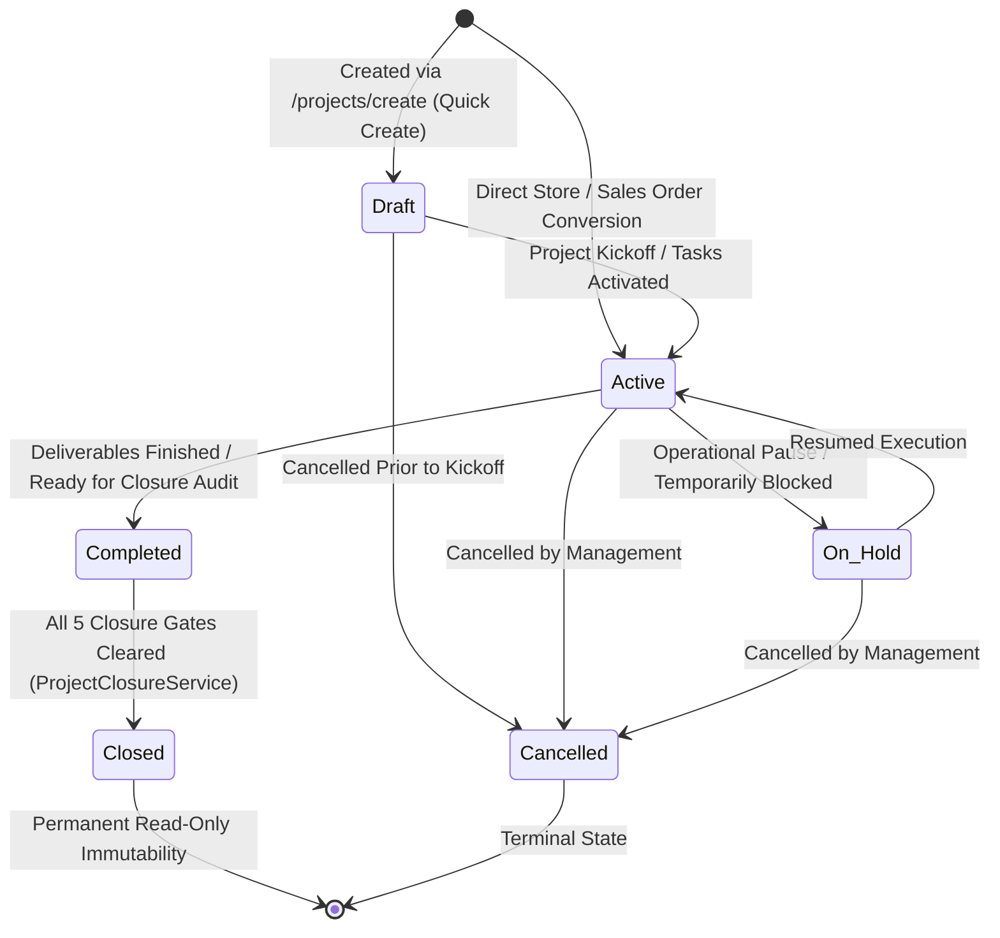
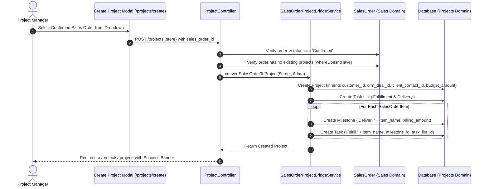
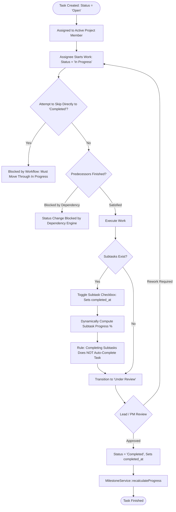
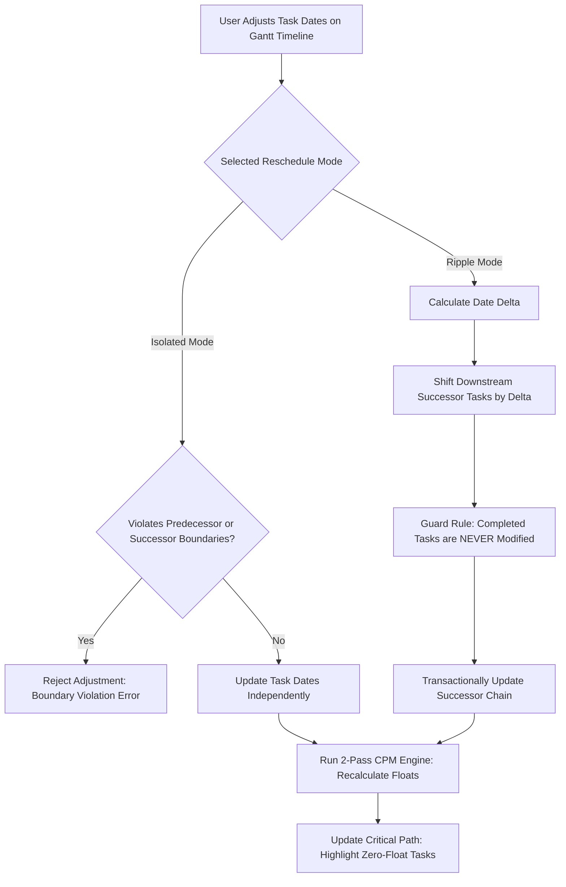
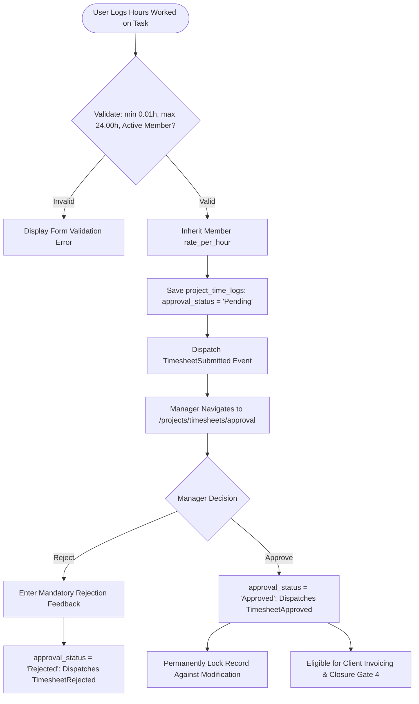
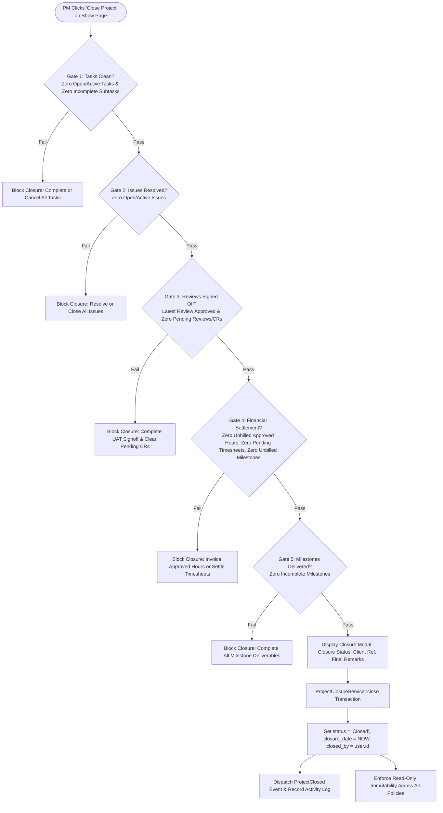

# Project Management Module — End-to-End Operational Workflows

## 1. Project Lifecycle & Canonical State Machine

Projects follow a strictly governed state machine from scoping to formal closure. Transitions are managed by `ProjectService` and guarded by authorization policies.



### Canonical Lifecycle States:
1. **Draft**: Initial scoping state. Child deliverables (tasks, milestones) can be drafted without triggering external notifications.
2. **Active**: Normal execution state. Team members log time, execute tasks, report issues, and link shop-floor production jobs.
3. **On Hold**: Temporarily paused. Time logging and scheduling updates are restricted.
4. **Completed**: All delivery work has concluded. Awaiting formal closure audit.
5. **Closed**: Terminal state. Can only be reached if all **5 Quality & Financial Gates** pass. Once closed, the project and all child records are permanently read-only and immutable.
6. **Cancelled**: Abandoned or terminated project. Cannot be reopened.

---

## 2. Commercial Sales Order Conversion Workflow

Delivery projects can be initiated directly from confirmed commercial contracts:



### Conversion Safeguards:
- **Eligibility**: Only orders with `status === 'Confirmed'` appear in the selection dropdown and pass backend validation.
- **Duplicate Protection**: A Sales Order cannot be converted twice; `whereDoesntHave('projects')` filters the list, and pre-store validation rejects duplicate attempts.
- **Traceability**: Source Sales Order, CRM Deal, and Client Contact references are persisted directly onto the project header.

---

## 3. Work Breakdown, Task Execution & Subtasks

Tasks enforce structured execution rules to prevent skipping stages:



### Execution Rules:
1. **Sequential Progression**: Allowed task flow is `Open` → `In Progress` → `Under Review` → `Completed` (or `Cancelled`). Skipping directly from `Open` to `Completed` is prohibited.
2. **Subtask Independence**: Subtask checklist completion percentage is **computed dynamically** in real time (`(completed / total) * 100`). Completing all subtasks does **not** automatically mark the parent task completed.
3. **Dependency Blocking**: A task cannot transition to `In Progress` or `Completed` if upstream predecessor dependencies (FS, SS, FF, SF) are unsatisfied, unless overridden by an authorized manager.

---

## 4. Manufacturing & Procurement Task Integration Workflow

Project Management tasks connect directly to shop-floor Production Orders and Purchase Requisitions:

```mermaid
flowchart TD
    subgraph TaskWorkspace [Task Workspace: /projects/{project}/tasks/{task}]
        Task[Task: Fulfill CNC Machine]
        LinkPO[Action: Link Production Order]
        LinkPR[Action: Link Purchase Requisition Item]
    end

    subgraph Validation [Scope Guards]
        BranchCheck{Same Company & Branch as Project?}
    end

    subgraph Execution [Shop Floor & Procurement]
        PRItem[Purchase Requisition Line: project_task_id set]
        PO1[Production Order 1: MO-001]
        PO2[Production Order 2: MO-002]
        ShopComp[Shop Floor Marks Order Completed]
    end

    subgraph SyncEngine [SyncProductionTaskCompletionListener]
        EvalOrders[Evaluate All Production Orders Linked to Task]
        CheckAllDone{All Linked Orders Completed?}
        CheckYield{Aggregate Produced Yield >= Total Ordered Quantity?}
        AutoTask[Set Task status = Completed, completed_at = NOW]
        Recalc[MilestoneService::recalculateProgress]
        ShortfallWarn[Task Remains In Progress\nLog Activity Warning: production.shortfall_warning]
    end

    LinkPO --> BranchCheck
    LinkPR --> BranchCheck
    BranchCheck -- Mismatch --> AbortLink[ValidationException: Scope Mismatch]
    BranchCheck -- Valid --> PRItem
    BranchCheck -- Valid --> PO1
    BranchCheck -- Valid --> PO2

    PO1 --> ShopComp
    PO2 --> ShopComp
    ShopComp --> EvalOrders
    EvalOrders --> CheckAllDone

    CheckAllDone -- No: Sibling Order Open --> ShortfallWarn
    CheckAllDone -- Yes --> CheckYield
    CheckYield -- No: Scrap/Shortfall --> ShortfallWarn
    CheckYield -- Yes: Yield Satisfied --> AutoTask
    AutoTask --> Recalc
```

### Key Integration Rules:
1. **Scope Protection**: Linked Production Orders and Purchase Requisitions must belong to the **same company and branch** as the parent project.
2. **Aggregate Yield Completion Rule**:
   - The task is marked `Completed` **only** when all linked Production Orders reach `Completed` AND total good produced units satisfy ordered quantity:
     $$\sum \text{quantity\_produced} \ge \left(\sum \text{quantity\_ordered} - 0.0001\right)$$
   - If scrap causes an aggregate shortfall, the task remains open and records a warning note in the project activity audit drawer.
3. **Unlinked Orders**: Production Orders with no project task link (`project_task_id = null`) execute normally without project overhead.

---

## 5. Timeline, CPM & Interactive Rescheduling

The Gantt timeline (`/projects/{project}?tab=timeline` or `/projects/{project}/timeline`) provides interactive scheduling:



### Rescheduling Modes:
- **Isolated Mode**: Moves the selected task independently. Rejects changes that violate predecessor finish dates or successor start dates.
- **Ripple Mode**: Automatically shifts all downstream successor tasks by the same delta, preserving lag buffers while strictly safeguarding already `Completed` tasks from accidental modification.

---

## 6. Time Tracking & Timesheet Approvals



---

## 7. Project Billing & Invoicing Bridge Workflow

```mermaid
flowchart TD
    StartBill([User Opens /projects/{project}?tab=billing]) --> ClickGen[Click 'Generate Invoice']
    ClickGen --> AuthCheck{Dual Permission Check:\nprojects.billing.generate_invoice AND sales.invoices.create?}
    AuthCheck -- No --> DenyAuth[HTTP 403: Forbidden]
    AuthCheck -- Yes --> PrereqCheck{Prerequisites Met:\nCustomer Assigned AND Active Service Product Exists?}
    PrereqCheck -- No --> AbortPrereq[Display Prerequisite Validation Alert]
    PrereqCheck -- Yes --> OpenModal[Display Generate Invoice Modal]

    OpenModal --> SelectItems[Select Unbilled Approved TimeLogs & Completed Milestones]
    SelectItems --> SubmitGen[Submit Invoice Generation]

    SubmitGen --> DBTrans[DB::transaction with lockForUpdate]
    DBTrans --> CheckAlreadyInv{Any Selected Item Already Invoiced?}
    CheckAlreadyInv -- Yes --> AbortDoubleBill[Throw InvalidArgumentException: Double-Billing Guard]
    CheckAlreadyInv -- No --> CallSales[SalesInvoiceCreationService::createDraftInvoice]

    CallSales --> CreateInv[Insert Sales Invoice: status = 'Draft', project_id = project.id]
    CreateInv --> FlagItems[Update time_logs & milestones: is_invoiced = true, invoice_id = inv.id]
    FlagItems --> SuccessBan[Display Draft Invoice Link in Billing Tab]

    SuccessBan --> PostSales{Sales Officer Verifies & Posts Invoice}
    PostSales --> DispatPost[Dispatch InvoicePosted Event]
    DispatPost --> AccListener[Sales Listener: PostSalesInvoiceJournal]
    AccListener --> PostGL[Write General Ledger Double-Entry in Accounting]
```

---

## 8. Controlled Project Closure Workflow (The 5 Gates)

Project closure enforces formal audit verification via `ProjectClosureService`:



### The 5 Closure Gates:
1. **Gate 1 — Tasks Clean**: All tasks must be `Completed` or `Cancelled`, and all subtasks completed.
2. **Gate 2 — Issues Resolved**: All defects must be `Resolved` or `Closed`.
3. **Gate 3 — Formal Review Signoff**: If milestones exist, at least one approved review is required. No reviews or change requests may be `Pending`.
4. **Gate 4 — Financial Settlement**: Zero unbilled approved billable time logs, zero pending timesheets, and zero unbilled completed milestones.
5. **Gate 5 — Milestones Delivered**: All milestones must be in `Completed` or `Closed` status.
6. **Permanent Immutability**: Once `Closed`, all domain policies reject further mutations. Closed projects cannot be reopened.
